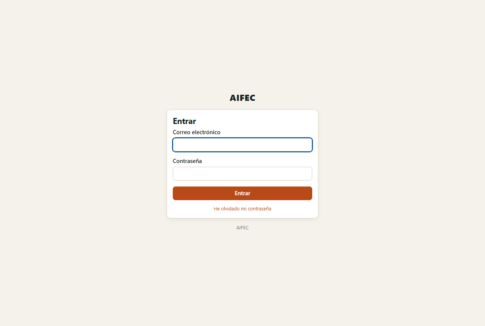

# Entrar al panel

El panel es donde llevas la tienda: pedidos, productos, clientes, ajustes. Se entra por la dirección `/admin` de tu sitio (por ejemplo, `https://tu-tienda.example/admin`). Esta página explica cómo entrar, cómo proteger tu cuenta con un segundo paso y cómo moverte por el panel.

## Entrar

1. Abre `/admin` en el navegador.
2. Escribe tu «Correo electrónico» y tu «Contraseña».
3. Pulsa «Entrar».

Si el correo o la contraseña no coinciden, el panel dice «El correo o la contraseña no son correctos.». Tras varios fallos seguidos dice «Demasiados intentos. Espera quince minutos y vuelve a probar.».

Si tu cuenta tiene la verificación en dos pasos encendida, después de la contraseña te pide un «Código de verificación» de seis cifras.

## Recuperar la contraseña

1. En la pantalla de entrada, pulsa «He olvidado mi contraseña».
2. Escribe tu correo y pulsa «Enviar el enlace».
3. Abre el correo y pulsa el enlace. Vale una hora.
4. Escribe la contraseña nueva dos veces y pulsa «Guardar la contraseña».

El panel contesta siempre lo mismo, tengas acceso o no, para no revelar quién tiene cuenta. Los correos de restablecer la contraseña salen aunque el correo de la tienda esté retenido (ver [La lista para vender](05-lista-para-vender.md)), salvo que lo hayas apagado en «Ajustes» → «Correo electrónico».

## La verificación en dos pasos

Con ella, la contraseña sola no basta: hace falta además un código de tu teléfono. Es la protección más útil que puedes activar.

1. Abre «Mi cuenta» (arriba a la derecha, junto a tu nombre) y la pestaña «Verificación en dos pasos».
2. Pulsa «Configurar la verificación en dos pasos».
3. En una aplicación de autenticación (Google Authenticator, Authy, 1Password…) añade una cuenta con la clave que enseña la pantalla, o abre el enlace desde el teléfono.
4. Escribe el código de seis cifras que enseña la aplicación y confirma.

Para apagarla, vuelve a la misma pestaña, escribe tu «Contraseña actual» y pulsa «Apagar la verificación en dos pasos».

## El menú

El menú de la izquierda se agrupa en: Ventas, Catálogo, Clientes, Contenido, Marketing, Inteligencia artificial, Diseño, Módulos y plugins, Ajustes y Sistema. Solo ves lo que tu papel permite: un editor no ve «Pedidos», por ejemplo.

«Inicio» es el resumen: ventas de hoy, de los últimos 7 y de los 30 días, pedidos por preparar, productos con pocas existencias y los avisos que necesitan tu atención.

## Buscar o ir a… (Ctrl K)

Arriba hay un botón «Buscar o ir a…». Pulsa Ctrl + K (en Mac, Cmd + K) desde cualquier pantalla y se abre el buscador. Sin escribir nada lista las pantallas del menú. Al escribir también busca productos, categorías y entradas del blog por su nombre o su referencia. Muévete con las flechas y pulsa Intro para abrir el resultado.

## Tema claro y oscuro

El botón «Claro u oscuro» de la cabecera cambia el aspecto del panel. Se acuerda de tu elección en ese navegador. Si nunca lo has tocado, sigue la preferencia de tu sistema.

## Mi cuenta

«Mi cuenta» tiene cuatro pestañas:

| Pestaña | Para qué |
|---|---|
| «Mis datos» | Tu «Nombre», tu «Correo electrónico» (es con el que entras; para cambiarlo pide la «Contraseña actual») y el «Idioma del panel»: Español o English. |
| «Contraseña» | Cambiarla. Pide al menos 10 caracteres; una frase larga vale más que un enredo corto. Al cambiarla se cierran tus otras sesiones. |
| «Verificación en dos pasos» | Encenderla o apagarla. |
| «Sesiones» | Cada navegador en el que has entrado mantiene su sesión abierta dos semanas. «Cerrar mis otras sesiones» las cierra todas menos la tuya. |

«Salir» está junto a tu nombre.

## Si algo no sale

- **«Ese código no vale. Comprueba la hora de tu teléfono y prueba con el siguiente.»** Los códigos dependen de la hora. Pon la hora del teléfono en automático y espera al código siguiente.
- **«Este enlace ya no vale. Pide uno nuevo.»** El enlace para restablecer la contraseña caduca a la hora o se usa una sola vez. Vuelve a pedirlo.
- **Perdiste el teléfono y no puedes entrar.** El panel no da códigos de recuperación ni deja que otra persona te quite el segundo paso. Por eso, al configurarlo, guarda en un sitio seguro la clave de texto que enseña la pantalla: con ella puedes dar de alta la cuenta en otra aplicación y seguir entrando.
