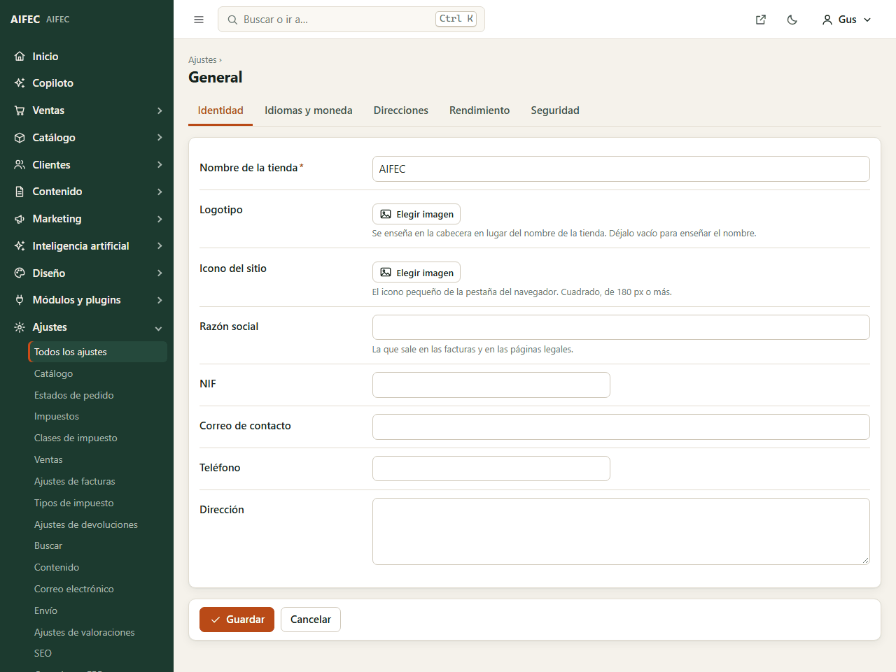

# Primeros ajustes

Antes de cargar productos conviene dejar bien la identidad de la tienda: su nombre, su logotipo, sus datos legales, el idioma y la moneda. Esos datos salen en la cabecera, en las facturas, en los correos y en las páginas legales. Todo está en «Ajustes» → «Todos los ajustes» → «General».

La pantalla tiene cinco pestañas. Pulsa «Guardar» al final: guarda todas a la vez, no hace falta guardar una por una. Estos ajustes valen solo para el sitio en el que estás; si tu instalación sirve varios sitios, cada uno tiene los suyos.

## Identidad

| Campo | Qué pones |
|---|---|
| «Nombre de la tienda» (obligatorio) | El que ve el cliente. Si no hay logotipo, sale este nombre en la cabecera. |
| «Logotipo» | Pulsa «Elegir imagen» y escoge una de la biblioteca de medios. Sustituye al nombre en la cabecera. |
| «Icono del sitio» | El icono pequeño de la pestaña del navegador. Cuadrado, de 180 píxeles o más. |
| «Razón social» | La que sale en las facturas y en las páginas legales. |
| «NIF» | El de la empresa. Sale en las facturas. |
| «Correo de contacto» | Donde quieres que te escriban. Lo usan el remitente del correo y las páginas legales. |
| «Teléfono» y «Dirección» | Datos de contacto y dirección fiscal. |

El logotipo y el icono tienen también una pantalla propia en «Diseño» → «Logotipo e icono».

Rellena la razón social, el NIF, el correo y la dirección ahora: si faltan, las páginas legales saldrán con «…» donde deberían ir esos datos, y el diagnóstico avisará de que falta el correo de contacto.

## Idiomas y moneda

- **«Idiomas»**: códigos de dos letras separados por comas, por ejemplo `es,en`. El primero es el idioma principal y no lleva prefijo en las direcciones; los demás sí.
- **«Moneda»**: EUR, USD, GBP, MXN, COP, CLP o ARS.
- **«Símbolo de la moneda»** (obligatorio): el que se enseña junto a los precios, por ejemplo «€».

El idioma del panel de cada persona se elige aparte, en «Mi cuenta». Redsys cobra solo en euros: con otra moneda no se ofrece.

## Direcciones

«Terminar las direcciones con una barra» sirve para conservar el estilo de una tienda que ya tenías. Si la tienda antigua usaba `/producto/silla/` y quieres mantener esa forma, enciéndelo; la otra forma redirige a esta. En una tienda nueva déjalo apagado.

Las palabras de las direcciones de productos, categorías y marcas (`/producto/`, `/categoria/`…) se cambian en «Ajustes» → «Catálogo», pestaña «Direcciones». Las antiguas siguen funcionando: redirigen a las nuevas.

## Rendimiento

«Caché de páginas»: quien visita sin carrito ni sesión recibe una copia guardada de cada página, y la tienda va más rápido. Déjala encendida. Si cambias algo y no lo ves en la tienda, vacía la caché en «Sistema» → «Caché y mantenimiento» con «Vaciar la caché de páginas»; es siempre seguro.

## Seguridad

«Peticiones a la API por minuto»: el límite por dirección de origen para los programas que leen la tienda por la API. Viene en 120. Con cero se quita el límite, y no es lo que quieres en una tienda abierta a internet.

## Y después

Con la identidad hecha, sigue por [Equipo y papeles](04-equipo-y-papeles.md) si vas a trabajar con más personas, o directamente por [La lista para vender](05-lista-para-vender.md).

## Si algo no sale

- **Falta algún dato y el panel lo recuerda.** En «Sistema» → «Diagnóstico», la comprobación «Nombre de la tienda y correo de contacto» dice qué falta («Falta: el correo de contacto») y su botón «Arreglar» te lleva a «Todos los ajustes».
- **Cambias algo y la tienda enseña lo de antes.** Es la caché de páginas: vacíala como se explica arriba.
- **No sabes qué idiomas poner.** Los dos que vienen completos son el castellano (`es`) y el inglés (`en`).