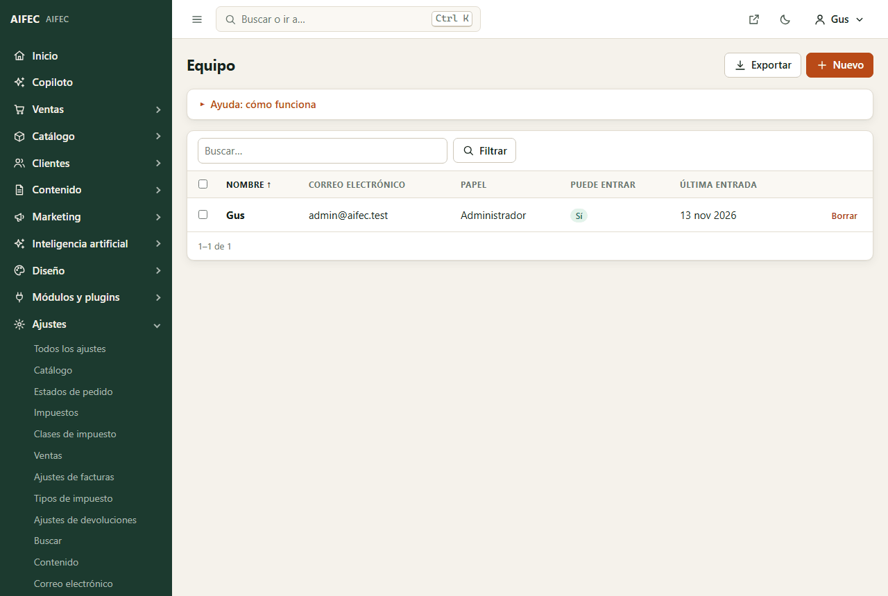

# Equipo y papeles

En AIFEC cada persona entra con su propio correo y su propia contraseña, y lo que puede ver y hacer depende de su papel. Así tu gestor de pedidos no toca los ajustes de pago y tu editora no ve los datos de los clientes. Esta página explica cómo dar de alta a una persona, qué hace cada papel y dónde mirar quién ha hecho qué.

## Dar de alta a una persona

1. Abre «Sistema» → «Equipo» y pulsa «Nuevo».
2. Rellena «Nombre» y «Correo electrónico» (los dos obligatorios).
3. Elige el «Papel» (obligatorio).
4. Elige el «Idioma del panel»: Español o English.
5. Escribe una «Contraseña» de al menos 10 caracteres.
6. Deja marcado «Puede entrar».
7. Pulsa «Guardar y cerrar».

Dale la contraseña por un canal distinto del correo y pídele que la cambie en «Mi cuenta». Para que alguien deje de entrar sin borrarlo, desmarca «Puede entrar» en su ficha: se conservan sus datos y su historial. Al editar, deja la contraseña vacía para conservar la actual.

En el listado ves «Nombre», «Correo electrónico», «Papel», «Puede entrar» y «Última entrada».

## Los papeles de serie

AIFEC trae cinco papeles. Los de serie no se pueden borrar y conservan su código.

| Papel | Qué puede hacer |
|---|---|
| «Administrador» | Todo, también lo que se añada en el futuro. |
| «Responsable de tienda» | Llevar el día a día: catálogo, pedidos, clientes, cupones, facturas, valoraciones, contenidos, medios y SEO. Solo ve los ajustes de envío e impuestos y el buscador. |
| «Editor» | Escribir y publicar contenidos, subir medios y trabajar el SEO. Usa la IA para redactar y ve el inicio y las valoraciones. |
| «Atención al cliente» | Ver pedidos, clientes, facturas y valoraciones, y añadir notas a los pedidos. No cambia nada más. |
| «Demostración» | Parecido al del responsable de tienda, con clientes y facturas solo en lectura, y además cambia el aspecto y ve los módulos y las herramientas. Es para las demos; no lo uses en una tienda real. |

## Crear un papel propio

Si ninguno encaja, «Sistema» → «Papeles» → «Nuevo».

1. Escribe el «Nombre» y el «Código» (corto y sin espacios; en los papeles de serie no se puede cambiar).
2. En «Permisos» marca lo que puede hacer. Cada área tiene una casilla «todo» y casillas sueltas: por ejemplo «orders · Ver los pedidos y los carritos», «orders · Devolver dinero de los pedidos» o «customers · Descargar los datos de un cliente y anonimizarlo».
3. «Todo, lo de ahora y lo que venga» es el permiso de administrador: úsalo solo para ese papel.
4. Pulsa «Guardar y cerrar».

Un papel que alguien está usando no se puede borrar ni cambiarle el código. Reparte permisos con calma: devolver dinero, exportar clientes y cambiar los ajustes de pago son permisos separados a propósito.

## El segundo paso en los administradores

El diagnóstico avisa cuando hay un solo administrador y sin segundo paso: «si esa cuenta se pierde, se pierde el panel». Crea un segundo administrador y que cada uno active la verificación en dos pasos en «Mi cuenta» (ver [Entrar al panel](02-entrar-al-panel.md)).

## El registro de actividad

«Sistema» → «Registro de actividad» apunta lo que se hace en el panel. Cada línea tiene «Cuándo», «Quién», «Acción», «Qué», «Id» y «Resumen»: por ejemplo, `login`, quién entró y con qué correo. Usa el buscador de arriba para encontrar a una persona o una acción, y «Exportar» para sacar el listado. Es un registro: no se edita ni se borra desde el panel.

## Si algo no sale

- **Alguien no ve un menú que necesita.** Su papel no tiene el permiso. Mira su papel en «Papeles» y marca el permiso que falte (el de «ver» o el de «cambiar», según lo que necesite).
- **«Los papeles de serie no se pueden borrar.»** Los cinco de serie se quedan. Si quieres uno distinto, crea otro.
- **«Hay personas con este papel. Dales otro antes.»** Cambia primero a esas personas a otro papel y vuelve a borrar.
- **«No puedes cambiar tu propio papel ni dejarte sin acceso. Pídeselo a otro administrador.»** Es una protección: por eso conviene tener dos administradores.
- **«Este valor ya está en uso».** Ese correo ya es de otra persona de la lista; quizá tiene la cuenta desactivada.
