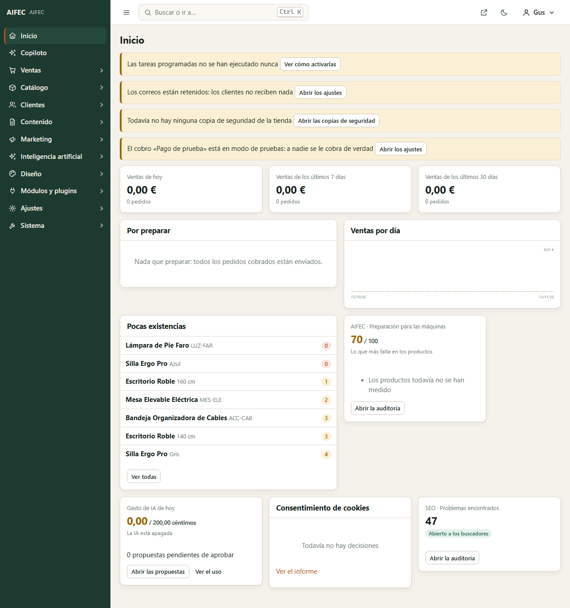

# La lista para vender

Una tienda nueva de AIFEC empieza «cerrada por seguridad»: el correo está retenido y los cobros en pruebas, para que nada llegue a un cliente por error. Esta lista te lleva, en orden, de ese estado a una tienda que puede vender. Al terminar, la pantalla de inicio no debería mostrar avisos.

## 1. Pasa el diagnóstico

Abre «Sistema» → «Diagnóstico». Cada comprobación mira el sistema en marcha: verde es correcto, naranja conviene mirarlo, rojo no funciona. El botón «Arreglar» de cada una te lleva a la pantalla donde se resuelve. Vuelve aquí al final: el objetivo es cero rojos.

## 2. Datos de la tienda e impuestos

- Completa la identidad en «Ajustes» → «General» ([Primeros ajustes](03-primeros-ajustes.md)).
- Comprueba el país, el tipo y si los precios llevan impuesto en [Impuestos](../02-tienda/08-impuestos.md).

## 3. Envíos

Debe haber al menos un transportista activo con tarifa para tus zonas. Usa «Probar un envío» en «Ajustes» → «Envío» para comprobar un destino ([Envíos](../02-tienda/07-envios.md)).

## 4. Formas de pago, en pruebas primero

Configura la que vayas a usar ([Formas de pago](../02-tienda/10-formas-de-pago.md)). Redsys y PayPal empiezan en su entorno de pruebas: pasa a producción solo después de comprobar un pago de prueba completo.

## 5. El correo

El correo tiene tres modos, en «Ajustes» → «Correo electrónico», pestaña «Modo»:

| Modo | Qué hace |
|---|---|
| «Retenido: no sale nada» | Todo se guarda en el «Registro de correo» con el estado Retenido y no sale nada. |
| «Pruebas: enviarlo todo a una dirección» | Todo sale, pero solo a la «Dirección de pruebas», con el destinatario real escrito en el asunto. |
| «Activo: enviarlo todo» | Cada correo sale en cuanto se crea. |

**Cómo soltar lo retenido.** Cambiar el modo a «Activo» no envía lo que ya estaba retenido: solo sale lo que se cree a partir de entonces. Un correo retenido se suelta uno a uno: «Sistema» → «Registro de correo», abre la línea y pulsa «Liberar» («Liberado. Saldrá en menos de un minuto.»). Solo se puede liberar un correo con menos de 24 horas; pasado ese plazo ya no sale.

Antes de abrir: rellena «Correo del remitente» y «Nombre del remitente» (pestaña «Remitente»), elige la «Forma de envío» (SMTP, la función de correo del servidor, o guardar en ficheros, que no envía nada) y pulsa «Enviar un correo de prueba». El diagnóstico te dice si falla. Después pasa el modo a «Activo». Más en [Correo](../02-tienda/11-correo.md).

## 6. Páginas legales

«Contenido» → «Páginas legales» enseña cinco textos: «Aviso legal», «Política de privacidad», «Política de cookies», «Condiciones de compra» y «Envío y devoluciones». Pulsa «Crear las páginas que faltan como borradores». Son solo un punto de partida: revísalas, complétalas, hazlas comprobar por un profesional y publícalas. Después elige la «Página de condiciones» en «Ajustes» → «Ventas»: el cliente la acepta en la caja.

## 7. Una compra de prueba, de principio a fin

1. Añade un producto al carrito en la tienda y pulsa para finalizar la compra.
2. Rellena la dirección, elige envío y forma de pago, acepta las condiciones y haz el pedido.
3. En el panel, abre el pedido en «Ventas» → «Pedidos», márcalo como cobrado, pasa a «Enviado» y a «Completado».
4. Comprueba la factura en «Facturas» y que el correo del cliente aparece en el «Registro de correo».
5. Si no era un pedido real, ábrelo y pulsa «Cancelar el pedido» marcando «Volver a poner las unidades en existencias».

Prueba mejor con el «Pago simulado» o el entorno de pruebas de Redsys o PayPal: esos pedidos usan la serie de facturas TEST y no gastan un número real. Un pedido de prueba cobrado a mano sí gasta el siguiente número de factura, y los números no se reutilizan.

## 8. Las tareas en segundo plano

Muchas cosas de la tienda no pasan al pulsar un botón, sino en una tarea que corre sola: enviar el correo, cancelar pedidos sin pagar, borrar carritos viejos, pedir valoraciones, hacer la copia nocturna. Las llama un «cron» del servidor cada minuto. Si no está puesto, no se hace nada de eso.

Abre «Sistema» → «Tareas programadas». Arriba salen la «Dirección web» y la línea de «Cron del servidor, cada minuto», con «Copiar». Añade esa línea al cron de tu alojamiento. Después, la tabla debe mostrar «Última pasada» y «Última vez bien» con fechas recientes, y la columna «Error» vacía. «Ejecutar ahora» lanza una tarea a mano. En «Sistema» → «Tareas en segundo plano» ves los trabajos pendientes, en curso, hechos y fallidos.

## 9. Una copia de seguridad

En «Sistema» → «Copias de seguridad», pulsa «Crear una copia ahora». Se hace otra cada noche y se guardan las últimas 7. Es una copia de la base de datos: las imágenes subidas no van dentro.

## Si algo no sale

- **«Las tareas programadas se están ejecutando» en rojo, «No se han ejecutado nunca».** Falta el cron del punto 8.
- **No llegan los correos de pedidos.** Mira el modo del correo: si pone «Retenido», están en el registro esperando.
- **Un correo retenido no tiene botón «Liberar».** Tiene más de 24 horas: ya no se puede soltar.
