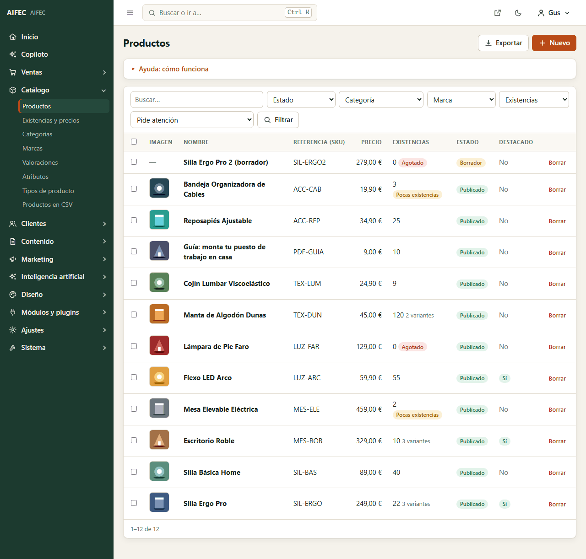
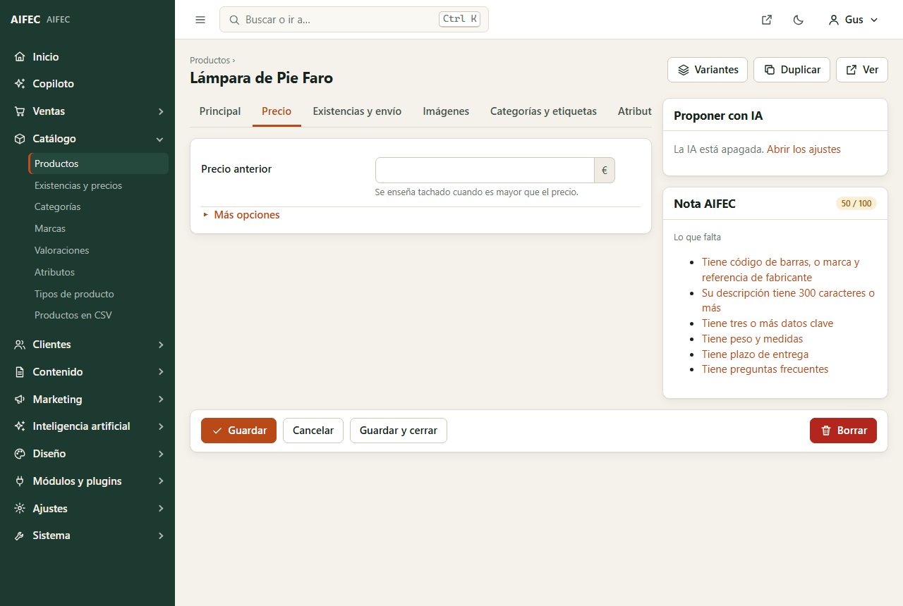

# Productos

Un producto es lo que vendes. Su ficha reúne lo que enseña la tienda (nombre, precio, fotos, descripción) y los datos exactos que leen los buscadores y los asistentes de IA (peso, medidas, plazo de entrega, preguntas frecuentes). Están en «Catálogo» → «Productos».

## El listado

Muestra la imagen, el nombre, la «Referencia (SKU)», el «Precio», las «Existencias» (con un aviso «Pocas existencias» o «Agotado»), el «Estado» y si es «Destacado». Filtra por «Estado», «Categoría», «Marca» y «Existencias» («Pocas existencias» o «Agotado»). El filtro «Pide atención» tiene la opción «Publicados sin imagen o sin precio».

Para cambiar muchos a la vez, marca las casillas y elige una acción: «Publicar», «Pasar a borrador», «Archivar» o «Borrar», y pulsa «Aplicar». Un producto que aparece en pedidos no se puede borrar: se archiva.

## Crear un producto

1. Pulsa «Nuevo».
2. En la pestaña «Principal», escribe el «Nombre» (obligatorio) y el «Precio».
3. Deja el «Estado» en «Borrador» hasta que esté listo.
4. Pulsa «Guardar». Seguirás en la ficha para completarla.
5. Cuando esté todo, cambia el «Estado» a «Publicado» y guarda otra vez. «Guardar y cerrar» vuelve al listado.

## Las pestañas de la ficha

| Pestaña | Qué hay |
|---|---|
| «Principal» | «Nombre», «Precio», «Resumen» (dos o tres líneas), «Descripción» y «Estado» («Borrador», «Publicado», «Archivado»). En «Más opciones»: «Visibilidad», «Destacado», «Marca», «Tipo de producto» y «Tipo» (Físico, Digital o Servicio). |
| «Precio» | «Precio anterior» (sale tachado), «Precio de oferta» con fechas de inicio y fin, «Coste» (nunca lo ven los clientes) y «Clase de impuesto». Ver [Precios y existencias](04-precios-y-existencias.md). |
| «Existencias y envío» | «Referencia (SKU)», «Controlar las existencias», «Existencias» y «Peso» en gramos. En «Más opciones»: código de barras (GTIN), referencia del fabricante, aviso de pocas existencias, pedidos sin existencias, cantidades mínima y máxima, largo, ancho y alto en milímetros y plazo de entrega en días. |
| «Imágenes» | «Añadir imágenes». La primera es la principal; arrastra para cambiar el orden. |
| «Categorías y etiquetas» | Las «Categorías» en las que sale, como etiquetas con su ruta («Hogar › Cocina»), y las «Etiquetas» (separadas por comas). Para añadir una categoría escribe en «Buscar una categoría» (busca sin tildes ni mayúsculas y enseña la ruta de cada una; si no existe, «Crear «…» en…» la crea sin salir de la ficha) o pulsa «Ver todos» para abrir el árbol, con su filtro, «Desplegar todo» y «Plegar todo». Marcar una subcategoría no marca a su madre. Una de las categorías es la «Principal» (el botón de cada etiqueta): decide las migas de pan y la dirección; si la quitas, pasa a serlo la primera que quede. |
| «Atributos» | Los que pide el «Tipo de producto». Elige uno en «Principal» y guarda para verlos. |
| «SEO e IA» | «Dirección» (vacía, se saca del nombre), «Meta título», «Meta descripción», «Datos clave» y «Preguntas frecuentes». |
| «Ficheros» | Solo en productos digitales. |
| «Relacionados» | «Productos relacionados», «Alternativas mejores» y «Se compran juntos». |

«Visibilidad» tiene cuatro opciones: «En todas partes», «Solo catálogo (no sale en el buscador)», «Solo buscador (no sale en el catálogo)» y «Oculto (solo con el enlace)».

## Datos clave y preguntas frecuentes

Los «Datos clave» son datos breves y comprobables (una medida, un material). Las «Preguntas frecuentes» son preguntas reales con una respuesta corta y sincera. Los buscadores y los asistentes de IA las citan cuando recomiendan o comparan productos: son lo que más ayuda a que te recomienden.

## Productos digitales

Con «Tipo» en «Digital», al guardar aparece la pestaña «Ficheros»: «Añadir un fichero» sube el que el cliente podrá descargar después de pagar. Cada fichero tiene «Nombre» y «Versión». Se guardan fuera de la carpeta pública. Un «Servicio» ni se envía ni se descarga.

## La «Nota AIFEC»

Al pie de la ficha, «Nota AIFEC» da una puntuación sobre 100 y una lista de «Lo que falta»: código de barras o marca y referencia de fabricante, descripción de 300 caracteres o más, tres o más datos clave, peso y medidas, plazo de entrega y preguntas frecuentes. «Proponer con IA» pide ayuda a la IA, si la has configurado.

## Duplicar, ver y borrar

Arriba de la ficha, «Duplicar» crea una copia y «Ver» abre el producto en la tienda. «Borrar» pide confirmación. Un producto con pedidos no se borra: archívalo.

## Si algo no sale

- **El producto está en «Publicado» y no se ve.** Mira su «Visibilidad» («Oculto» o «Solo buscador») y que su categoría esté activa: una categoría desactivada desaparece con sus subcategorías.
- **«Pide atención».** El producto está publicado sin imagen o sin precio. Añádeselo.
- **Las existencias de la ficha no se pueden cambiar.** El producto tiene variantes: se gestionan en cada una ([Variantes y atributos](02-variantes-y-atributos.md)).
