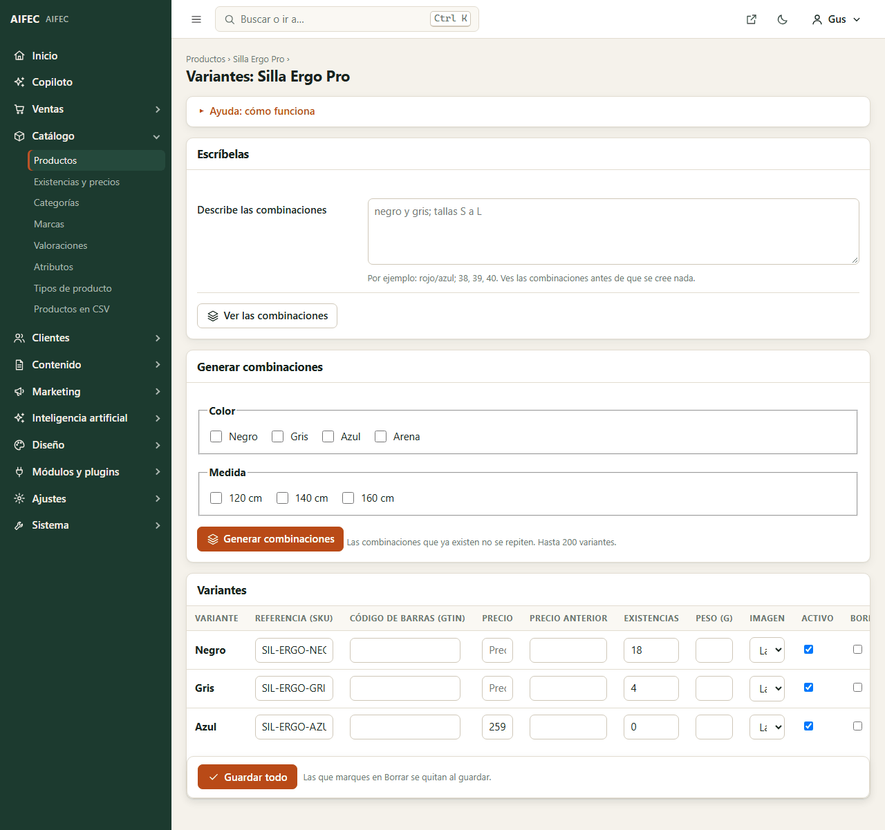

# Variantes y atributos

Una variante es lo que el cliente compra de verdad: una silla en color negro o en gris, una mesa de 120 o de 160 cm. Cada variante tiene su propia referencia, sus existencias y, si quieres, su precio. Los atributos son las características con las que se describen los productos (color, medida, material) y con las que se crean las variantes.

## Crear los atributos

1. Abre «Catálogo» → «Atributos» y pulsa «Nuevo».
2. Escribe el «Código» (corto y sin espacios, como `color`; se usa en los filtros y las importaciones) y el «Nombre».
3. Elige el «Tipo»: «Lista de opciones», «Lista de opciones múltiples», «Texto», «Número», «Sí o no» o «Color».
4. Si es un número, pon la «Unidad» (por ejemplo `kg` o `cm`): se enseña detrás del valor.
5. Marca lo que corresponda: «Sirve para filtrar productos», «Se enseña en la ficha del producto» y «Sirve para crear variantes».
6. Guarda.

Solo las listas de opciones y los colores pueden crear variantes. Cuando un atributo de lista ya existe, abre su ficha y pulsa «Valores» para escribir sus opciones (Rojo, Azul…). Cada fila tiene «Etiqueta» y «Código»; arrastra el asa para ordenar. «Añadir un valor» añade otra fila. Un valor que usa un producto o una variante no se puede borrar, y el código de un atributo en uso tampoco se puede cambiar.

## Tipos de producto

«Catálogo» → «Tipos de producto» agrupa atributos. Un tipo (por ejemplo «Silla») dice qué atributos se piden al dar de alta un producto de ese tipo. Pulsa «Nuevo», pon el «Nombre» y marca los atributos. En la ficha del producto eliges el «Tipo de producto» en «Principal», guardas, y en la pestaña «Atributos» aparecen los que pide ese tipo.

## Crear variantes de un producto

1. Abre el producto y pulsa «Variantes», arriba de la ficha.
2. Elige cómo crearlas:
   - **«Escríbelas»**: en «Describe las combinaciones» escribe, por ejemplo, `rojo/azul; 38, 39, 40`. Pulsa «Ver las combinaciones» para ver qué saldría antes de crear nada y «Generar combinaciones» para crearlas.
   - **Marcando valores**: debajo salen los atributos que sirven para variantes con sus valores (por ejemplo «Color» y «Medida»). Marca los que quieras y pulsa «Generar combinaciones».
3. Las combinaciones que ya existen no se repiten. El máximo es de 200 variantes por producto.

## Editar las variantes

Debajo, la tabla «Variantes» tiene una fila por variante con «Referencia (SKU)», «Código de barras (GTIN)», «Precio», «Precio anterior», «Existencias», «Peso (g)», «Imagen» y «Activo». Un precio vacío es el del producto. Elige una «Imagen» entre las del producto. Para quitar una, marca «Borrar»; se quita al pulsar «Guardar todo».

Las existencias de un producto con variantes son las de cada variante. En el listado de productos, junto a las existencias sale «2 variantes» (o las que sean).

## Comprar desde el listado

En las categorías, el buscador y la portada, cada tarjeta de producto deja **elegir la combinación y las unidades y añadir al carrito sin abrir la ficha**. Al cambiar de talla, color o formato cambian el precio, la disponibilidad y la foto (la de esa variante, si la tiene), y el enlace de la tarjeta lleva a la ficha con esa misma combinación elegida. Una opción con muchos valores (las tallas de un zapato) sale como desplegable, con las agotadas apagadas; con pocos, como botones.

Se ajusta en «Ajustes» → «Catálogo»:

| Ajuste | Para qué |
|---|---|
| «Elegir la combinación y las unidades en los listados» | Encendido de serie. Apagado, la tarjeta vuelve a llevar solo su botón. |
| «Combinaciones que caben en una tarjeta» | 24 de serie. Un producto con más combinaciones enseña «Elegir opciones» y abre su ficha. |

Sin JavaScript también se compra desde la tarjeta: el botón envía lo elegido y la tienda resuelve la variante.

## Si algo no sale

- **Un atributo no sale al crear variantes.** Edítalo y marca «Sirve para crear variantes», y comprueba que su tipo es lista de opciones o color.
- **No puedes borrar una variante.** Está en algún pedido: se apaga desmarcando «Activo». Una que no esté en pedidos sí se borra.
- **No puedes borrar un valor o cambiar un código.** Lo usa algún producto o variante. Quita primero el uso.
