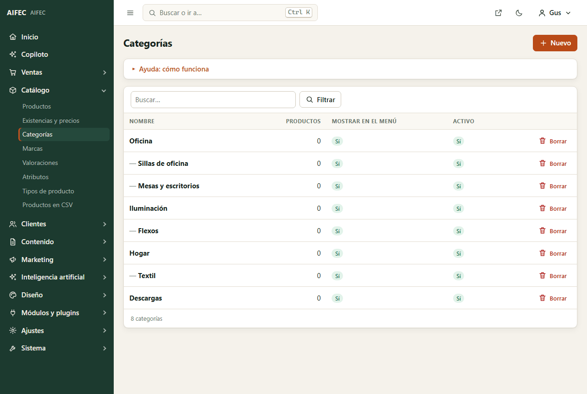

# Categorías, marcas y etiquetas

Las categorías ordenan el catálogo en un árbol (Oficina → Sillas de oficina). Las marcas dicen quién fabrica cada producto. Las etiquetas son palabras sueltas con las que marcas un producto. Todo se prepara una vez y después solo se elige en la ficha del producto.

## Categorías

«Catálogo» → «Categorías» las enseña como un árbol, en el orden que tienen en la tienda. Cada fila dice cuántos «Productos» tiene, si sale «Mostrar en el menú» y si está «Activo».

Para crear una:

1. Pulsa «Nuevo».
2. En la pestaña «Categoría» escribe el «Nombre» (obligatorio) y elige la «Categoría madre»: «Ninguna (primer nivel)» o una existente.
3. Deja «Activo» marcado: una categoría desactivada desaparece de la tienda con todas sus subcategorías.
4. Marca «Mostrar en el menú» si quieres que salga en la navegación de la tienda.
5. Añade una «Imagen» con «Elegir imagen» y el «Orden».
6. En «Contenido y SEO» rellena la «Dirección», la «Descripción», los «Datos clave», el «Meta título» (unos 60 caracteres) y la «Meta descripción» (unos 155).
7. Pulsa «Guardar y cerrar».

La «Dirección» se saca del nombre si la dejas vacía, y siempre lleva delante la de la categoría madre. Si mueves una categoría de sitio, cambian las direcciones de ella y de sus hijas; las antiguas siguen funcionando y redirigen a las nuevas.

Una categoría con subcategorías o con productos no se puede borrar.

## Poner un producto en una categoría

En la ficha del producto, pestaña «Categorías y etiquetas», marca todas las categorías en las que debe salir. En «Más opciones», elige la «Categoría principal»: es la que decide las migas de pan y la dirección que se enseña del producto. Si no eliges ninguna, vale la primera que hayas marcado.

## Marcas

«Catálogo» → «Marcas» → «Nuevo». Rellena el «Nombre» (obligatorio), la «Dirección» (vacía, sale del nombre), la «Descripción», la «Web», el «Logotipo» (con «Elegir imagen»), «Activo» y el «Orden». El listado cuenta los productos de cada marca y deja filtrar por «Activo» o «Inactiva». En el producto, la marca se elige en la pestaña «Principal».

Una marca con productos no se puede borrar: desactívala.

## Etiquetas

Las etiquetas de producto se escriben en la ficha, pestaña «Categorías y etiquetas», en el campo «Etiquetas»: palabras separadas por comas. No hay una pantalla aparte para gestionarlas. Las del blog sí la tienen: «Contenido» → «Etiquetas del blog» (ver [Páginas y blog](../03-contenido-y-diseno/01-paginas-y-blog.md)).

## Si algo no sale

- **Una categoría no aparece en la tienda.** Mira que esté «Activo» y que su categoría madre también lo esté.
- **No puedes borrar una categoría o una marca.** Tiene productos o subcategorías. Muévelos antes, o desactiva la marca.
- **La dirección de una categoría cambió sola.** Es normal: incluye la de sus madres y se reescribe al moverla. Las direcciones antiguas redirigen; si quieres cambiar la palabra inicial de todas, está en «Ajustes» → «Catálogo», pestaña «Direcciones».
