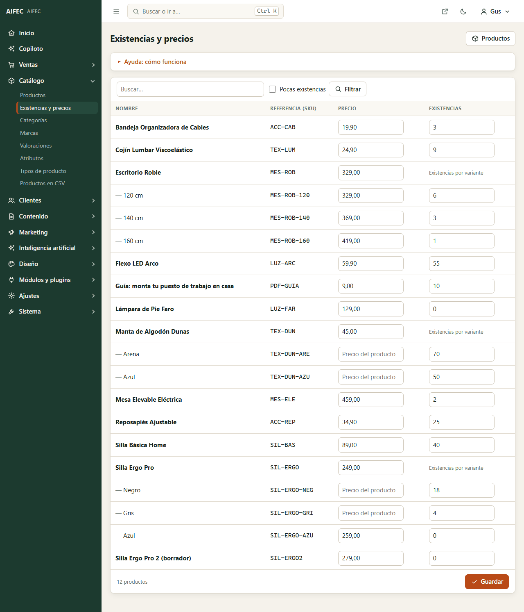

# Precios y existencias

El precio y las existencias de un producto se guardan una sola vez: la ficha, el carrito, el buscador y lo que leen las máquinas dicen lo mismo. Esta página explica cómo ponerlos, cómo hacer una oferta y cómo cambiar muchos productos de golpe.

## Con impuesto o sin impuesto

Cómo se escribe un precio lo decide el ajuste «Los precios ya llevan el impuesto» en «Ajustes» → «Impuestos» ([Impuestos](08-impuestos.md)). Junto al campo «Precio» de la ficha, AIFEC lo recuerda: «Los precios se escriben con el impuesto incluido» o «Los precios se escriben sin impuesto». Lo que escribes en un producto, en un envío, en un recargo o en un cupón sigue esa misma regla.

Los importes se escriben con coma decimal (`19,99`).

## Precio, precio anterior y oferta

Los tres están en la pestaña «Precio» de la ficha:

| Campo | Para qué |
|---|---|
| «Precio» | El precio de venta normal. |
| «Precio anterior» | Se enseña tachado si es mayor que el precio. Sirve para enseñar un descuento. |
| «Precio de oferta» | Un precio temporal. Tiene que ser menor que el precio. |
| «Empieza la oferta» / «Termina la oferta» | Las fechas en que vale. La oferta tiene que acabar después de empezar. |
| «Coste» | Lo que te cuesta. Los clientes nunca lo ven. |
| «Clase de impuesto» | «La de por defecto» u otra. Ver [Impuestos](08-impuestos.md). |

Para una oferta con fechas, rellena «Precio de oferta» y las dos fechas, y guarda. Fuera de ese periodo, el producto vuelve a su precio. Para un descuento con un código que escribe el cliente, usa un [cupón](09-cupones.md).

## Existencias

En la pestaña «Existencias y envío»:

1. Marca «Controlar las existencias» si quieres que AIFEC cuente las unidades.
2. Escribe las «Existencias». Si las cambias aquí, queda apuntado como un movimiento manual.
3. En «Más opciones», «Avisar cuando las existencias lleguen a» marca el umbral de «Pocas existencias» de ese producto. El umbral general está en «Ajustes» → «Catálogo».
4. En «Pedidos sin existencias» elige: «No permitir», «Permitir, y dejar que los clientes se apunten al aviso de reposición» o «Permitir y vender sin existencias».
5. «Cantidad mínima» y «Cantidad máxima» limitan cuántas unidades se pueden comprar de una vez; 0 en el máximo significa sin tope.

Cuando se hace un pedido, sus unidades salen de las existencias. Si lo cancelas, marcando «Volver a poner las unidades en existencias» vuelven. Un pedido sin pagar por una pasarela se cancela solo pasado un tiempo y libera sus unidades ([Pedidos](05-pedidos.md)).

Si el producto tiene variantes, las existencias se gestionan en cada una: la ficha lo dice («Este producto tiene 2 variantes, y las existencias se gestionan en cada una de ellas, no aquí»).

## Cambiar muchos a la vez

«Catálogo» → «Existencias y precios» lista los productos con su «Precio» y sus «Existencias» en casillas editables. Los productos con variantes llevan debajo «Existencias por variante». Cambia lo que necesites y pulsa «Guardar»: solo se guarda lo que has cambiado. Un precio vacío en una variante es el del producto. Las existencias que escribas quedan apuntadas como un movimiento manual.

Arriba hay un buscador por nombre o referencia y la casilla «Pocas existencias», con «Filtrar», para ver solo lo que se acaba. Los productos con pocas existencias salen también en la pantalla de inicio.

Para traer o actualizar miles de precios desde una hoja de cálculo, ver [Importar y exportar](14-importar-y-exportar.md).

## Si algo no sale

- **«El precio de oferta tiene que ser menor que el precio».** Corrige uno de los dos.
- **«La oferta tiene que acabar después de empezar».** Revisa las fechas.
- **«Las existencias tienen que ser un número entero, cero o más».** Quita decimales y signos.
- **Sale «Agotado» y el cliente no puede comprar.** Está en «No permitir» y sin unidades. Sube las existencias o cambia «Pedidos sin existencias».
