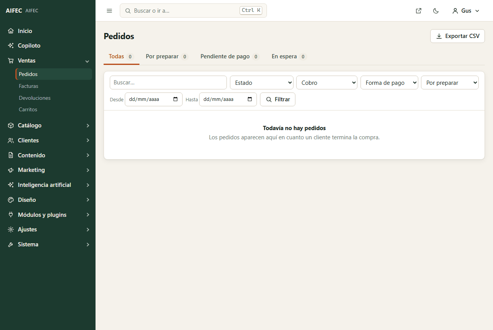

# Pedidos

Un pedido nace cuando un cliente termina la compra. Aquí lo ves entero (qué compró, cómo pagó, adónde va), cambias su estado, apuntas el cobro, mandas el paquete, devuelves dinero y avisas al cliente. Está en «Ventas» → «Pedidos».

## El listado

Arriba, las vistas rápidas con su cuenta: «Todas», «Por preparar», «Pendiente de pago» y «En espera». Más abajo, los filtros: «Estado», «Cobro», «Forma de pago», «Desde» y «Hasta». «Exportar CSV» baja el listado para una hoja de cálculo.

Los pedidos aparecen en cuanto un cliente termina la compra. Hasta entonces, sale «Todavía no hay pedidos». Los carritos que no llegaron a pedido están en «Ventas» → «Carritos», durante 30 días, solo para leer: desde ahí no se manda nada a nadie.

## Los estados

| Estado | Cuándo |
|---|---|
| «Pendiente de pago» | El cliente hizo el pedido y el cobro no ha terminado. |
| «En espera» | Espera un pago manual (transferencia, contra reembolso). |
| «En preparación» | Pagado; toca preparar el paquete. |
| «Enviado» | El paquete salió. |
| «Completado» | Entregado y cerrado. |
| «Cancelada» | Anulado; no se cobró nada. |
| «Reembolsada» | Se devolvió todo el dinero. |
| «Pago fallido» | El pago falló o no se completó a tiempo. |

Los estados se ven y se retocan en «Ajustes» → «Estados de pedido»: cada uno tiene color, clase y el correo que manda. Los de serie no se pueden borrar.

## La ficha del pedido

Pulsa un pedido para abrirlo. Contiene:

- **«Artículos»**: lo que compró, con el desglose (subtotal, envío, impuesto incluido, total, y cuánto está «Cobrado»).
- **«Cobros y devoluciones»**: cada cobro o devolución con fecha, tipo, método, referencia, importe y estado.
- **«Historial»**: todo lo que ha pasado, con quién lo hizo (el sistema, el correo o una persona del equipo).
- **«Cliente»** y **«Direcciones»**: datos de contacto, dirección de envío y de facturación (con «Copiar»), y un enlace a la «Ficha del cliente».
- **«Origen»**: de dónde vino (Tienda web, Asistente de IA, API…) y la nota del cliente, si dejó una.

Arriba, «Ver como el cliente» abre la página que ve él, e «Imprimir» saca una copia en papel.

## Cambiar el estado

En el bloque «Estado», elige el nuevo en «Cambiar el estado», escribe una nota para el cliente si quieres y deja marcado «Avisar al cliente por correo» si debe enterarse. Pulsa «Cambiar estado». No todos los cambios están permitidos: si no lo está, avisa «No se ha podido cambiar el estado: ese cambio no está permitido.». «Volver a mandar el correo del estado» repite el aviso del estado actual.

## Notas

«Añadir una nota» con dos opciones de visibilidad: «Privada: solo el equipo» o «Pública: la ve el cliente». Pulsa «Guardar la nota».

## Cobrar

Con tarjeta o PayPal, el cobro se apunta solo cuando el banco lo confirma. Con transferencia o contra reembolso, hazlo tú: en «Acciones de cobro», escribe una «Referencia del cobro» y pulsa «Marcar como cobrado». Se apunta el total completo y, por defecto, se emite la factura ([Facturas](13-facturas.md)).

## Enviar

En «Envío» escribe el «Código de seguimiento», marca «Marcar como enviado» y, si quieres, «Avisar al cliente por correo». Pulsa «Guardar».

## Devolver dinero

Cuando hay un cobro, «Acciones de cobro» muestra «Reembolsar» y «Queda por devolver: …».

1. Escribe el «Importe», o indica cuántas unidades de cada artículo se devuelven (el importe se calcula con las líneas).
2. Escribe el «Motivo».
3. Marca «Volver a poner las unidades en existencias» si el género vuelve al almacén.
4. Pulsa «Reembolsar» y confirma: no se puede deshacer.

Una devolución parcial deja el cobro en «Devuelto en parte»; una total, en «Reembolsada», y el pedido pasa al estado «Reembolsada», que manda su correo al cliente. Por defecto se emite una factura rectificativa. Si el pedido se pagó por Redsys o PayPal, puedes devolver por la pasarela de pago. Si no (transferencia, contra reembolso), el dinero lo devuelves tú y aquí solo se apunta.

## Cancelar

«Cancelar el pedido» pide un «Motivo» y «Volver a poner las unidades en existencias». No se puede deshacer.

## Reenviar un correo

El correo del estado se repite con «Volver a mandar el correo del estado». Para ver o soltar los correos de la tienda, abre «Sistema» → «Registro de correo» ([Correo](11-correo.md)).

## Si algo no sale

- **No llegó el correo de un cambio de estado.** Mira si el correo está retenido (aparece en el «Registro de correo» como «Retenido»).
- **«Reembolsar» no aparece.** Solo sale cuando hay un cobro apuntado. Si no se ha cobrado, usa «Cancelar el pedido».
- **«No se ha podido cambiar el estado: ese cambio no está permitido.»** Ese salto no se admite desde el estado en que está el pedido. Elige otro estado de la lista.
