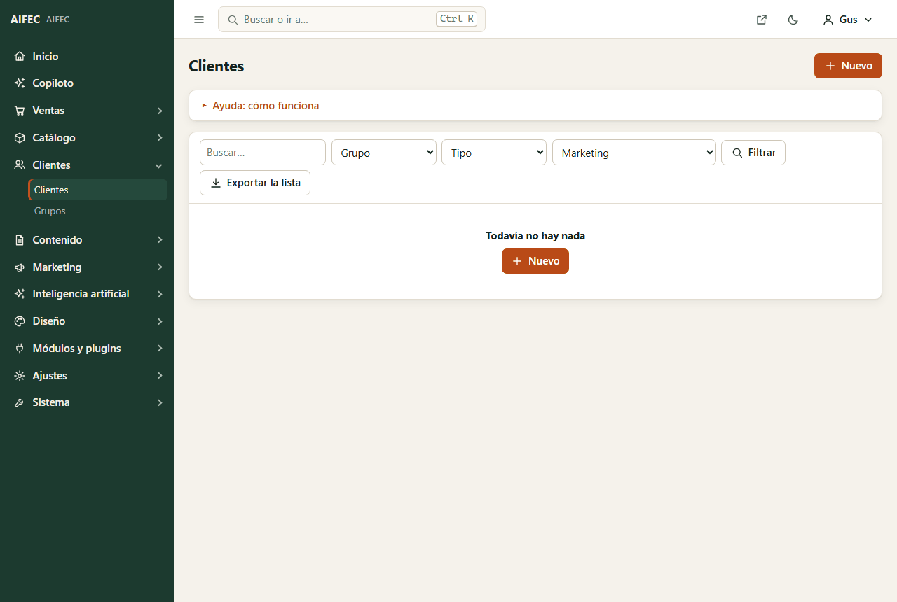

# Clientes

Cada persona que compra en tu tienda tiene una ficha: sus datos, sus direcciones, su grupo y sus pedidos. Los hay con cuenta y los hay «invitados», que compraron sin crearse una cuenta. Están en «Clientes» → «Clientes».

## El listado

Cada fila enseña el «Nombre» (con la marca «Invitado» si compró sin cuenta), el «Correo electrónico», el «Grupo», los «Pedidos», el «Total gastado» y la fecha de «Alta». Filtra por «Grupo», por «Tipo» («Con cuenta» o «Invitado») y por «Marketing» («Acepta correos de publicidad» o «No acepta»). «Exportar la lista» baja los clientes a un fichero.

## La ficha de un cliente

Se abre con un clic. Tiene dos pestañas:

- **«Cliente»**: «Correo electrónico» (obligatorio), «Nombre», «Apellidos», «Empresa», «NIF», «Teléfono», «Grupo», «Idioma» (código de dos letras, como `es`), «Activo», «Acepta correos de publicidad» y «Notas internas» (nunca las ve el cliente).
- **«Acceso»**: «Contraseña nueva» (vacía conserva la actual), «Invitado (compró sin cuenta)» y «Correo verificado».

A la derecha, «Direcciones» lista sus direcciones y «Gestionar direcciones» te lleva a editarlas o añadir otra (con la dirección de envío y de facturación por defecto). Debajo, un «Resumen» con sus pedidos, su gasto, la fecha de alta, la última entrada y si es invitado.

## Crear un cliente a mano

1. Pulsa «Nuevo» en el listado.
2. Escribe el «Correo electrónico» y los datos que tengas.
3. Elige el «Grupo».
4. Pulsa «Guardar y cerrar».

## Grupos de clientes

En «Clientes» → «Grupos». Un grupo reúne a los clientes que comparten un descuento o una exención de impuestos. Cada grupo tiene:

| Campo | Qué hace |
|---|---|
| «Nombre» | El del grupo. |
| «Descuento» | Un porcentaje que se descuenta del precio a los clientes del grupo. |
| «Exento de impuestos» | Para clientes empresa de otro país de la UE. |
| «Grupo por defecto» | Donde entran los clientes nuevos. Solo un grupo puede serlo. |

Una tienda empieza con un solo grupo, «Clientes», con 0 % de descuento y marcado como el de por defecto.

## Los derechos de la persona: exportar y anonimizar

La ley da a cada persona derecho a saber qué guardas de ella y a pedir que lo borres. En la ficha del cliente, arriba:

- **«Descargar datos»** baja un fichero con los datos de esa persona, para dárselo cuando los pida.
- **«Anonimizar»** borra sus datos personales y conserva los pedidos (los necesitas para tu contabilidad). Pide confirmación: «¿Anonimizar a este cliente? Sus datos personales se borrarán y no se puede deshacer.».

Un cliente que ya ha hecho pedidos no se puede borrar: el panel dice «Este cliente tiene pedidos y no se puede borrar. Usa «Anonimizar» para borrar sus datos personales.». Los permisos de exportar la lista y de descargar o anonimizar a una persona son aparte de ver clientes: asígnalos solo a quien los necesite ([Equipo y papeles](../01-empezar/04-equipo-y-papeles.md)).

Los clientes con cuenta también pueden hacerlo ellos: en su cuenta, «Privacidad» tiene «Descargar mis datos» y «Eliminar mi cuenta».

## Cómo entran los clientes

En «Ajustes» → «Clientes»: «Permitir que los clientes creen una cuenta» (si lo apagas, nadie puede crearse una cuenta; los invitados compran igualmente) y «Permitir entrar con un enlace enviado por correo» (un enlace de un solo uso que caduca a los 15 minutos). Si traes clientes de un PrestaShop antiguo, la pestaña «Cuentas migradas» guarda la «Clave de cookie del PrestaShop antiguo», para que entren con la contraseña de entonces.

## Si algo no sale

- **No puedes borrar a un cliente.** Tiene pedidos. Usa «Anonimizar».
- **Un cliente no recibe sus correos.** Mira el «Registro de correo»: si pone «Retenido», el correo de la tienda aún está cerrado ([Correo](11-correo.md)).
- **Un cliente no puede crearse una cuenta.** Mira «Ajustes» → «Clientes»: «Permitir que los clientes creen una cuenta» tiene que estar encendido.
