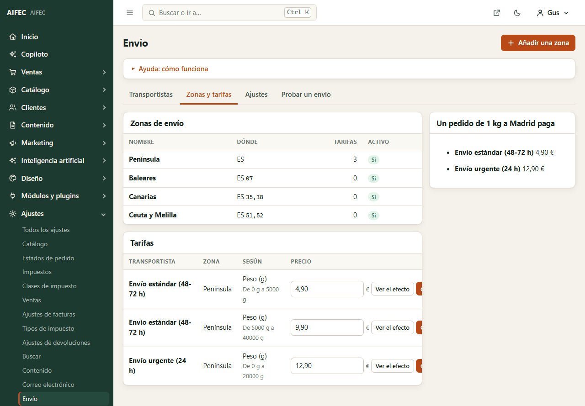

# Envíos

Para cobrar el envío, AIFEC necesita saber tres cosas: adónde envías (zonas), con quién (transportistas) y cuánto cuesta cada tramo (tarifas). Todo está en «Ajustes» → «Envío», que se abre en «Transportistas». Arriba hay cuatro pestañas: «Transportistas», «Zonas y tarifas», «Ajustes» y «Probar un envío».

## Zonas

Una zona es un conjunto de lugares que comparten los mismos precios, por ejemplo la península o las islas.

1. Abre «Zonas y tarifas» y pulsa «Añadir una zona».
2. Escribe el «Nombre» y el «Orden» (si dos zonas encajan igual con un destino, gana la de menor orden). Deja «Activo» marcado.
3. En «Dónde se aplica» cada fila es un lugar: elige un país (o «Resto del mundo») y, si hace falta, escribe una «Región» o unos «Códigos postales» (por ejemplo `35,38` para Canarias, o rangos como `51000-51999`). «Añadir un lugar» añade otra fila.
4. Guarda.

Gana el lugar más concreto: un código postal antes que una región, una región antes que un país y un país antes que el resto del mundo. Una zona con tarifas de transportistas no se puede borrar. La demostración trae «Península», «Baleares», «Canarias» y «Ceuta y Melilla».

## Transportistas

Un transportista es una forma de enviar. Pulsa «Añadir un transportista». En la pestaña «Transportista»:

| Campo | Qué pones |
|---|---|
| «Nombre» y «Código» | El nombre que ve el cliente y un código corto sin espacios, por ejemplo `gls-24`. |
| «Cálculo» | «Tabla de tarifas» o «Recogida en tienda». |
| «Plazo de entrega» | Un texto («24-48 h») y, aparte, «Días mínimos» y «Días máximos». |
| «Peso máximo» | En gramos; el paquete más pesado que lleva. 0 es sin límite. |
| «Gratis a partir de» | Los pedidos que lleguen a este importe se envían gratis. Vacío: nunca. |
| «Clase de impuesto» | «Según los ajustes de impuestos» u otra. |
| «Enlace de seguimiento» | Con `{code}` donde va el código, por ejemplo `https://transportista.example/seguimiento/{code}`. |
| «Logotipo», «Orden», «Activo» | Presentación. |

Con «Recogida en tienda» no hay tarifas: pones el «Precio de la recogida» (0 si es gratis) y la «Dirección de recogida».

## Tarifas

Para cada transportista con tabla de tarifas, la pestaña «Tarifas» tiene una fila por tramo: «Zona», «Según» («Peso (g)» o «Importe del pedido»), «Desde», «Hasta (0 = sin tope)» y «Precio €». «Añadir una tarifa» añade otra fila.

También puedes cambiar un precio en «Zonas y tarifas»: debajo de las zonas, cada tarifa tiene su propio «Precio» con «Ver el efecto» y «Guardar». «Ver el efecto» muestra al momento lo que pagaría un pedido de 1 kg a Madrid con cada transportista.

Un paquete que no cabe en ningún tramo no se puede enviar con ese transportista. Cuida que los tramos no dejen huecos (de 0 a 5000 g y de 5000 a 40000 g, por ejemplo).

## Ajustes

En la pestaña «Ajustes»: el «País por defecto» (el que se usa cuando un destino no dice su país) y «Dejar que los clientes calculen el envío en el carrito», que les deja ver los transportistas y sus precios eligiendo país y código postal antes de la caja.

**El teléfono de la entrega es obligatorio** en todo pedido que se envía: lo piden todos los transportistas para avisar o resolver una incidencia. Lo exige la caja de la web, el asistente, la API, el MCP y UCP; vale un teléfono español de nueve cifras o uno internacional con su «+». Lo que no se envía (una descarga) no lo necesita.

## Probar un envío

En «Probar un envío» eliges un país y, si quieres, escribes un «Código postal», un «Peso» en gramos y el «Importe de los productos». Pulsa «Pruebas» y AIFEC enseña los transportistas que servirían y su precio. Pruébalo con tus destinos antes de abrir la tienda: es la forma más rápida de pillar un hueco en las tarifas.

## Si algo no sale

- **En la caja sale «No podemos enviar a este destino».** Ninguna zona cubre ese destino, o el paquete no cabe en ningún tramo. Pruébalo en «Probar un envío».
- **Un transportista no aparece.** Mira que esté «Activo», que su zona también y que tenga tarifa para el peso o el importe del pedido.
- **El envío sale con impuesto que no esperabas.** Lo decide la «Clase de impuesto» del transportista o, si no, el ajuste de «Ajustes» → «Impuestos» ([Impuestos](08-impuestos.md)).
