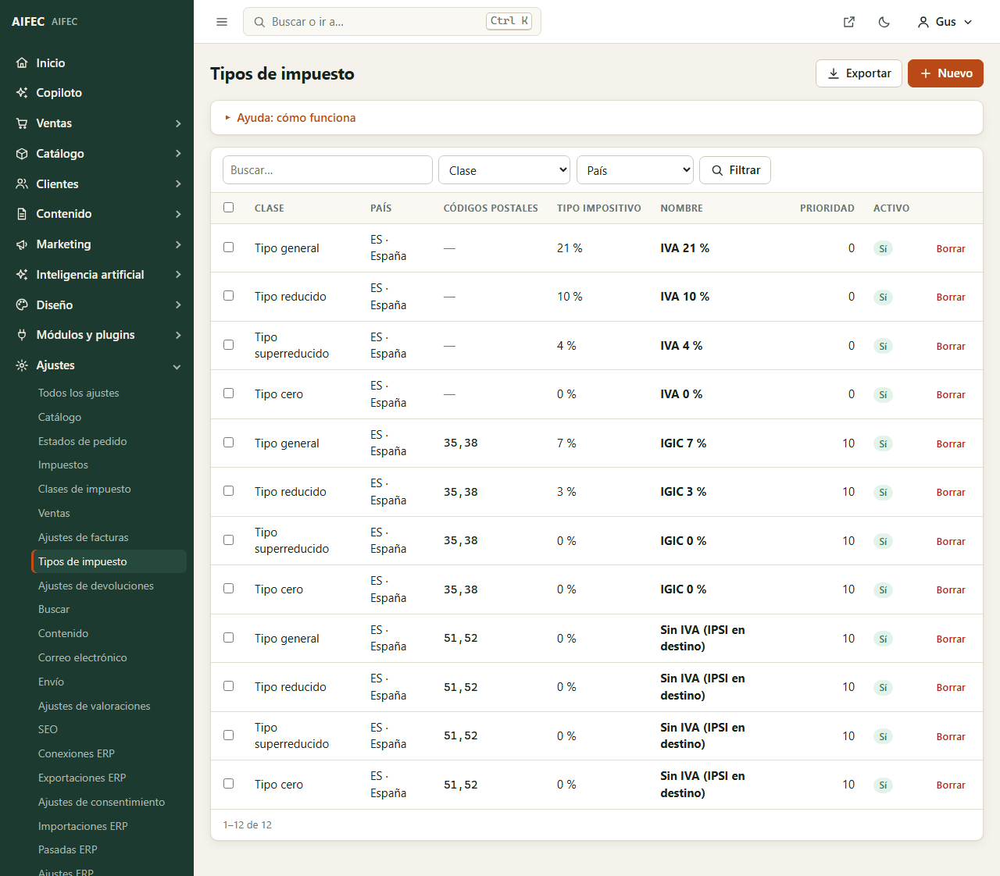

# Impuestos

AIFEC calcula el impuesto de cada pedido con reglas fijas, según la clase de impuesto del producto y el destino del cliente. Tú defines tres cosas: las clases (grupos de productos con el mismo impuesto), los tipos (el porcentaje que corresponde a cada clase en cada lugar) y cómo se escriben y se enseñan los precios. Todo está en «Ajustes»: «Impuestos», «Clases de impuesto» y «Tipos de impuesto».

## Ajustes generales

«Ajustes» → «Impuestos», pestaña «General»:

| Campo | Qué hace |
|---|---|
| «Los precios ya llevan el impuesto» | Encendido: el precio que escribes es el final y el impuesto se saca de él. Apagado: el impuesto se suma al precio que escribes. Vale para productos, envío, recargos y cupones. |
| «Enseñar los precios con impuestos en la tienda» | Lo que ve el cliente: con o sin impuesto. |
| «País de la tienda» (obligatorio) | Desde donde vendes. |
| «Código postal de la tienda» | Opcional. |
| «Impuesto del envío» | «El tipo más alto del carrito» o una clase concreta. |
| «Sin impuestos para empresas de otros países de la UE» | Los clientes con NIF que reciben en otro país de la UE no pagan impuestos. |

## Clases de impuesto

Una clase agrupa los productos que llevan el mismo impuesto. En «Ajustes» → «Clases de impuesto» vienen cuatro: «Tipo general» (la de por defecto), «Tipo reducido», «Tipo superreducido» y «Tipo cero». Para crear otra, pulsa «Nuevo» y escribe el «Nombre», el «Código» y el «Orden». «Clase por defecto» marca la que usan los productos sin clase; siempre tiene que haber una.

El código de una clase no se puede cambiar cuando tiene tipos o la usa algún producto, y una clase con tipos o con productos no se puede borrar.

## Tipos de impuesto

Un tipo dice qué porcentaje lleva una clase en un lugar. En «Ajustes» → «Tipos de impuesto», pulsa «Nuevo»:

1. Elige la «Clase de impuesto» y el «País».
2. Opcional: una «Región» o unos «Códigos postales» (prefijos o rangos separados por comas, como `35,38` o `51000-51999`). Si rellenas los códigos postales, la región no se usa.
3. Escribe el «Tipo impositivo» en porcentaje y el «Nombre» que saldrá en la factura, por ejemplo «IVA 21 %».
4. Pon la «Prioridad» y deja «Activo» marcado.

Gana el tipo más concreto: primero los códigos postales, después la región y por último el país solo. Si dos son igual de concretos, gana el de mayor prioridad. Cambiar un tipo no cambia los pedidos ya hechos: conservan el impuesto que se les cobró.

### Canarias, Ceuta y Melilla

En este sitio vienen cargados los tipos de España: IVA general, reducido, superreducido y cero para toda la península, y tipos propios elegidos por código postal. Canarias (códigos `35` y `38`) lleva IGIC y Ceuta y Melilla (`51` y `52`) llevan «Sin IVA (IPSI en destino)», con prioridad 10. Allí las ventas no llevan IVA.

## Clase de impuesto de un producto

En la ficha del producto, pestaña «Precio», «Clase de impuesto»: «La de por defecto» u otra. Un envío tiene la suya en el transportista ([Envíos](07-envios.md)).

## Qué ve el cliente, y qué se factura

El cliente ve el precio con o sin impuesto según «Enseñar los precios con impuestos en la tienda». En el pedido, el desglose sale como «Incluye IVA 21 %» con su importe. La factura copia el nombre del tipo y su porcentaje ([Facturas](13-facturas.md)).

## Si algo no sale

- **Los precios salen con 21 % de más (o de menos).** Mira «Los precios ya llevan el impuesto»: es el ajuste que decide si el precio que escribiste ya lo incluye.
- **Un cliente de Canarias paga IVA.** Comprueba que el tipo de esa zona tiene los códigos postales `35,38` y la prioridad mayor que el general, y que el cliente ha puesto bien su código postal.
- **No puedes borrar una clase.** Tiene tipos o productos: «Esta clase tiene tipos de impuesto. Bórralos antes.» o «Hay productos o métodos de envío que usan esta clase. Pásalos antes a otra clase.»
- **Tipos de verdad.** AIFEC no fija por ti los porcentajes: los que ves son datos de la demostración. Compruébalos con tu gestoría.
