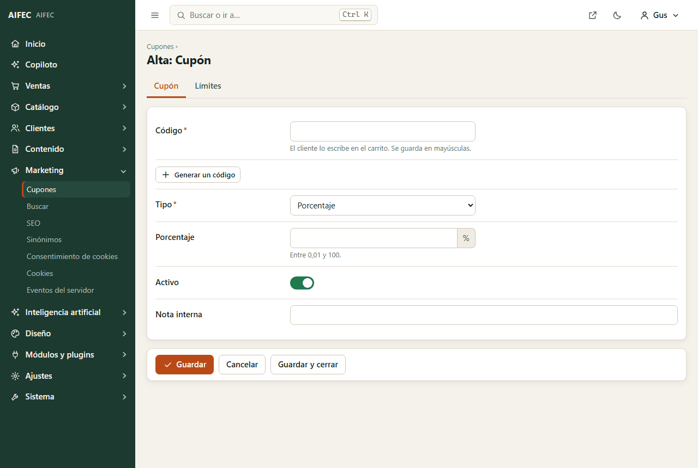

# Cupones

Un cupón es un código que el cliente escribe en el carrito para obtener un descuento. Puede ser un porcentaje, un importe fijo o el envío gratis, y puede limitarse por fechas, usos, importe del pedido, productos y categorías. Está en «Marketing» → «Cupones».

## Crear un cupón

1. Pulsa «Nuevo».
2. En la pestaña «Cupón», escribe el «Código» (obligatorio). Solo letras, números, guiones y guiones bajos; se guarda en mayúsculas. «Generar un código» inventa uno.
3. Elige el «Tipo»:
   - «Porcentaje»: escribe el porcentaje, entre 0,01 y 100.
   - «Importe fijo»: escribe el «Importe», mayor que cero, como escribes los precios de los productos.
   - «Envío gratis».
4. Deja «Activo» marcado. Si quieres, una «Nota interna» (solo la ves tú).
5. En la pestaña «Límites» pon las restricciones (abajo).
6. Pulsa «Guardar y cerrar».

## Los límites

| Campo | Qué hace |
|---|---|
| «Empieza» / «Termina» | Las fechas en que vale. El fin tiene que ser posterior al inicio. |
| «Usos máximos» | Cuántas veces se puede usar en total. 0 es sin límite. |
| «Usos por cliente» | Cuántas veces por persona. 0 es sin límite. |
| «Importe mínimo del pedido» | Vacío si no hay mínimo. |
| «Solo para el primer pedido» | Solo vale la primera compra de un cliente. |
| «No vale con artículos en oferta» | Los artículos con precio de oferta no reciben descuento. |
| «Se puede sumar a otros cupones» | Si no, no se mezcla con otro. |
| «Limitado a un cliente» | Solo lo puede usar la persona que elijas. |
| «Limitado a productos» | Números de producto separados por comas. Vacío es todos. |
| «Limitado a categorías» | Marca las categorías. Ninguna marcada es todas. |

Si limitas a productos y a categorías a la vez, un artículo entra si coincide con una de las dos cosas.

## El listado

Muestra el «Código», el «Descuento», los «Usos» (por ejemplo `0 / ∞`), la «Vigencia» y si está «Activo». Filtra por «Tipo» y por «Estado»: «Vigente», «Caducado» o «Agotado». Un cupón que ya se ha usado no se puede borrar: desactívalo desmarcando «Activo». En la ficha de un cupón usado ves en qué pedidos.

## Descuentos que no son un cupón

- Un precio rebajado con fechas es una oferta de la ficha del producto ([Precios y existencias](04-precios-y-existencias.md)).
- Un porcentaje fijo para un tipo de clientes es un grupo con «Descuento» ([Clientes](06-clientes.md)).

## Lo que ve el cliente

Si el cupón no vale, el carrito dice por qué: «Este código de cupón no es válido», «Este cupón ha caducado», «Este cupón se ha agotado», «Este cupón solo vale para tu primer pedido», «Añade 20,00 € más a tu pedido para usar este cupón»… El descuento sale en el pedido como «Descuento: Cupón CÓDIGO».

## Si algo no sale

- **«Otro cupón ya tiene este código».** Cambia el código o edita el que ya existe.
- **«Este cupón no se puede aplicar a ningún artículo de tu carrito».** Hay límites de productos o categorías y el carrito no tiene ninguno de ellos.
- **«Este cupón no se puede sumar a otros cupones».** Había ya otro cupón en el carrito. Si quieres que se puedan combinar, revisa «Se puede sumar a otros cupones» en los cupones implicados.
- **«Este cupón ya se ha usado y no se puede borrar. Desactívalo.»** Es lo esperado: desmarca «Activo».
