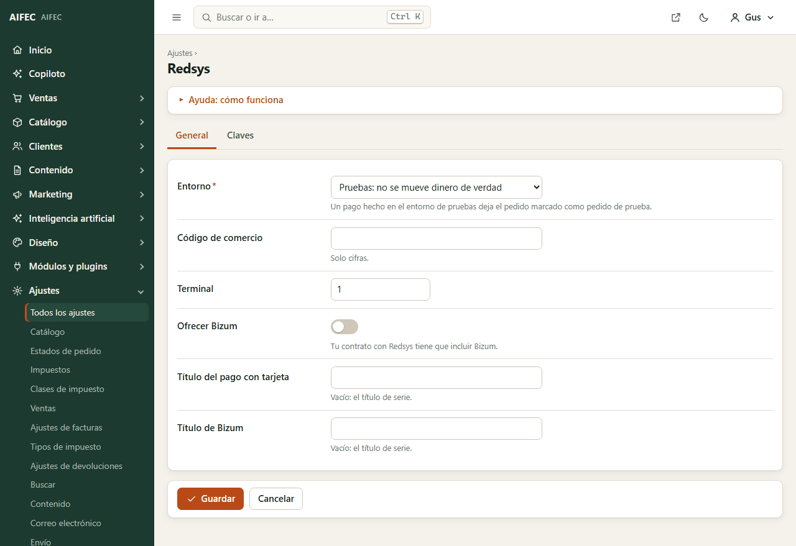

# Formas de pago

AIFEC trae cinco formas de pago: transferencia bancaria, contra reembolso, tarjeta y Bizum con Redsys, PayPal y un pago simulado para pruebas. Cada una se configura en su propia pantalla de «Ajustes» → «Todos los ajustes» y solo se ofrece al cliente cuando está completa. Aquí ves qué pide cada una y cómo comprobar que funciona antes de cobrar de verdad.

## El orden en la caja

En «Ajustes» → «Ventas», pestaña «Formas de pago», «Orden de las formas de pago» son los códigos separados por comas, por ejemplo `redsys, paypal, transfer`. Es el orden en que las ve el cliente; las que no nombres van al final. Los códigos son `redsys` (tarjeta), `bizum`, `paypal`, `transfer`, `cod` y `simulated`.

## Transferencia bancaria

«Ajustes» → «Transferencia bancaria». En la pestaña «Cuenta bancaria»: «Titular», «IBAN», «Banco», «Días para pagar» (con 0 no se menciona plazo) y una «Nota adicional» que sale debajo de los datos. En «Textos»: el «Título» y la «Descripción» (vacíos usan los de serie).

- Sin un IBAN válido, la transferencia no se ofrece. Al guardar, si sus dígitos de control están mal: «El IBAN no es válido: sus dígitos de control están mal. No se ha guardado.»
- El pedido queda «En espera» hasta que lo marques como cobrado ([Pedidos](05-pedidos.md)).
- El cliente ve los datos en la página del pedido y en el correo de pedido en espera, con el número de pedido como concepto.

## Contra reembolso

«Ajustes» → «Contra reembolso». Solo se ofrece en pedidos que necesitan envío.

- **«Dónde»**: «Países» (códigos de dos letras, como `ES, PT`) y «Total de pedido más alto» (con 0 no hay límite).
- **«Recargo»**: «Recargo fijo» más un «Porcentaje del total del pedido», y nunca menos que el «Recargo mínimo». Los importes se escriben como tus precios.
- **«Textos»**: «Título» y «Descripción».

## Tarjeta y Bizum con Redsys

«Ajustes» → «Redsys». Tu banco te da el código de comercio, el número de terminal y una clave secreta de cada entorno cuando activa tu tienda.

**AIFEC no trae ningún comercio de pruebas.** Para probar antes de tener el contrato, date de alta en un TPV de pruebas de Redsys y usa su código de comercio, su terminal y su clave: quien prueba usa su propio comercio de pruebas.

- Cómo son las tarjetas y los entornos de pruebas: [pagosonline.redsys.es](https://pagosonline.redsys.es/desarrolladores-inicio/integrate-con-nosotros/tarjetas-y-entornos-de-prueba/).
- Alta y acceso al portal de administración del entorno de pruebas: [sis-t.redsys.es](https://sis-t.redsys.es:25443/admincanales-web/index.jsp#/login?highlightTrialUser=true).

1. Pestaña «General»: «Entorno» en «Pruebas: no se mueve dinero de verdad» (viene así); «Código de comercio» (solo cifras) y «Terminal».
2. Marca «Ofrecer Bizum» solo si tu contrato incluye Bizum. Cambia si quieres el «Título del pago con tarjeta» y el «Título de Bizum».
3. Pestaña «Claves»: «Clave secreta (pruebas)» y «Clave secreta (producción)», de 32 caracteres. Se guardan cifradas; déjalas vacías para conservar la actual.
4. Copia la «Dirección de aviso» (botón «Copiar») y dásela al banco como URL de notificación del comercio.

El pedido se marca como pagado solo cuando el banco llama a esa dirección con una firma válida. Redsys solo cobra en euros: con otra moneda no se ofrece.

## PayPal

«Ajustes» → «PayPal». Crea una aplicación REST en tu cuenta de desarrollador de PayPal: te da un identificador de cliente y un secreto para el sandbox y otro par para producción.

1. Pestaña «General»: «Entorno» en «Sandbox: no se mueve dinero de verdad» (viene así) y el «Título del pago».
2. Pestaña «Claves»: «Identificador de cliente», «Secreto» e «Identificador del aviso», de sandbox y de producción.
3. Da de alta la «Dirección de aviso» en PayPal como webhook y marca los eventos `PAYMENT.CAPTURE.COMPLETED`, `PAYMENT.CAPTURE.DENIED` y `PAYMENT.CAPTURE.REFUNDED`. El «Identificador del aviso» te lo da PayPal al darla de alta.

El pedido también se marca como pagado cuando PayPal llama a esa dirección con una firma válida, aunque el cliente no vuelva a la tienda.

### Más formas de pago con la misma cuenta de PayPal

En la pestaña «Formas de pago» marcas las que quieres ofrecer y les das un orden. Cada una sale en la caja como una opción aparte y **solo** a los compradores de sus países y en sus monedas; las demás ni se enseñan. La página de la caja no carga nada de PayPal: el cliente va a PayPal o a su banco y vuelve.

| Forma de pago | A quién se ofrece | Moneda |
|---|---|---|
| PayPal (la cartera) | Cualquier país | Las 24 monedas de PayPal |
| «Tarjeta por PayPal» (sin cuenta de PayPal) | Cualquier país | Las mismas |
| Bancontact | Bélgica | Euros |
| BLIK | Polonia | Solo złotys (PLN) |
| eps | Austria | Euros |
| iDEAL | Países Bajos | Euros |
| MyBank | Italia | Euros |
| Przelewy24 | Polonia | Złotys o euros |
| Trustly | Doce países europeos, España entre ellos | EUR, DKK, SEK, GBP, NOK |

De serie vienen encendidas PayPal y la tarjeta. Lo que tienes que saber:

- Bancontact, BLIK, eps, iDEAL, MyBank, Przelewy24 y Trustly hay que **activarlas también en tu cuenta de PayPal**; la tarjeta sin cuenta necesita que PayPal tenga encendido el pago sin cuenta. Si alguna no está activada allí, el historial del pedido lo dice y al cliente solo se le pide que elija otra forma de pago.
- Trustly puede confirmar el pago días después: el pedido queda en espera, sin pagar, hasta que llega el aviso de PayPal.
- La pestaña avisa de las que nunca se ofrecerán con la moneda de tu tienda («Con la tienda en EUR nunca se ofrecen estas…»).
- Las devoluciones se hacen como con cualquier pago de PayPal, desde la ficha del pedido.

### Google Pay, Apple Pay, «Paga más tarde» y la tarjeta sin salir de la tienda

Estas se pagan en una **página de pago de la tienda** a la que el cliente llega tras «Hacer el pedido». Esa página, y solo esa, carga el guion de PayPal (y el de Google para Google Pay); el resto de la tienda no carga nada de fuera. Sin JavaScript no se pueden usar, y al cliente se le dice.

| Forma de pago | A quién se ofrece | Qué tienes que activar |
|---|---|---|
| «Google Pay» | 36 países, España entre ellos, si su navegador lo admite | Google Pay en tu aplicación de PayPal, y aceptar las condiciones de Google Pay |
| «Apple Pay» | Los mismos países, con Safari en un dispositivo de Apple | Apple Pay en tu aplicación de PayPal, registrar el dominio en PayPal y pegar el «Fichero del dominio para Apple Pay» en los ajustes |
| «Paga más tarde con PayPal» | España, Italia, Francia, Alemania, Reino Unido, Estados Unidos, Canadá y Australia, dentro de los importes de cada país | Una cuenta de PayPal del país del comprador |
| «Tarjeta de crédito o débito en la página de pago» | Cualquier país | Los pagos avanzados con tarjeta en tu aplicación de PayPal |
| «Venmo» | Estados Unidos, en dólares | Una cuenta de PayPal de Estados Unidos |

- El número de la tarjeta se escribe en campos de PayPal: nunca pasa por tu tienda. Cuando el banco lo pide, se hace la verificación del titular (3-D Secure) antes de cobrar.
- El pedido nace «pendiente de pago» y se marca pagado cuando PayPal cobra, también si el cliente cierra la página y el aviso de PayPal llega después. Un pedido cuya página de pago se abandona se cancela solo a las dos horas.
- «Enseñar el mensaje de los plazos junto al importe» añade, en la página de pago de «Paga más tarde», el mensaje de PayPal con los plazos. Viene apagado.
- El pago contra factura (solo Alemania) todavía no se ofrece: la caja no pide la fecha de nacimiento, que PayPal exige.

#### Apple Pay: registrar el dominio, paso a paso

Apple solo enseña su botón en un dominio que demuestre ser del comercio. Lo comprueba pidiendo un fichero en `https://tu-dominio/.well-known/apple-developer-merchantid-domain-association`. Ese fichero te lo da PayPal y AIFEC lo sirve por ti: no hay que subir nada al servidor. Los mismos pasos salen en «Ajustes» → «PayPal» → «Formas de pago», con la dirección de tu tienda ya escrita.

1. En tu cuenta de desarrollador de PayPal (developer.paypal.com) abre «Apps & Credentials», elige «Sandbox» (pruebas) o «Live» (real) con el interruptor y abre tu aplicación. En «Features», marca «Apple Pay» y guarda.
2. Descarga el fichero de asociación del dominio. PayPal lo da en su [guía de Apple Pay](https://developer.paypal.com/docs/checkout/apm/apple-pay/), uno para pruebas y otro para real.
3. Abre el fichero descargado con un editor de texto (no tiene extensión), cópialo entero y pégalo en «Fichero del dominio para Apple Pay». Guarda.
4. Comprueba que tu tienda lo sirve: abre `https://tu-dominio/.well-known/apple-developer-merchantid-domain-association`. Tiene que descargar ese mismo fichero, por HTTPS y sin redirecciones. Mientras el campo está vacío, esa dirección contesta «no encontrado».
5. De vuelta en PayPal, en tu aplicación, ve al apartado «Apple Pay» y pulsa «Manage». Pulsa «Add Domain», escribe el dominio de tu tienda y pulsa «Register Domain». PayPal lee el fichero en ese momento: si falla, repite el paso 4.
6. Enciende «Apple Pay» en los ajustes de la tienda y guarda. El botón solo se enseña en Safari, en un dispositivo de Apple.

- Cada dominio y cada subdominio que enseñe el botón se registra por separado, y también pruebas y real.
- Para probar en el entorno de pruebas hace falta además una cuenta de pruebas de Apple Pay, de Apple. No hace falta una cuenta de desarrollador de Apple.
- Apple lee el fichero en la raíz del dominio. Una tienda instalada en una carpeta (`/demos/mi-tienda`) no puede servirlo: lo tiene que servir la tienda que está en la raíz.

Prueba cada una en «Sandbox» antes de pasar a real: lo que hace el guion de PayPal en el navegador solo se ve con tus claves.

## Pago simulado

«Ajustes» → «Pago simulado» no cobra nada. «Ofrecer el pago simulado» y, en «Qué pasa cuando el cliente lo elige», uno de tres modos: «Preguntar en una página de prueba» (el cliente elige «Simular pago correcto» o «Simular pago rechazado»), «Dar todos los pagos por buenos» o «Rechazar todos los pagos». Solo se ofrece en sitios de demostración y en modo de depuración, salvo que marques «Permitirlo en una tienda real»: déjalo apagado, porque los clientes podrían pedir sin pagar.

## Cómo comprobar que funciona

1. Con el entorno de pruebas (Redsys en «Pruebas», PayPal en «Sandbox»), haz una compra completa como cliente.
2. Abre el pedido en «Ventas» → «Pedidos». El «Cobro» debe pasar a «Cobrado» y, en el «Historial», debe aparecer «Pago recibido: …» con la referencia.
3. En «Facturas» el pedido de pruebas lleva la serie TEST.
4. Si el pedido no llega a «Cobrado» tras pagar, el banco no ha podido llamar a la «Dirección de aviso». Revisa que sea accesible desde internet.
5. Solo entonces cambia el «Entorno» a «Producción» y rellena las claves de producción.

## Si algo no sale

- **Una forma de pago no sale en la caja.** Está incompleta (sin IBAN, sin claves o sin código de comercio), no cubre el país (contra reembolso) o la moneda no es el euro (Redsys).
- **«El banco ha rechazado el pago (código …)».** El pedido queda sin pagar; el cliente puede reintentarlo.
- **«PAGO TARDÍO …».** Llegó el pago de un pedido que ya no estaba esperándolo (por ejemplo, cancelado por tardar): decide si lo preparas o lo devuelves.
