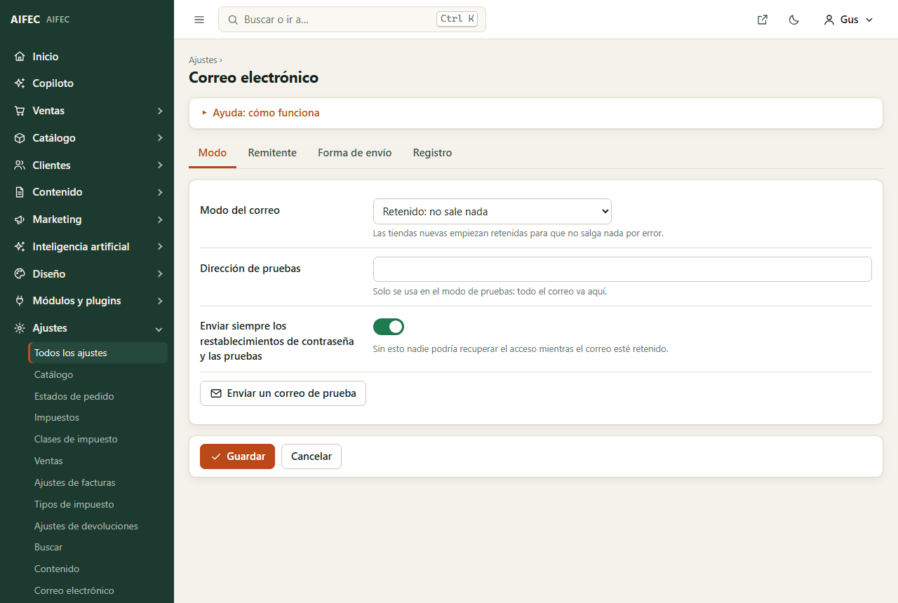

# Correo

La tienda manda correos solos: la confirmación del pedido, el aviso de envío, el enlace para entrar o restablecer una contraseña, el aviso de un formulario. AIFEC los crea todos en una cola y un interruptor general decide si salen. Esta página explica ese interruptor, cómo se configura el envío y dónde ver lo que ha pasado con cada correo.

## El modo del correo

«Ajustes» → «Correo electrónico», pestaña «Modo». Una tienda nueva empieza «Retenido» para que no salga nada por error.

| Modo | Qué pasa |
|---|---|
| «Retenido: no sale nada» | Todo se guarda en el registro con el estado Retenido y no sale nada. Se libera uno a uno. |
| «Activo: enviarlo todo» | El correo se envía en cuanto se crea. |
| «Pruebas: enviarlo todo a una dirección» | Todo se envía, pero solo a la «Dirección de pruebas», con el destinatario real escrito en el asunto. |

La casilla «Enviar siempre los restablecimientos de contraseña y las pruebas» deja salir esos dos tipos aunque el correo esté retenido: sin ella, nadie podría recuperar su acceso. El botón «Enviar un correo de prueba» manda uno a tu dirección para comprobar el envío.

El modo se comprueba dos veces: al crear el correo y al enviarlo. Si lo pasas a «Activo», sale lo que se cree desde ese momento; lo que ya estaba retenido sigue retenido.

## Remitente

Pestaña «Remitente»: «Correo del remitente», «Nombre del remitente» y «Responder a». Si dejas vacío el correo, se usa el correo de contacto de la tienda; si dejas vacío el nombre, el nombre de la tienda (los dos en «Ajustes» → «General»).

## Forma de envío

Pestaña «Forma de envío», campo «Método»:

- «Servidor SMTP»: pide «Servidor SMTP», «Puerto SMTP», «Cifrado» («STARTTLS», normalmente el puerto 587; «SSL/TLS», normalmente el 465, o «Ninguno»), «Usuario SMTP», «Contraseña SMTP» y «Tiempo de espera» en segundos.
- «La función de correo del servidor».
- «Guardar en ficheros (no se envía nada)»: para demostraciones y trabajo en local.

## Registro

Pestaña «Registro»: «Días que se conserva el contenido de cada correo». Pasado ese tiempo el contenido se vacía y la línea del registro se conserva. Con cero se conserva todo.

## El registro de correo

«Sistema» → «Registro de correo» enseña todo el correo que crea la tienda, también el que se retuvo y no llegó a salir: «Fecha», «Hasta», «Asunto», «Plantilla» y «Estado». Filtra por «Estado»: «Enviado», «Pendiente», «Retenido» o «Fallido». Abre una línea para ver el destinatario, el asunto, la plantilla, el idioma, los intentos y el motivo si algo falló.

- **«Liberar»** (en un correo «Retenido»): lo deja salir en menos de un minuto («Liberado. Saldrá en menos de un minuto.»). Solo sirve si tiene menos de 24 horas.
- **«Reenviar»** (en uno «Enviado» o «Fallido»): crea una copia que sale otra vez.

Un correo «Pendiente» que pasa de 24 horas sin salir no se envía nunca: pasa a «Retenido» con el aviso «Demasiado antiguo para enviarlo: han pasado más de 24 horas». Un correo que falla se reintenta cinco veces con esperas cada vez más largas y, si sigue fallando, pasa a «Fallido».

## Plantillas

«Sistema» → «Plantillas de correo» lista los correos de la tienda con su «Módulo», su «Plantilla» y su «Descripción»: confirmación de pedido, pedido en espera, enviado, completado, cancelado, devolución, nuevo pedido para la tienda, bienvenida, contraseña, enlace de acceso, valoración y otros. Las marcadas «Sistema» (restablecer la contraseña, el enlace de acceso, la prueba) son las que siempre pueden salir. «Vista previa» enseña cómo queda cada una con datos de ejemplo. «Enviar un correo de prueba» manda una a tu dirección.

### Cambiar los textos de un correo

«Editar textos» abre, para cada idioma de la tienda, los tres textos que puedes cambiar: «Asunto», «Saludo» y «Despedida». Debajo de cada uno sale el «Texto original» y la lista de «Variables que puedes escribir entre llaves» (por ejemplo `{number}`, el número del pedido, o `{shop}`, el nombre de la tienda): se sustituyen por el dato de cada envío. La tabla del pedido, los botones y los datos legales los pinta la plantilla y no se editan aquí. Lo que escribes sale siempre como texto, sin HTML.

- «Vista previa sin guardar» enseña el correo montado con lo que hay en el formulario.
- «Enviarme una prueba» te lo manda a tu dirección.
- «Volver al texto original» deja ese idioma como venía.
- Si escribes una variable que esa plantilla no tiene, se queda tal cual y la pantalla te lo avisa.

### Con la IA

Con la IA configurada («Ajustes» → «Inteligencia artificial») y el permiso para usarla, la misma pantalla lleva un cuadro con dos ayudas. **La IA solo propone: no se guarda nada hasta que tú guardas.**

- **«Proponer con IA».** Elige el «Tono» («Cercano», «Formal», «Breve y directo», o descríbelo con tus palabras) y pulsa. El formulario se rellena con la propuesta, marcada como «Propuesta de la IA: revísala y guarda», y debajo sale la vista previa. Si no te convence, cambia el tono y vuelve a pedirla, o escribe encima.
- **«Traducir a los demás idiomas».** Parte de los textos **guardados** del idioma que estás viendo y enseña, para cada uno de los otros idiomas, el original y la propuesta lado a lado. Se guardan solo los idiomas que marques; uno que ya tenía textos propios sale desmarcado para que no se pise sin querer.

Las variables están protegidas: si la propuesta inventa una que la plantilla no tiene, o pierde una que el texto llevaba, ese campo se descarta con un aviso («La propuesta de «Asunto» cambiaba {number}: no se ha usado») y se queda como estaba. A la IA solo viajan los textos de la plantilla y los datos de ejemplo, nunca los de un cliente. Cada petición cuenta en el gasto y en el registro de uso de la IA.

## Retener otra vez

Si algo sale mal, vuelve a «Retenido» en «Modo»: se corta al instante. Lo que ya salió no se puede recoger.

## Si algo no sale

- **«El correo de prueba no se ha enviado: …».** El motivo viene en el mensaje: credenciales SMTP incorrectas, puerto equivocado o el servidor no deja enviar. Mira también el diagnóstico.
- **No sale ningún correo y el modo es «Activo».** Comprueba que el cron corre: la cola del correo la despacha una tarea en segundo plano ([La lista para vender](../01-empezar/05-lista-para-vender.md)).
- **Un correo «Retenido» no tiene «Liberar».** Tiene más de 24 horas. Si hace falta que llegue, vuelve a mandar el aviso desde el pedido con «Volver a mandar el correo del estado».
- **«El modo de pruebas necesita una dirección a la que mandarlo todo».** Escribe la «Dirección de pruebas».
