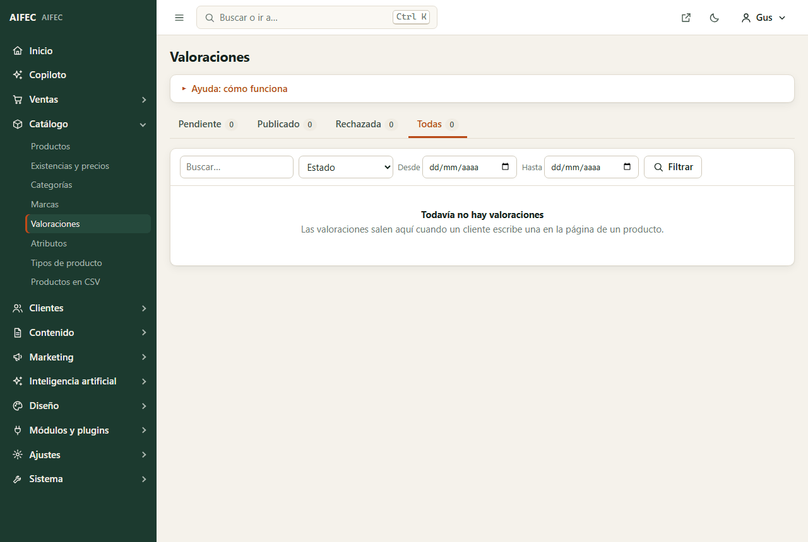

# Valoraciones

Las valoraciones son las opiniones que tus clientes dejan sobre un producto: una nota de 1 a 5 estrellas, un título y un texto. Ayudan a otros clientes a decidir y a los buscadores a entender el producto. Están en «Catálogo» → «Valoraciones», y sus ajustes en «Ajustes» → «Valoraciones».

## Cómo llega una valoración

De dos maneras:

- El cliente la escribe en la página del producto («Escribe una valoración»): «Tu nombre», «Tu correo electrónico» (no se muestra; sirve para comprobar que ha comprado el producto), «Tu nota», «Título (opcional)» y «Tu valoración».
- Recibe un correo unos días después de completarse su pedido, con un enlace por producto para valorar. Cada enlace se puede usar una sola vez.

Una valoración nueva espera en «Pendiente» hasta que la publiques, salvo que sea de una «Compra verificada» (hay un pedido pagado de ese correo con ese producto) y hayas activado la publicación automática.

## Moderar

1. Abre «Catálogo» → «Valoraciones». Arriba, las vistas rápidas: «Pendiente», «Publicado», «Rechazada» y «Todas», cada una con su número.
2. Filtra por «Estado» y por fechas («Desde», «Hasta»). Cada fila dice la «Fecha», el «Producto», la «Nota», el «Cliente» y el «Estado».
3. Abre una para leerla entera.
4. Pulsa «Publicar» para que salga en la tienda, o «Rechazar» para que no se muestre (pide confirmar: «¿Rechazar esta valoración? No se mostrará en la tienda.»).

Al publicar o rechazar, la nota media del producto se actualiza al momento.

## Responder

En la ficha de la valoración, el campo de respuesta lleva texto plano, de 1000 caracteres como máximo. Pulsa «Guardar la respuesta». La respuesta sale en la tienda como «Respuesta de la tienda». Para quitarla, déjala vacía y guarda.

## Ajustes

«Ajustes» → «Valoraciones», con dos pestañas:

- **«Valoraciones»**: «Publicar sin moderación las compras verificadas». Apagado, todas esperan a que las apruebes.
- **«Petición por correo»**: «Pedir una valoración a los compradores por correo» y «Días después de completarse el pedido». El correo sale una sola vez, con un enlace por producto, unos días después de completarse el pedido. Los pedidos completados antes de instalar el módulo de valoraciones no reciben ninguno.

El correo de petición sigue las reglas del correo de la tienda: con el correo retenido, se queda en el registro ([Correo](11-correo.md)).

## Lo que ve el cliente

En la ficha del producto, «Valoraciones de clientes», en poco espacio: una línea con la nota media («4,5 de 5») y cuántas hay, el reparto por nota en barras finas y las cinco opiniones más recientes, cada una con la marca «Compra verificada» cuando toca. Una opinión larga se corta y se abre con «Leer más»; las demás se piden con el paginador. Si no hay ninguna: «Todavía no hay valoraciones. Sé la primera persona en compartir su opinión.»

El formulario no está a la vista: se abre con el botón «Escribe una valoración» (y sale abierto si al enviarlo hubo un error que corregir). El correo de petición lleva a su propia página, ya con el formulario. La nota se da con cinco estrellas que también se manejan con el teclado.

## Si algo no sale

- **No aparece una valoración nueva en la tienda.** Estará en «Pendiente». Publícala o activa la publicación automática de compras verificadas.
- **El cliente ve «Este enlace para valorar no es válido o ya se ha usado.»** Cada enlace vale una vez. Si hace falta, el cliente puede valorar desde la ficha del producto.
- **«Ya has valorado este producto.»** Una persona solo puede valorar un producto una vez.
- **«Demasiadas valoraciones en poco tiempo.»** Es el freno contra el abuso. Espera un rato.
