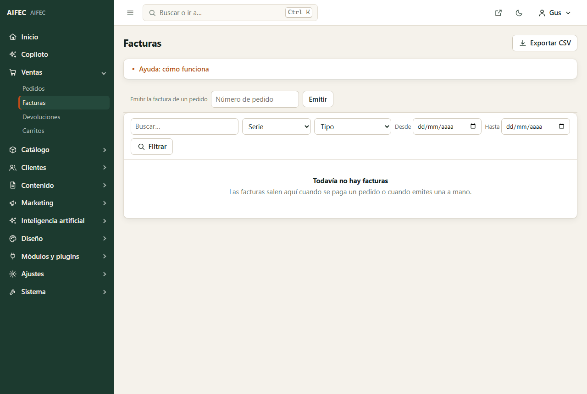

# Facturas

AIFEC emite las facturas solo, con numeración correlativa y sin huecos. Cuando se cobra un pedido sale la factura, y cuando se devuelve dinero sale la rectificativa. Están en «Ventas» → «Facturas», y sus ajustes en «Ajustes» → «Facturas».

## Cuándo se emite una factura

- **Al cobrar un pedido**: en cuanto el pedido se paga (por la pasarela, o cuando lo marcas «Marcar como cobrado»), se emite su factura.
- **Al devolver dinero**: la devolución genera una «Factura rectificativa» que rectifica la original, con los importes en negativo.
- **A mano**: en «Facturas», «Emitir la factura de un pedido»: escribe el número de pedido y pulsa «Emitir». También hay «Emitir la factura» en la ficha del pedido. No se puede emitir la factura de un pedido cancelado.

Se puede apagar la emisión automática en los ajustes.

## El listado

Cada fila trae «Número», «Tipo» («Factura» o «Factura rectificativa»), «Fecha», el pedido, el «Cliente», la «Base imponible», la «Cuota» y el «Total». Filtra por «Serie», «Tipo» y fechas («Desde», «Hasta»). Pulsa el número para descargar la factura en PDF. «Exportar CSV» baja una fila por factura y tipo de impuesto, con las rectificativas en negativo, listo para tu gestoría.

El cliente ve la factura en la página de su pedido («Factura F2026-00001 PDF») y, si lo activas, la recibe adjunta al correo de confirmación.

## Los números

Los números son correlativos en cada serie y nunca se reutilizan. Los pedidos pagados en modo de pruebas usan siempre la serie TEST y no gastan un número real.

## Los ajustes

«Ajustes» → «Facturas», tres pestañas:

| Pestaña | Campos |
|---|---|
| «General» | «Emitir la factura cuando se paga un pedido, y la rectificativa cuando se devuelve dinero» y «Adjuntar la factura al correo de confirmación del pedido». |
| «Numeración» | «Serie de las facturas» (solo letras y cifras; cada serie tiene su contador), «Formato del número de factura», «Serie de las rectificativas» y «Formato del número de rectificativa». |
| «Texto legal» | «Texto al pie de la factura»: por ejemplo, los datos del registro mercantil o el régimen fiscal. |

En los formatos, `{series}` es la serie, `{year}` el año y `{number:5}` el contador con ceros hasta 5 cifras: `{series}{year}-{number:5}` da `F2026-00001`. Cambiar el formato no cambia los números que ya existen.

## Los datos del emisor

La razón social, el NIF y la dirección salen de «Ajustes» → «General» («Identidad»). Se copian en cada factura al emitirla: cambiarlos después no cambia las que ya existen. Rellénalos antes de vender ([Primeros ajustes](../01-empezar/03-primeros-ajustes.md)).

## Si algo no sale

- **«No se puede emitir una factura de un pedido cancelado».** Es lo esperado; no hay venta que facturar.
- **Cobraste a mano un pedido de prueba y gastó un número de factura.** Los números no se reutilizan. Para probar sin gastar, usa el «Pago simulado» o el entorno de pruebas de la pasarela ([Formas de pago](10-formas-de-pago.md)).
- **No sale la factura en el pedido.** Mira que «Emitir la factura cuando se paga un pedido» esté encendido y que el pedido tenga un cobro apuntado.
- **El NIF o la dirección salen vacíos.** Faltan en «Ajustes» → «General»; corrígelos para las facturas que emitas desde ahora.
