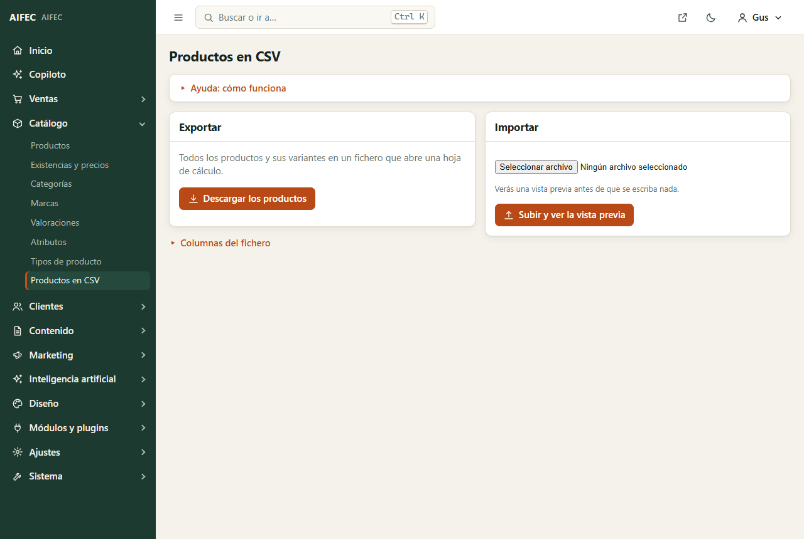

# Importar y exportar

Hay dos formas de meter datos en AIFEC desde fuera: una hoja de cálculo CSV para el catálogo, y la migración completa de una tienda que ya tienes en WooCommerce o en PrestaShop. Las dos enseñan una vista previa antes de escribir nada, y ninguna manda correos a nadie.

## Productos en CSV

«Catálogo» → «Productos en CSV».

**Exportar.** «Descargar los productos» baja todos los productos y sus variantes en un fichero que abre una hoja de cálculo: una fila por producto y una por variante.

**Importar.** Edita ese fichero y súbelo de nuevo:

1. En «Importar», elige el fichero y pulsa «Subir y ver la vista previa».
2. Revisa lo que haría: qué se crea y qué se cambia. No se ha escrito nada todavía.
3. Confirma.

Los productos y las variantes se casan por su referencia (`sku`): la que existe se cambia y la que no existe se crea. Nunca se borra nada. Una celda vacía no cambia nada.

| Columna | Qué lleva |
|---|---|
| `sku` | La referencia. Obligatoria. |
| `parent_sku` | Solo en filas de variantes: la referencia del producto al que pertenecen. |
| `name` | Nombre (en una variante, su etiqueta). |
| `summary`, `description` | Textos, en HTML. |
| `price`, `compare_price`, `sale_price` | Importes con coma decimal (`19,99`), con o sin impuestos como los tiene la tienda. |
| `stock`, `weight` | Unidades y gramos. |
| `status` | `draft`, `published` o `archived`. |
| `categories` | Las categorías del producto; la primera es la principal. Las que falten se crean. Formato debajo. |
| `brand` | Nombre; se crea si no existe. |
| `tax_class` | Código de la clase de impuesto. |
| `gtin`, `mpn` | Códigos del producto. |
| `images` | Direcciones de imágenes; se descargan y la primera es la principal. |
| `attribute:<código>` | Valor de un atributo. En una variante, su opción. Los que falten se crean. |
| `meta_title`, `meta_description` | Textos para buscadores. |
| `name:<idioma>` | El nombre en otro idioma, por ejemplo `name:en`. |

En `categories` e `images` varios valores se separan con una barra vertical (`|`), y en las categorías los niveles con `>`: `Muebles > Sillas|Hogar` son dos categorías, «Sillas» dentro de «Muebles» y «Hogar».

## Migrar una tienda entera

«Sistema» → «Migración» → «Nueva migración» trae ajustes, impuestos, envíos, catálogo, clientes, pedidos y contenidos. Es un asistente de pasos: «Origen», «Conexión», «Qué traer», «Equivalencias», «Simulacro», «Confirmar», «En curso» y «Resultado».

### De dónde

| Origen | Cómo lee | Qué trae |
|---|---|---|
| «WooCommerce (API REST con clave)» | La API REST, con una clave de solo lectura (WooCommerce → Ajustes → Avanzado → API REST). | Toda la tienda, salvo las contraseñas de los clientes. |
| «WooCommerce (pública, sin clave)» | La API pública. | Solo catálogo y contenidos publicados: ni existencias, costes, borradores, clientes ni pedidos. |
| «WooCommerce (copia de la base de datos)» | Una copia de la base de datos y, si la das, de sus ficheros. | Además, las contraseñas cifradas, las redirecciones y los datos de posicionamiento. |
| «PrestaShop (servicio web)» | El servicio web (1.7, 8 o 9) con una clave de solo lectura (GET) a todos los recursos. | La tienda. |
| «PrestaShop (copia de la base de datos)» | Una copia de la base de datos (1.7, 8 o 9). No se escribe en ella. | La tienda; para las imágenes, da la carpeta de ficheros o la dirección de la tienda. |

### Los pasos

1. Elige el origen, pon un nombre si quieres y pulsa «Continuar».
2. En «Conexión», rellena los datos y pulsa «Probar la conexión»; luego «Guardar y continuar».
3. En «Qué traer», marca los «Datos de la tienda» y los «Datos de personas» (clientes, pedidos y equipo: solo si estás autorizado), y las «Opciones»: direcciones antiguas, imágenes y lo editado aquí.
4. En «Equivalencias» empareja los estados, clases y grupos del origen con los de aquí, o deja «Decidir por su significado».
5. Pulsa «Hacer el simulacro»: lee todo el origen y enseña «Qué pasaría» sin escribir nada.
6. En «Confirmar», marca «He leído que no se enviará ningún correo y que las formas de pago quedan apagadas» y pulsa «Empezar la migración».
7. En «En curso» puedes «Pausar», «Reanudar» o «Cancelar»; lo que ya se trajo se queda.
8. En «Resultado», «Ver el informe»: lo creado, actualizado, sin cambios, los choques y los descartados, con «Descargar la lista (CSV)» y «Revisar a mano».

### Qué se garantiza

- **Nunca se envía un correo a los clientes importados.** No se compone ninguno durante la migración.
- Las formas de pago llegan apagadas y en pruebas; los miembros del equipo, inactivos y sin contraseña.
- Se puede repetir: lo que ya está aquí se empareja, no se duplica. Lo editado aquí no se pisa salvo que lo pidas.
- Los pedidos no tocan las existencias, y uno pendiente llega «En espera» para que la cancelación automática lo respete.

## Si algo no sale

- **«No hay ningún lector disponible».** No hay módulo para leer ese origen; mira «Módulos y plugins».
- **«Hay otra migración en curso».** Puedes preparar la nueva, pero no empezarla hasta que acabe la otra: termínala o cancélala.
- **«Estos clientes tendrán que restablecer su contraseña».** El origen no dio contraseñas legibles; entrarán con «He olvidado mi contraseña».
- **Después de migrar, el correo sigue retenido.** Es lo previsto: revisa [Correo](11-correo.md) antes de abrirlo.
