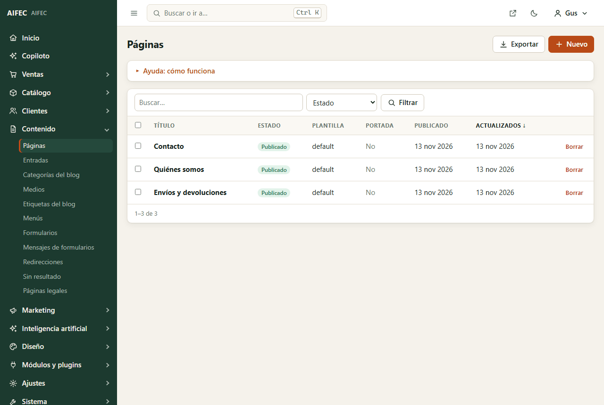
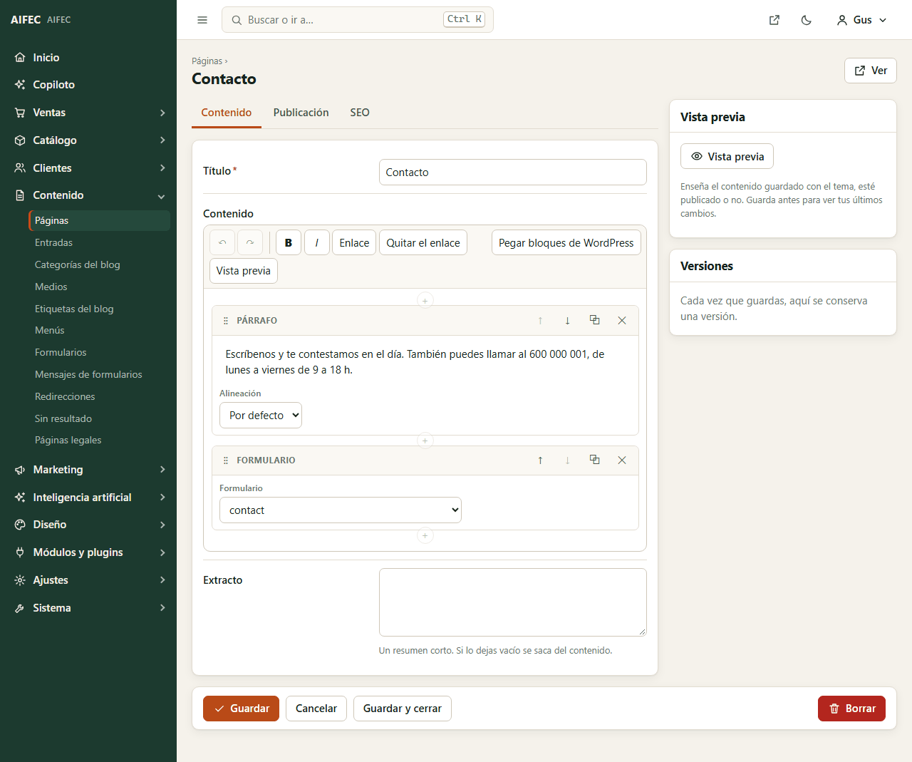

# Páginas y blog

Las páginas son los textos fijos de la tienda («Quiénes somos», «Contacto», «Envíos y devoluciones»). Las entradas son los artículos del blog. Las dos se escriben con el mismo editor de bloques: cada párrafo, imagen o lista es un bloque que puedes mover, duplicar o borrar por separado.

Las encuentras en el menú «Contenido», en «Páginas» y «Entradas».

## Crear una página

1. Entra en «Contenido» → «Páginas» y pulsa «Nuevo».
2. En la pestaña «Contenido», escribe el «Título» y, debajo, el contenido con el editor.
3. Para añadir un bloque, pulsa «Añadir bloque» o escribe una barra («/») en un párrafo vacío. El buscador de bloques filtra mientras escribes.
4. Rellena el «Extracto» si quieres un resumen corto. Si lo dejas vacío, se saca del contenido.
5. En la pestaña «Publicación» elige el «Estado» (más abajo) y la «Plantilla»: «Por defecto», «Ancha» o «Página de entrada».
6. Pulsa «Guardar» para seguir editando, o «Guardar y cerrar» para volver al listado.

El resto de campos de «Publicación» sirven para ordenar el sitio: «Página madre» (cuelga la página de otra), «Orden» y «Portada». Solo una página puede ser la portada: al marcar una, la anterior deja de serlo.

## Los bloques

| Bloque | Para qué sirve |
|---|---|
| Párrafo, Título, Lista, Cita | Texto. La lista puede ser numerada. |
| Imagen, Galería | Imágenes de la biblioteca (ver [Medios](02-medios.md)), con texto alternativo. |
| Tabla | Filas y columnas, con fila de cabecera opcional. |
| Columnas, Grupo, Portada | Maquetación: columnas, un bloque que agrupa a otros y una franja con imagen de fondo. |
| Botones, Separador, Espacio | Botones con enlace (rellenos o con borde), línea divisoria y hueco vertical. |
| Vídeo, Contenido incrustado | Solo aceptan direcciones que empiecen por `https://`. |
| Sección desplegable | Un título que abre y cierra un texto. Sirve para preguntas frecuentes. |
| Código, HTML | Código para enseñar, o HTML propio. El servidor limpia el HTML al guardar: quita los guiones y los atributos peligrosos. |
| Productos, Producto destacado | Productos de la tienda: elegidos a mano, de una categoría, los últimos, los destacados o los que están en oferta. |
| Entradas recientes, Formulario, Índice | Las últimas entradas del blog, un formulario de «Formularios» y un índice con los títulos de la página. |

Cada bloque tiene su barra con «Subir», «Bajar», «Duplicar» y «Borrar», y un asa para arrastrarlo. «Deshacer» y «Rehacer» recuperan los últimos cambios. En un texto puedes poner negrita, cursiva y enlaces.

Si vienes de WordPress, pulsa «Pegar bloques de WordPress», pega el código y pulsa «Convertir en bloques». El editor avisa de cuántos bloques ha añadido y cuántos «Hay que revisarlo».

## Crear una entrada

El formulario es el mismo, con tres campos más: «Imagen destacada», «Categorías» y «Etiquetas» (separadas por comas; las que no existen se crean). Las categorías se crean antes en «Contenido» → «Categorías del blog». Si no eliges imagen destacada, se usa la primera imagen de la entrada.

La palabra con la que empiezan las direcciones del blog («blog» por defecto) se cambia en «Ajustes» → «Contenido». Al cambiarla, las direcciones antiguas redirigen a las nuevas. El blog también ofrece su propio canal de novedades en `/blog/feed.xml`.

## Vista previa, publicar y programar

- **Borrador**: no se ve en la tienda.
- **Publicado**: se ve en cuanto guardas.
- **Programada**: eliges una «Fecha de publicación» futura y la página aparece sola cuando llega. Con la fecha vacía sale ahora.

La tarjeta «Vista previa» enseña el contenido guardado con el tema de la tienda, esté publicado o no. Guarda antes para ver tus últimos cambios.

En el listado puedes marcar varias filas y usar «Publicar», «Pasar a borrador» o «Borrar». Para publicar hace falta el permiso correspondiente: sin él, la página se queda en borrador.

## Versiones

Cada vez que guardas, la tarjeta «Versiones» conserva una copia. Se guardan las últimas 20. «Restaurar» carga una versión antigua, y el contenido vuelve a ser un borrador: revísalo y publícalo de nuevo.

## Si algo no sale

- **La página no aparece en la tienda.** Mira el «Estado»: «Borrador» y «Programada» no se ven hasta que se publican o llega su fecha.
- **«No se ha podido convertir el código».** El código pegado no es de bloques de WordPress. Pega solo el código del editor, sin la página entera.
- **«Solo se aceptan direcciones que empiecen por https://».** El vídeo o el contenido incrustado usa una dirección sin `https://`. Cámbiala.
- **«Una página no puede estar dentro de sí misma».** Has elegido como «Página madre» la propia página o una de sus subpáginas.
- Cambiar la dirección de una página no rompe los enlaces antiguos: la dirección vieja redirige sola.
