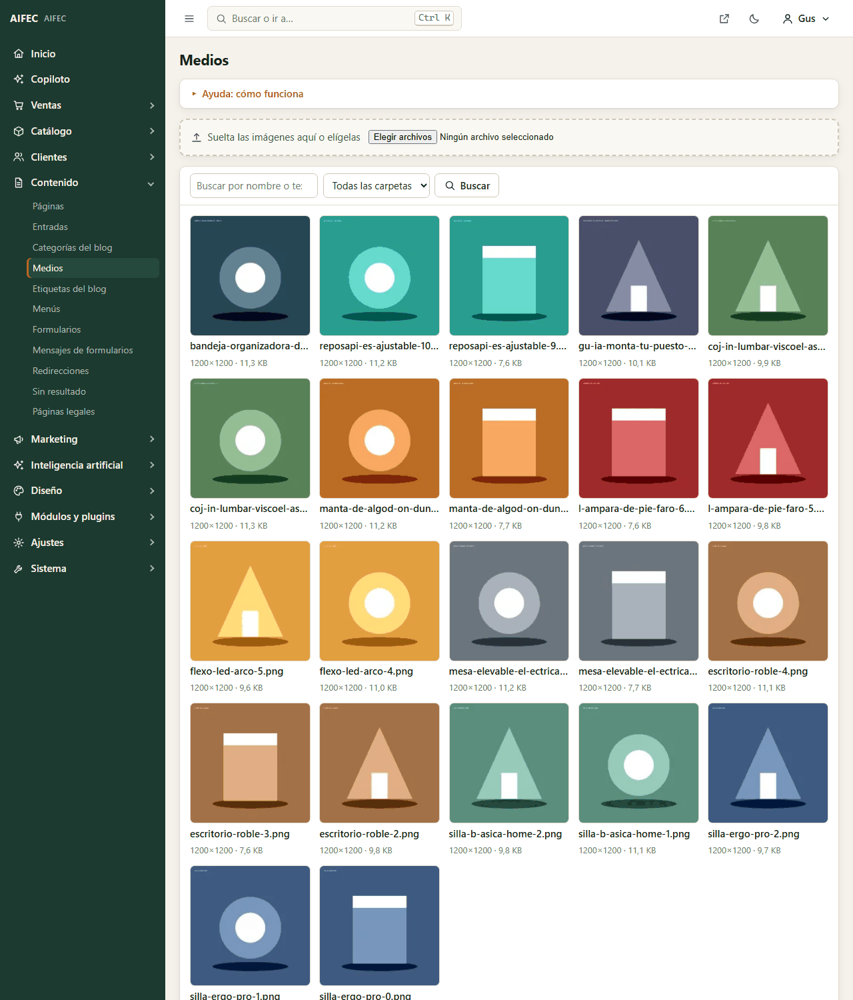

# Medios

La biblioteca de medios guarda las imágenes de la tienda: las de los productos, las de las páginas y las entradas, el logotipo. Se sube una vez y se usa donde haga falta. Está en «Contenido» → «Medios».

## Subir imágenes

1. Entra en «Contenido» → «Medios».
2. Arrastra las imágenes a la zona «Suelta las imágenes aquí o elígelas», o pulsa esa zona para elegirlas en tu ordenador.
3. Pulsa «Subir». Mientras sube, verás «Subiendo…».
4. Cada imagen sale en la cuadrícula con su nombre, sus dimensiones y su peso.

Lo que debes saber de la subida:

- Solo se aceptan imágenes. El sistema mira lo que contiene el fichero, no su nombre: un fichero que se llame `foto.jpg` y no sea una imagen se rechaza.
- El mismo fichero subido dos veces se guarda una sola vez.
- Hay un tamaño máximo por fichero: 8 MB, salvo que lo cambies. Se cambia en «Ajustes» → «Medios», en «Fichero más grande (MB)», con un máximo de 64.
- Una imagen con demasiados píxeles también se rechaza.

## Texto alternativo, título y carpetas

Pulsa una imagen para abrir su ficha. En la parte de abajo está el bloque «Descripción»:

- **«Texto alternativo»**: lo que muestra la imagen, para quien no puede verla y para los buscadores. Escribe una frase corta y concreta («Silla de oficina negra con respaldo de malla», no «foto1»). La [auditoría AIFEC](../04-ai-first/04-la-auditoria-aifec.md) mide si todas las imágenes de un producto lo tienen.
- **«Título»**: un nombre para ti.
- **«Subcarpeta»**: sirve para ordenar. La lista de la biblioteca tiene un selector «Todas las carpetas» y un buscador que busca por nombre o por texto alternativo.

Pulsa «Guardar» para conservar los cambios.

## Dónde se usa una imagen

En la ficha, el bloque «Se usa en» enseña las páginas, entradas o productos que la usan. Si no la usa nadie, dice «No se usa en ningún sitio».

Mira este bloque antes de borrar. Si la imagen está en uso, «Borrar» te avisa («Esta imagen está en uso. ¿Borrarla de todos modos?») y solo la borra si lo confirmas.

## Por qué hay versiones ligeras

Las imágenes se guardan tal como se suben, y además el sistema hace una copia más ligera para cada tamaño que usa el tema. En la ficha las ves en el bloque «Tamaños»; en el sitio de demostración son:

| Tamaño | Dimensiones | Para qué se usa |
|---|---|---|
| `thumb` | 160 × 160 px | Miniaturas |
| `card` | 480 × 480 px | Tarjetas de producto en los listados |
| `large` | 1200 × 1200 px | La imagen grande |

La tienda enseña a cada visitante la copia del tamaño que necesita, en formato WebP cuando se puede. Así las páginas pesan menos y cargan antes, y eso cuenta para los buscadores. En «Ajustes» → «Medios» está la «Calidad WebP», entre 50 y 95: más alto es más nítido y pesa más.

Los tamaños concretos dependen del tema activo. Si cambias de tema y las imágenes se ven borrosas o a un tamaño raro, abre la ficha de una imagen y pulsa «Rehacer los tamaños».

Los GIF animados y los SVG se muestran tal como se subieron: no tienen copias más pequeñas.

## Elegir una imagen desde otro sitio

Los campos de imagen del panel (el logotipo, la imagen destacada de una entrada, las imágenes de un producto) abren la misma biblioteca en una ventana. Marca las que quieras y pulsa «Usar las elegidas», o sube una nueva desde allí.

## Si algo no sale

- **«El fichero no es una imagen admitida» o «Este tipo de fichero no está permitido».** El formato no se acepta. Convierte la imagen a JPG, PNG o WebP y vuelve a subirla.
- **«El fichero es demasiado grande».** Reduce la imagen o sube el límite en «Ajustes» → «Medios».
- **«No se puede escribir en la carpeta de medios».** Es un problema del servidor, no de tu imagen: avisa a quien lo administra.
- **Una imagen se ve con otro tamaño del esperado tras cambiar de tema.** Pulsa «Rehacer los tamaños» en su ficha.
