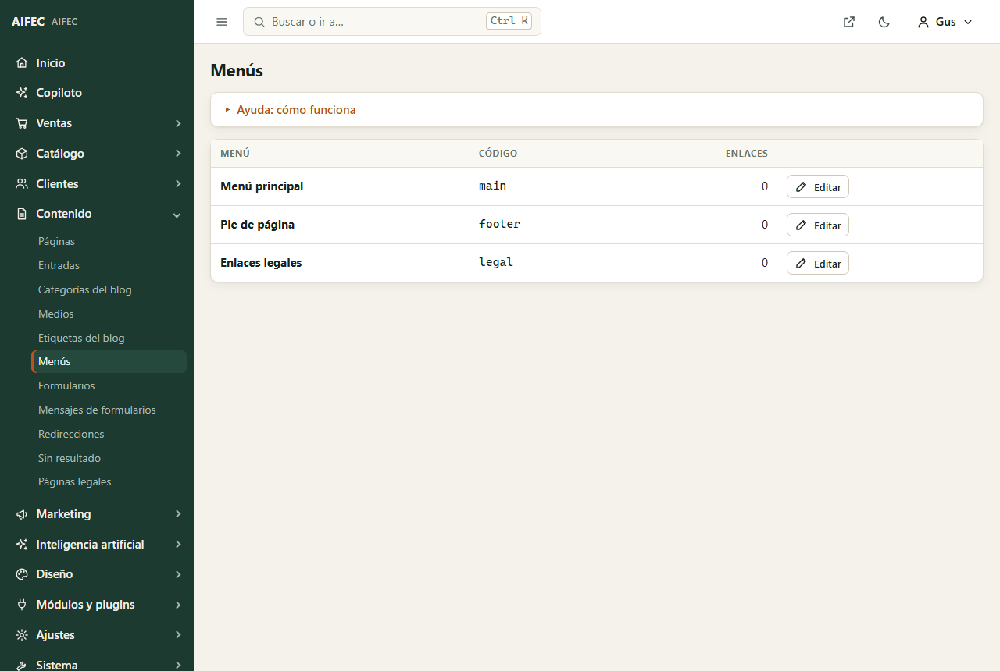
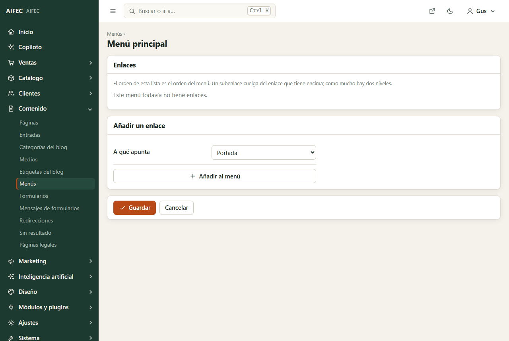
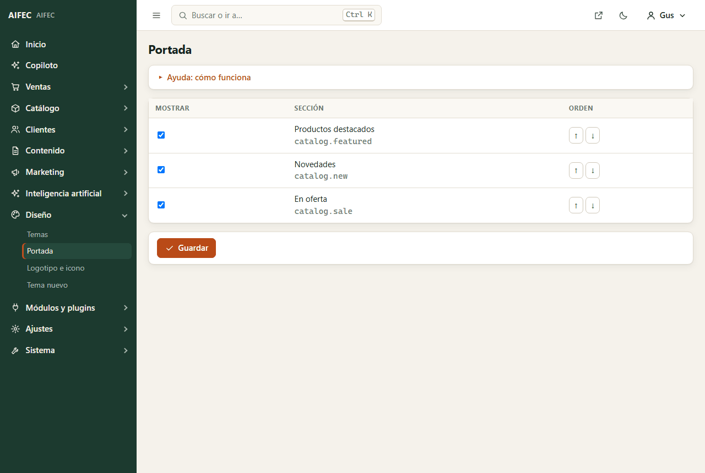

# Menús y portada

Los menús son los enlaces que salen en la cabecera y el pie de la tienda. La portada es la primera página que ve el visitante, y se compone de secciones que puedes ordenar y ocultar.

## Los menús

Entra en «Contenido» → «Menús». Cada tema declara los menús que tiene, y la lista los enseña con su nombre, su código y cuántos enlaces llevan. El de la demostración trae tres: «Main menu» (código `main`, la cabecera), «Footer» (`footer`, el pie) y «Legal links» (`legal`, los enlaces legales). El tema decide dónde sale cada uno; tú decides qué enlaces lleva.

### Añadir enlaces a un menú

1. En la lista, pulsa «Editar» en el menú que quieras cambiar.
2. En «Añadir un enlace», elige «A qué apunta»: «Portada», «Página», «Entrada», «Categoría o etiqueta del blog», «Enlace», «Categoría de productos», «Producto», «Buscar» o «Dirección».
3. Según lo que elijas, aparece un selector (la página, el producto, la categoría) o un campo para escribir la dirección.
4. Escribe el texto del enlace en cada idioma de la tienda.
5. Marca la casilla de abrir en una pestaña nueva si el enlace sale de la tienda.
6. Pulsa «Añadir al menú» y después «Guardar».

El orden de la lista es el orden del menú. Cada enlace tiene botones para subirlo y bajarlo. Con las flechas de sangría puedes convertir un enlace en subenlace, que cuelga del que tiene encima, o devolverlo a enlace principal. Como mucho hay dos niveles. La «×» quita el enlace.

Si cambias de sitio o de dirección una página, el enlace del menú la sigue: se guarda a qué apunta, no solo la dirección.

Cuando un menú no tiene enlaces, el tema puede enseñar uno de reserva. En el sitio de demostración, la cabecera muestra entonces las categorías de producto aunque «Main menu» esté vacío. Si la tienda tiene una sola categoría principal, lo que enseña son sus subcategorías: así no queda un menú de un solo enlace. En cuanto añades enlaces al menú, mandan los tuyos.

### Lo que sale en el pie

El pie de la tienda se monta solo, con lo que haya, en cuatro bloques. Un bloque sin datos no sale:

| Bloque | De dónde sale |
|---|---|
| Categorías | Las categorías principales del catálogo (hasta seis) |
| Información | Los enlaces de los menús «Footer» y «Legal links» |
| Atención al cliente | El teléfono, el correo y la dirección de «Ajustes» → «General» → «Identidad» |
| Formas de pago | Los nombres de las que tienes encendidas |

Así que para un pie completo: rellena tus datos de contacto, publica tus páginas de «Envíos y devoluciones», «Aviso legal», «Privacidad» y «Contacto», y ponlas en esos dos menús.

### Lo que la tienda dice de sí misma junto al botón de compra

Debajo de «Añadir al carrito», y en el carrito bajo «Finalizar compra», salen hasta tres líneas con datos reales de tu tienda. Si un dato no existe, esa línea no sale: no hay textos de relleno.

- **Envío**: «Envío desde 4,95 €», «Envío gratis a partir de 60 €» o «Envío gratis», y el plazo, según tus tarifas de «Ajustes» → «Envío».
- **Devolución**: «Devolución en 30 días», de «Ajustes de devoluciones» (y quién paga la vuelta, si lo has escrito).
- **Pago**: las formas de pago encendidas.

En el carrito, además, «Seguir comprando», lo que falta para el envío gratis si lo ofreces, y «También te puede interesar». Esto último, que también cierra la ficha de producto, enseña hasta cuatro productos (los relacionados que hayas elegido o, si no hay, otros de la misma categoría con existencias primero) y se apaga en «Ajustes» → «Catálogo» → «Enseñar «También te puede interesar» en la ficha y en el carrito».

## La portada

La portada se compone en «Diseño» → «Portada». Cada fila es una sección que aporta un módulo. En el sitio de demostración hay tres, del catálogo: los productos destacados, las novedades y las ofertas.

1. Entra en «Diseño» → «Portada».
2. Usa las flechas arriba y abajo de cada fila para cambiar el orden.
3. Desmarca «Mostrar» en las secciones que no quieras ver. Una sección oculta no se borra: márcala de nuevo para volver a enseñarla.
4. Pulsa «Guardar».

### Poner una página propia como portada

Las secciones vienen de los módulos, pero la portada también puede ser un texto tuyo. En «Contenido» → «Páginas», abre la página y marca «Portada» en la pestaña «Publicación». Esa página pasa a ser una sección más de la portada, con su propio lugar en el orden. Solo una página puede ser la portada: al marcar otra, la anterior deja de serlo.

## Lo que no se gestiona aquí

- El **logotipo** y el **icono** del sitio se eligen en «Diseño» → «Logotipo e icono»: pulsa «Elegir imagen» en cada uno y guarda. El logotipo sustituye al nombre de la tienda en la cabecera; si lo dejas vacío, se enseña el nombre. El icono es el que sale en la pestaña del navegador: cuadrado, de 180 px o más.
- Los **colores, tipografías y estructura** se cambian con el [personalizador de temas](04-temas-y-personalizador.md).
- Las **páginas legales** se crean en «Contenido» → «Páginas legales». Son un punto de partida: revísalas y haz que las compruebe un profesional antes de publicarlas.

## Si algo no sale

- **«Este tema no tiene menús».** El tema activo no declara ninguno en su fichero `theme.json`. Cambia de tema o añade el menú al tema.
- **Los enlaces nuevos no salen en la tienda.** Comprueba que has pulsado «Guardar» después de «Añadir al menú», y que el tema activo pinta ese menú.
- **Una sección de la portada no se ve.** Mira si está desmarcada en «Mostrar».
- **En la lista de secciones salen códigos como `catalog.featured`.** Son los nombres internos de cada sección: `catalog.featured` son los productos destacados, `catalog.new` las novedades y `catalog.sale` los productos en oferta.
