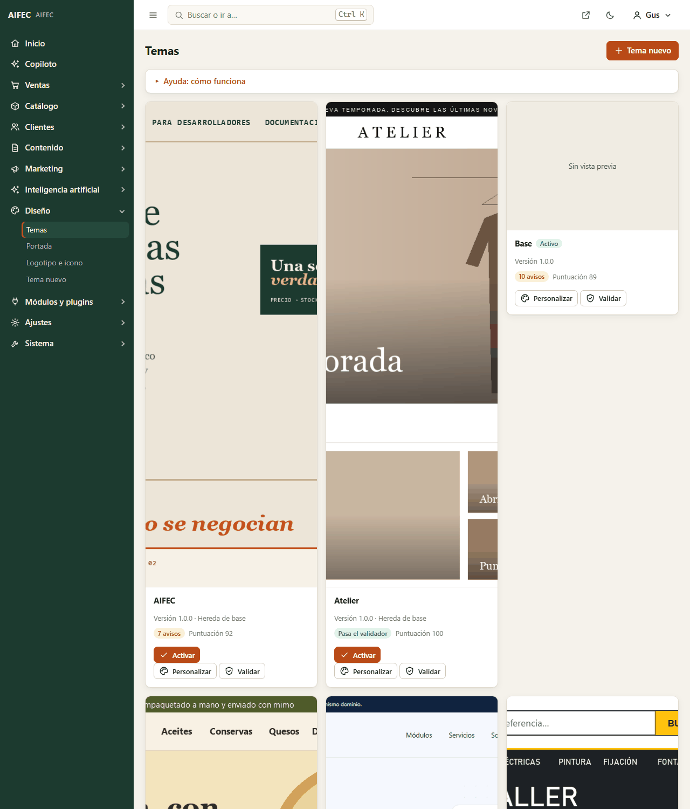
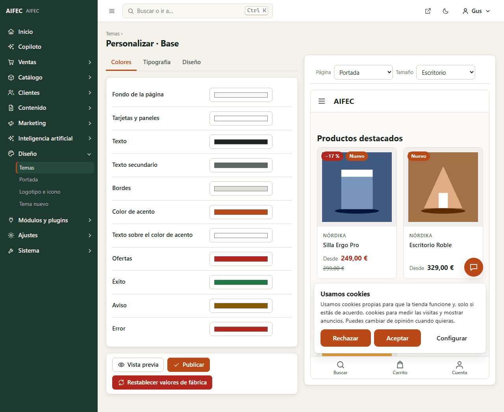

# Temas y personalizador

Un tema define el aspecto de la tienda: la cabecera, las tarjetas de producto, la ficha, los colores y las tipografías. Puedes elegir uno, ajustarlo con el personalizador y volver atrás cuando quieras. Está en «Diseño» → «Temas».

## Elegir un tema

La lista enseña cada tema con su versión, su tema padre («Hereda de base») y el resultado del validador, por ejemplo «Pasa el validador, Puntuación 100» o «6 avisos, Puntuación 93». El tema que se está usando lleva la marca «Activo».

1. Entra en «Diseño» → «Temas».
2. Si quieres comprobar un tema antes de elegirlo, pulsa «Validar» en su tarjeta. Se abre su informe: qué comprobaciones pasa y cuáles no.
3. Pulsa «Activar» en el tema que quieras.

Un tema con errores bloqueantes no se puede activar. Abre su informe, que dice qué hay que arreglar y en qué fichero. Los avisos no bloquean: son mejoras posibles.

El informe revisa, entre otras cosas, que el fichero del tema sea válido, que existan las plantillas que necesita la tienda, que la portada responda bien con ese tema y que todos sus textos estén traducidos. Una tarjeta puede llevar el rótulo «Sin vista previa» si el tema no trae imagen de muestra.

## Personalizar: colores, tipografías y estructura

El personalizador te deja cambiar colores, tipografías y estructura, y ver el resultado antes de publicarlo.

1. En la tarjeta del tema, pulsa «Personalizar».
2. Cambia lo que quieras. Las pestañas habituales son «Colores», «Tipografía» y «Diseño»; un tema puede añadir otras suyas.
3. Pulsa «Vista previa» para ver la tienda con tus cambios, sin que nadie más los vea. Mientras la miras, la pantalla avisa: «Estás viendo un borrador: todavía no está publicado».
4. Cuando estés conforme, pulsa «Publicar». Hasta ese momento, los visitantes siguen viendo la versión anterior.

Lo que se puede cambiar:

| Pestaña | Opciones |
|---|---|
| Colores | Fondo de la página, tarjetas y paneles, texto, texto secundario, bordes, color de acento y texto sobre el acento, y los colores de ofertas, éxito, aviso y error. |
| Tipografía | Tipografía del texto y de los títulos (de una lista), y tamaño base del texto. |
| Diseño | Redondeo de esquinas, ancho de la página, estilo de cabecera («Clásica» o «Centrada»), forma de la imagen de la tarjeta de producto y si se muestra la marca en las tarjetas. |

El sistema vigila que se lea bien. Si eliges un color de acento que no tiene contraste suficiente con el fondo, lo oscurece o lo aclara hasta llegar al contraste AA. Si no hay forma de arreglarlo, lo rechaza y lo dice.

### Volver atrás

«Restablecer valores de fábrica» deshace tus cambios en ese tema y vuelve a los valores con los que venía. Te pide confirmación. Y «Cancelar» sale sin guardar nada. Para volver a un aspecto anterior de toda la tienda, también puedes activar de nuevo el tema que usabas.

## Personalizar un tema que no está activo

Puedes abrir el personalizador de cualquier tema. Si no es el activo, la pantalla avisa de que no puedes ver la vista previa de tus cambios hasta que lo actives: actívalo primero, o cambia sus valores y míralos después de activarlo.

## Qué es un tema hijo

Un tema hijo hereda de otro tema (su padre) lo que no cambies y solo cambia lo que le pidas. Es la forma segura de tener un aspecto propio: el tema padre se puede actualizar sin que pierdas tus cambios, porque tus cambios viven en el hijo.

Para crear uno:

1. Entra en «Diseño» → «Tema nuevo».
2. Escribe un «Identificador» (letras minúsculas, cifras y guiones; da nombre a la carpeta del tema) y un «Nombre».
3. En «Hereda de», elige el tema padre.
4. Elige lo que quieres cambiar: «Cabecera», «Imagen de la tarjeta de producto», «Columnas de productos», el fondo y el color de acento. Lo que dejes en «Como el tema padre» se hereda tal cual.
5. Pulsa «Crear tema». Aparece en la lista de temas: valídalo y actívalo.

Lo mismo se puede hacer desde la consola de AIFEC: `php aifec theme:create <identificador>`. Y `php aifec theme:check <identificador>` pasa el validador a un tema.

Crear un tema escribe ficheros en el servidor: hace falta el permiso para ello.

## Si algo no sale

- **«El tema tiene errores bloqueantes y no se puede activar».** Abre «Validar» en ese tema, arregla lo que marque con «Error» y vuelve a validar.
- **«Ya existe un tema con ese identificador».** Elige otro identificador para el tema nuevo.
- **«El identificador del tema no es válido».** Usa solo letras minúsculas, cifras y guiones.
- **No veo mis cambios en la tienda.** «Vista previa» no cambia lo que ve el público. Pulsa «Publicar» cuando estés conforme.
- **El color que he puesto sale distinto.** El sistema lo ha ajustado para que el texto se lea. Mira el aviso que sale al guardar.
