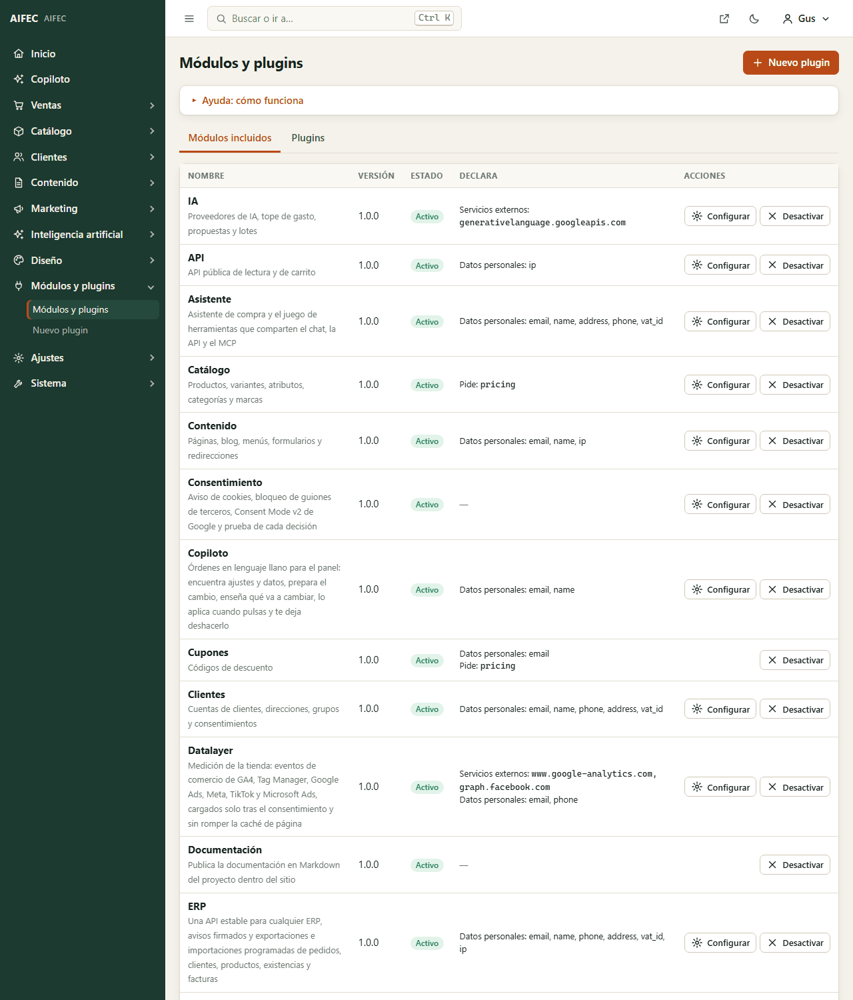

# Plugins

Un módulo es parte del sistema: viene con AIFEC (el catálogo, los pedidos, el SEO). Un plugin es una ampliación que puedes instalar, activar, configurar y quitar. Los dos se gestionan en «Diseño» → «Módulos y plugins».

La pantalla tiene dos pestañas: «Módulos incluidos» y «Plugins». En cada fila ves el nombre, la versión, el estado («Activo», «Apagado», «Sin validar», «No válido» o «Esencial»), la nota del contrato y lo que el plugin declara.

## Instalar un plugin

1. Entra en «Diseño» → «Módulos y plugins» y abre la pestaña «Plugins».
2. En «Subir un plugin», elige el fichero ZIP y pulsa «Subir ZIP».
3. El plugin se instala apagado. Pulsa «Validar» para pasar el contrato (más abajo) y mira el informe.
4. Si lo pasa, pulsa «Activar».

El ZIP tiene que contener una sola carpeta con el plugin dentro y su fichero `plugin.json`. Se rechaza un ZIP dañado, uno con rutas no permitidas, uno con enlaces simbólicos o uno que pese más de 20 MB descomprimido.

Desde la consola: `php aifec plugin:install <fichero.zip>`.

## Activar, desactivar y quitar

- **«Activar»** y **«Desactivar»** encienden y apagan el plugin sin borrar nada. Antes de activarse, un plugin pasa el contrato: no se activa si no lo cumple.
- **«Configurar»** abre sus ajustes, si los tiene.
- **«Desinstalar»** borra sus ficheros. Pide confirmación. Con la casilla «Conservar los datos» marcada, sus tablas y sus ajustes se quedan donde están, por si lo vuelves a instalar. Sin marcarla, se borran con él.
- Los módulos marcados como «Esenciales» no se pueden apagar.

## Qué declara un plugin

Un plugin no puede tocar lo que no ha dicho que va a tocar. Lo declara en su fichero `plugin.json`, y la columna «Declara» lo enseña:

| Declaración | Qué significa |
|---|---|
| «Servicios externos» | Los dominios a los que el plugin llama. Por ejemplo, el módulo de IA declara `generativelanguage.googleapis.com`. Si un plugin llama a otro dominio, el contrato lo detecta. |
| «Datos personales» | Qué datos de personas maneja (correo, nombre, dirección, IP…). Sirve para tus avisos legales y para saber a quién le llegan esos datos. |
| Tablas | Las tablas nuevas que crea en la base de datos. No salen en la lista, pero están en el informe. |
| «Pide» | Una capacidad especial, como `pricing`, que le dejaría cambiar precios, impuestos o plazos. Aparece «Sin conceder» hasta que tú la concedes. |

Las capacidades no se dan solas. Si un plugin pide `pricing`, la fila enseña «Pide: pricing» y un botón «Conceder». Léelo con calma: concédela solo a plugins de confianza. «Retirar» se la quita cuando quieras. Por consola: `php aifec plugin:grant <id> <capacidad>`.

## Qué significa «cumple el Contrato AIFEC»

El contrato es una lista de comprobaciones que AIFEC pasa a cada plugin antes de dejarlo activarse. Da una nota de 0 a 100, que sale en la columna «Contrato». Un plugin «cumple» cuando la pasa sin errores. El informe de cada plugin (botón «Validar») enseña cada regla con «Correcto» o el motivo del fallo:

- **M1** el manifiesto está completo y declara lo que usa;
- **P1** no usa código prohibido;
- **C1** el dinero solo pasa por los cauces oficiales;
- **C2** los datos que añade al producto están declarados y tienen tipo;
- **C3** su salida es ligera y se puede guardar en caché;
- **C4** lo que pinta va escapado y por plantillas;
- **C5** los servicios externos y los datos personales están declarados;
- **C6** la IA, el correo y las tareas pasan por los cauces comunes del sistema;
- **C7** los datos estructurados de la página siguen intactos;
- **C8** sus textos están traducidos;
- **C9** se desinstala limpio;
- **C10** no tumba la tienda: se cargan la portada, un producto y el carrito con el plugin puesto y se comprueba que responden.

En resumen: un plugin que cumple no puede cambiar tus precios sin permiso, no habla con servidores que no haya declarado y no estropea lo que las máquinas leen de tus páginas. Eso es lo que garantiza el contrato, no que el plugin haga bien su trabajo.

## Crear un plugin propio

«Nuevo plugin» genera uno para que tu desarrollador lo complete. Eliges un identificador, un nombre, una descripción, un autor y las piezas de partida (un ajuste, una pantalla, un hueco en la ficha de producto, una tarea periódica…). Se crea apagado, con su manifiesto, su catálogo en castellano, una prueba y un `LEEME.md`. Es trabajo para quien programe.

## Si algo no sale

- **«No hay plugins instalados».** Es lo normal si aún no has subido ninguno.
- **El plugin no se activa.** Abre «Validar»: el informe dice qué regla falla y en qué fichero.
- **«El ZIP debe contener una sola carpeta con el plugin dentro».** Vuelve a empaquetarlo con la carpeta del plugin en la raíz.
- **«Este servidor no puede abrir ficheros ZIP».** A tu servidor le falta la extensión `zip` de PHP. Pídele a quien lo administra que la active.
- **Un plugin pide una capacidad y no sabes si dársela.** No se la des hasta saber para qué la necesita.
