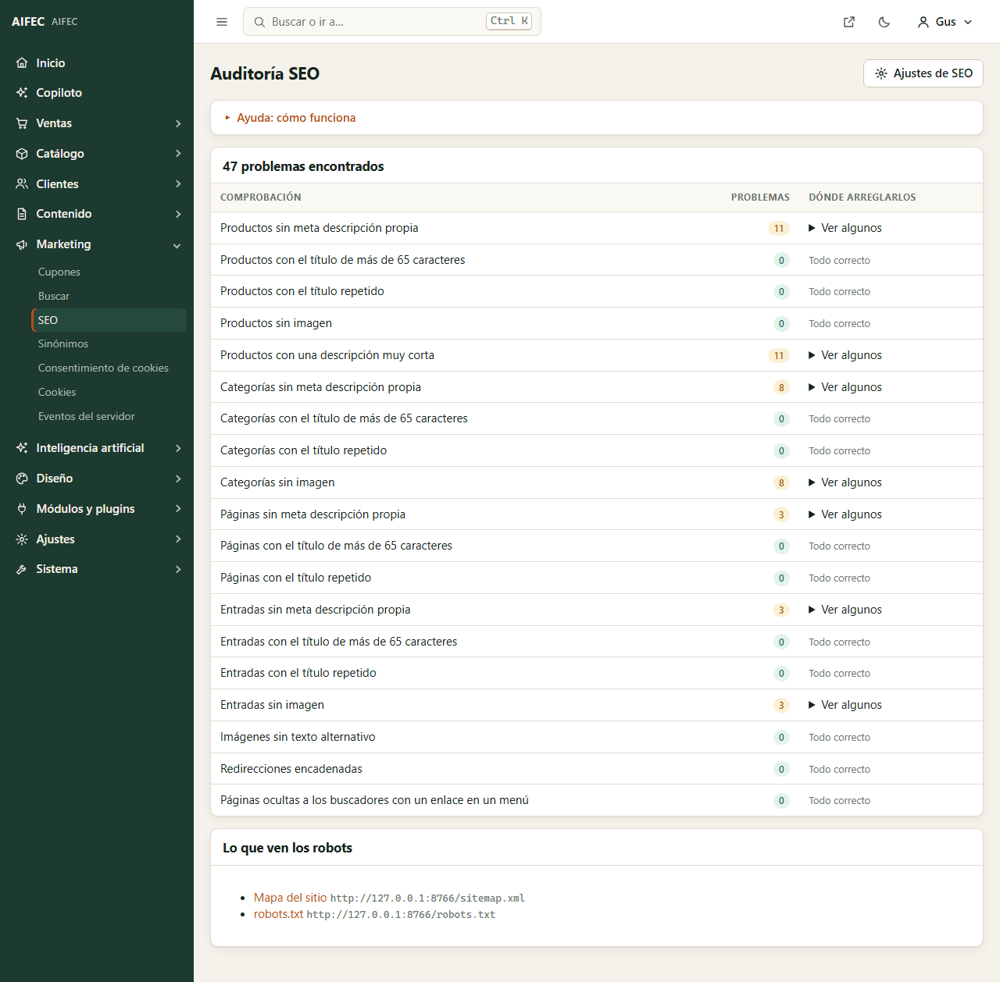

# SEO

El SEO es lo que decide cómo aparece tu tienda en los buscadores: el título y la descripción que se ven en el resultado, la dirección de cada página, y qué se indexa y qué no. AIFEC pone valores razonables por defecto y te deja ajustarlos en un solo sitio. Lo que sirve a los asistentes de IA tiene su propia sección: [qué ofrece tu tienda a las máquinas](../04-ai-first/02-lo-que-publica-tu-tienda.md).

## Títulos y descripciones

Cada página tiene un título y una descripción para los buscadores («Meta título» y «Meta descripción»). Hay dos formas de fijarlos:

- **A mano**, en la pestaña «SEO» de la página, la entrada, la categoría o el producto (en el producto está en la pestaña «SEO e IA»). El título debería tener unos 60 caracteres y la descripción unos 155.
- **Con una plantilla**, para todas las páginas de un tipo, en «Ajustes» → «SEO», pestaña «Títulos». Hay una plantilla de título y otra de descripción para la portada, los productos, las categorías, las marcas, las páginas, las entradas y el blog. En ellas puedes usar estas variables: `{name}`, `{shop}`, `{category}`, `{brand}`, `{price}` y `{page}`.

Por defecto, el título de un producto es `{name} | {shop}`: el nombre del producto y el de la tienda.

Reglas que conviene saber:

- Una página con su propio meta título o descripción lo conserva: la plantilla solo rellena lo que falta.
- Una variable vacía no deja separadores sueltos.
- Los títulos se cortan a 65 caracteres y las descripciones a 160.
- Los cambios de la plantilla se aplican a todas las páginas de ese tipo que no traigan sus propios valores.

## Direcciones amigables

La dirección de una página sale de su título («Silla Ergo Pro» da `/producto/silla-ergo-pro`). Si quieres otra, escríbela en el campo «Dirección». Déjalo vacío para que se genere sola.

Si cambias una dirección, la antigua sigue funcionando y redirige a la nueva. No hace falta que lo hagas a mano. Lo mismo pasa con las palabras con las que empiezan las direcciones del blog, que se cambian en «Ajustes» → «Contenido».

## Redirecciones

Entra en «Contenido» → «Redirecciones» para mandar una dirección vieja a otra nueva. Pulsa «Nuevo», escribe la dirección de origen y la de destino, y deja el estado en «Activo». «En pausa» la desactiva sin borrarla. El destino no puede ser la misma dirección, ni puede haber dos redirecciones desde el mismo origen.

«Contenido» → «Sin resultado» te ayuda a encontrarlas: lista las direcciones que los visitantes han pedido y no existen, las más pedidas primero. Escribe adónde tiene que ir cada una y pulsa «Redirigir». Guarda las últimas 5000.

## Qué se indexa y qué no

En «Ajustes» → «SEO», pestaña «General»:

- `«Ocultar todo el sitio a los buscadores»` añade «noindex» a todas las páginas y bloquea a los buscadores y a los robots de entrenamiento. Un asistente que lee una página para una persona en ese momento (ChatGPT, Claude, Perplexity…) la puede seguir leyendo, porque no indexa nada: si tampoco quieres eso, bloquea «Asistentes de IA» en la pestaña de robots. Úsalo mientras montas la tienda y apágalo cuando esté lista. Mientras esté encendido, se pide a todos los buscadores que no incluyan la tienda.
- **«Última página de un listado que se puede indexar»**: las páginas siguientes de un listado se marcan «noindex». Con 0 no hay límite.

Cada página se puede excluir con «No indexar esta página» (pestaña «SEO»).

## Mapa del sitio y robots.txt

Los dos se generan solos; no los editas a mano.

- El **mapa del sitio** está en `/sitemap.xml`. Es un índice que apunta a un mapa por tipo: páginas, entradas, productos, categorías y marcas, cada uno con la fecha de la última modificación. Si la tienda tiene varios idiomas, incluye las versiones de cada página.
- El **`robots.txt`** está en `/robots.txt`. Cierra a los robots las zonas privadas (`/admin`, `/carrito`, `/finalizar-compra`, `/mi-cuenta`, `/buscar`) y las direcciones de filtros y orden, que repiten el mismo contenido. Enlaza al mapa del sitio. En «Ajustes» → «SEO», pestaña «Robots», decides si cada familia de robots puede leer la tienda: buscadores, asistentes de IA y entrenamiento de IA. El detalle está en [robots de IA](../04-ai-first/03-robots-de-ia.md).
- Si necesitas más reglas, en «Líneas extra para robots.txt» puedes escribir una por línea. Solo se conservan `User-agent`, `Allow`, `Disallow`, `Crawl-delay`, `Sitemap` y los comentarios.

## Verificar el sitio en Google y Bing

En la pestaña «Verificación» pegas el código de «Google Search Console» y el de «Bing Webmaster Tools». Pega solo el código, no la etiqueta entera.

## La auditoría SEO

«SEO» → «Auditoría SEO» mira los productos, las categorías, las páginas y las entradas publicados, en el idioma principal. Agrupa los problemas: productos sin meta descripción propia, títulos de más de 65 caracteres o repetidos, productos sin imagen, descripciones muy cortas, categorías sin imagen… «Ver algunos» muestra ejemplos y «Abrir el listado» te lleva a donde se arreglan. El resultado se guarda 10 minutos.

## Si algo no sale

- **Mi tienda no aparece en Google.** Mira si `«Ocultar todo el sitio a los buscadores»` está encendido. Y recuerda que un buscador tarda en indexar una tienda nueva.
- **El título de una página sale cortado.** Pasa de 65 caracteres. Acórtalo.
- **«Ya hay una redirección desde esta dirección».** Edita la que existe en vez de crear otra.
- **Cambié la plantilla de título y una página no cambia.** Tiene su propio meta título, que manda sobre la plantilla. Vacíalo.
- **La auditoría sigue enseñando un problema ya arreglado.** Espera 10 minutos.
