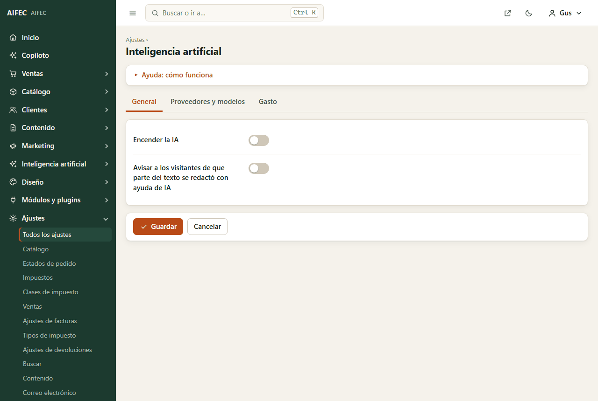
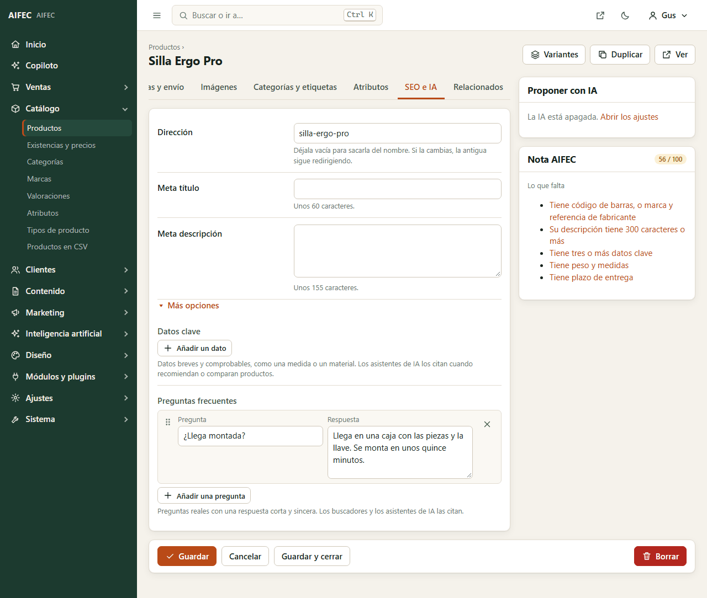
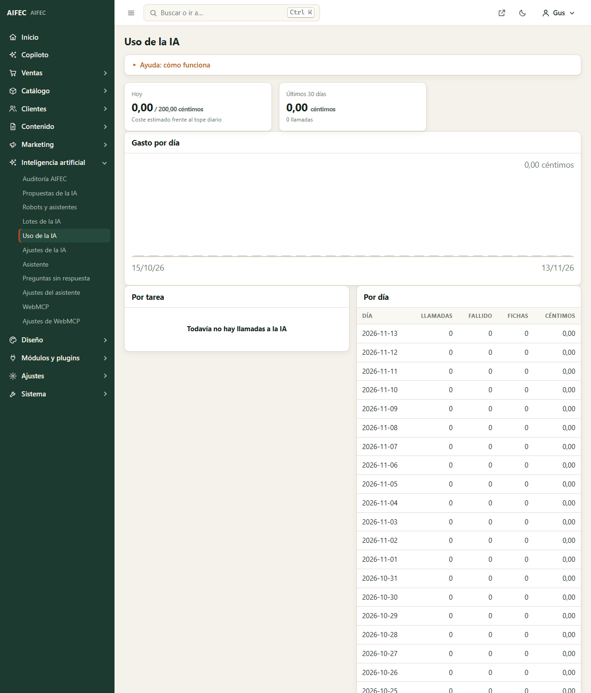

# IA en el panel

AIFEC puede redactar por ti los textos de un producto: la descripción, el resumen, los datos clave, las preguntas frecuentes, el meta título, la meta descripción, el texto alternativo de las imágenes y las traducciones. La regla es una sola: **la IA propone y tú apruebas**. Nada de lo que escribe llega a la tienda hasta que pulsas «Aprobar». Y la tienda funciona igual con la IA apagada: es una ayuda, no una pieza de la que dependa nada.

## Encenderla

La IA viene apagada. Para usarla, entra en «Inteligencia artificial» → «Ajustes de la IA».

1. En la pestaña «General», marca «Encender la IA».
2. En «Proveedor y clave de la API» (Inteligencia artificial → IA → Ajustes; con la IA apagada, el inicio del panel lleva un aviso con el botón «Configurar la IA») hay tres niveles: económico, estándar y avanzado. Cada uno tiene su «Proveedor» («Simulado (sin coste, para pruebas)», «Google Gemini» o «Compatible con OpenAI»), su «Modelo» y su «Clave de la API». Los trabajos cortos, como las metaetiquetas y las traducciones, usan el nivel económico; las descripciones largas, el estándar.
3. Con Google Gemini, deja «Modelo» vacío para usar `gemini-flash-latest`, o escribe otro de los que indica la ayuda del campo (`gemini-flash-lite-latest`, `gemini-3-flash-preview`, `gemini-3-pro-preview`).
4. Con «Compatible con OpenAI» tienes que rellenar también la «Dirección base» del servicio.
5. En «Gasto», fija los topes (más abajo).
6. Pulsa «Guardar».

Después abre «Inteligencia artificial» → «IA» → «Prueba de conexión». Elige el nivel y pulsa «Probar la conexión guardada». Se hace una petición corta con los datos que has guardado: la clave no aparece en el formulario ni en la respuesta y el coste cuenta para los topes. Si eliges el proveedor simulado, la pantalla lo indica expresamente: esa respuesta no comprueba una conexión externa. En las demos públicas no se permiten direcciones personalizadas de proveedores compatibles con OpenAI, para evitar enviar una clave heredada a otro servidor.

Desde «Asistente» tienes también los enlaces «Configurar el asistente», «Proveedor, modelos y límites de IA» y «Probar la conexión de IA». La configuración de la conexión y el presupuesto es común a las tareas de IA; las opciones de cómo habla el chat están en los ajustes del asistente.

## Personalizar el asistente

En «Inteligencia artificial» → «Asistente» → «Ajustes» puedes cambiar su nombre, tono, calidad de respuesta, saludo, información de la tienda y horarios, además de permitir los pedidos en el chat y limitar su importe. «Nombre del asistente» se usa en el botón del chat y en su presentación; siempre se identifica como una IA. Si lo dejas vacío mantiene su nombre y presentación habituales.

En «Instrucciones específicas para el asistente» puedes indicar cómo aconsejar y expresarse. Solo se usan cuando la IA está disponible. No sustituyen los precios, las existencias, los datos del catálogo, la privacidad ni la confirmación del cliente antes de hacer un pedido. La información de la tienda, los horarios y las políticas siguen teniendo sus campos propios.

Respecto a `ecom_asistente` para PrestaShop, esta pantalla cubre la configuración de conexión, comportamiento y presupuesto disponible en AIFEC. Las herramientas de videollamada, asesoramiento por fotos y canal WhatsApp del módulo PrestaShop necesitan integraciones propias: AIFEC no presenta interruptores para capacidades que todavía no tiene.

Si el módulo de suscripciones está activo y disponible, el asistente también consulta los planes mensuales publicados y ofrece el enlace para revisarlos. Indica que el precio base puede ajustarse según los impuestos de la dirección de facturación. El importe mensual definitivo se muestra en la confirmación de la cuenta del cliente: el chat no acepta pagos recurrentes, no crea suscripciones y no cobra en nombre de la persona. Esta consulta también funciona en el modo sin IA.

La clave de la API es un campo secreto: no la compartas ni la pegues en otros sitios. El proveedor «Simulado» no llama a nadie ni cuesta nada; sirve para probar el flujo con textos de mentira.

Con la IA encendida, el sistema manda al proveedor que elijas la ficha del producto cuyo texto le pides. El módulo declara el servicio externo al que llama (ver [plugins](05-plugins.md)): cuenta con ello en tu política de privacidad.

## Dónde está el botón

En la ficha de un producto («Catálogo» → «Productos»), en la columna de la derecha, hay una tarjeta «Proponer con IA». Si la IA está apagada, la tarjeta lo dice y enlaza a los ajustes. Si está encendida, enseña un botón por cada texto: «Descripción», «Resumen», «Datos clave», «Preguntas frecuentes», «Meta título», «Meta descripción» y «Texto alternativo de las imágenes». Si la tienda tiene más de un idioma, aparece también «Traducir», con el campo y el idioma de destino.

1. Abre el producto y pulsa el botón del texto que quieres.
2. La IA crea una propuesta y la deja en «Inteligencia artificial» → «Propuestas de la IA», en estado «Pendiente».
3. Abre la propuesta. A la izquierda ves el «Texto actual» y a la derecha el «Texto propuesto», con las palabras que cambian marcadas.
4. Si quieres corregirlo, edita el cuadro «Corrige el texto antes de aprobar» y pulsa «Guardar el texto».
5. Pulsa «Aprobar» para escribirlo en el producto, o «Rechazar» para dejar el producto como estaba.

Una propuesta nueva para el mismo campo e idioma sustituye a la que estaba esperando. En el listado puedes seleccionar varias propuestas y aprobarlas o rechazarlas juntas.

## Cómo se marca lo generado

Cada propuesta guarda el modelo que la escribió, quién la aprobó y cuándo: es un registro interno.

Para avisar a tus visitantes, marca «Avisar a los visitantes de que parte del texto se redactó con ayuda de IA» en la pestaña «General». Entonces, las fichas de producto con algún texto aprobado de la IA enseñan: «Parte de este texto se redactó con ayuda de IA y fue revisado por una persona». Lo de «revisado por una persona» tiene que ser verdad.

## Textos para muchos productos a la vez

«Inteligencia artificial» → «Lotes de la IA» le pide un tipo de texto para muchos productos. Eliges la tarea (descripción, resumen, datos clave, preguntas frecuentes, meta título, meta descripción o traducir) y los productos: todos, los que no tienen descripción, los de una categoría o los que no tienen traducción. Antes de lanzarlo ves una estimación del coste. Cada texto se convierte en una propuesta pendiente. El lote corre en segundo plano, de diez en diez productos, y puedes pausarlo, reanudarlo o cancelarlo.

## Cuánto gasta y cómo se limita

«Inteligencia artificial» → «Uso de la IA» enseña el gasto de hoy frente al tope, el de los últimos 30 días, el gasto por día y por tarea.

Hay cuatro topes, en «Ajustes de la IA» → «Gasto»:

- **«Tope diario en céntimos»** (por defecto, 200): cuando el gasto estimado del día lo alcanza, la IA se para hasta mañana.
- **«Tope diario de llamadas»** (por defecto, 500): se para también al llegar a ese número de llamadas.
- **«Tope mensual de gasto»** (opcional, apagado con cero): suma el gasto del mes natural en UTC. Cambiar de día no lo reinicia; se reinicia al empezar el mes siguiente.
- **«Tope diario de fichas»** (opcional, apagado con cero): suma las fichas de entrada y salida comunicadas por el proveedor. La llamada que alcanza el tope queda registrada y las siguientes se bloquean. Sin precios también funciona. Una respuesta que ya está en la caché local puede reutilizarse sin llamar al proveedor ni consumir fichas.

Con un tope diario de gasto o llamadas a cero, la IA queda bloqueada. Cero en los topes opcionales de gasto mensual o fichas significa que ese tope no se aplica. El día y el mes se cuentan en UTC. En «Uso de la IA» se ven por separado el mes natural, los últimos 30 días y las fichas de hoy.

El gasto es una **estimación**: multiplica las fichas usadas por el «Precio por millón de fichas, en céntimos» que escribas para cada modelo, en entrada y en salida. Con el precio a cero no se cuenta nada y el tope en céntimos no protege; el de llamadas sí.

## Si algo no sale

- **«La IA está apagada».** Enciéndela en «Ajustes de la IA».
- **La IA se para a media mañana.** Ha llegado a uno de los topes diarios. Súbelo si quieres seguir, o espera a mañana.
- **No sale el botón «Proponer con IA».** Solo está en la ficha de un producto ya guardado, y hace falta el permiso para usar la IA.
