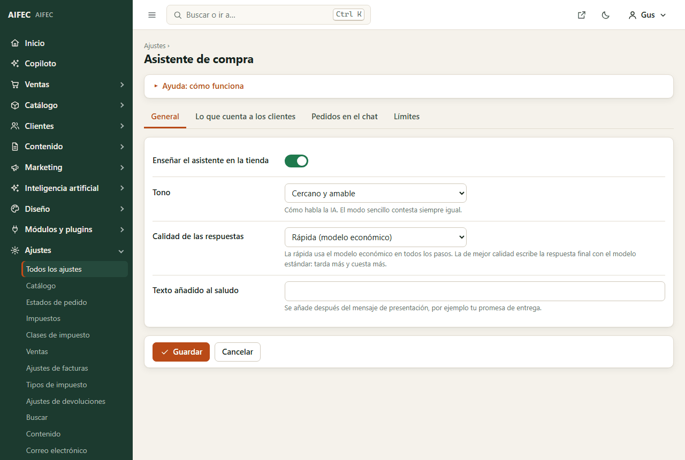

# Asistente de compra

El asistente es una ventana de conversación que sale en tu tienda, con un botón flotante. El visitante le pregunta («¿tenéis sillas con reposabrazos?», «¿cuánto cuesta el envío al 35001?») y contesta con los datos reales del catálogo. Funciona con o sin IA, y lo gestionas desde el menú «Inteligencia artificial» → «Asistente» y «Ajustes del asistente».

## Qué responde

El asistente tiene las mismas herramientas que usan la API y el servidor MCP (ver [API y MCP](../04-ai-first/05-api-y-mcp-para-no-tecnicos.md)). Con ellas puede:

- buscar productos y enseñar su ficha, con sus variantes, su precio y si hay existencias;
- listar las categorías y comprobar la disponibilidad de un producto;
- calcular el envío a un código postal;
- contar las políticas de la tienda: devoluciones, formas de pago, contacto y horario;
- ver el carrito, añadir productos y cambiar cantidades;
- dar la dirección para terminar el pago en la web, y decir el estado de un pedido si el cliente da el número y su correo.

Cada producto que enseña sale en una tarjeta pensada para decidir de un vistazo: **dos fotos** arriba (si el producto las tiene), y debajo el nombre, el **precio** en grande y lo que se puede elegir y comprar en ese momento («Talla: 39, 40, 42»). Un solo botón: «Añadir al carrito» o, si hay que elegir, «Elegir opciones»; el nombre lleva a la ficha. De la disponibilidad solo dice lo que impide comprar («Agotado»).

**Sabe qué tallas, colores y formatos existen.** Si el cliente pide una opción que el producto no tiene («añade la 52», «en verde»), no añade nada: lo dice y ofrece con botones las que sí hay. Si el producto no tiene opciones, también lo dice en vez de añadirlo sin más. Esto lo decide la tienda, no la IA.

Si la IA está apagada (o su proveedor no contesta), el asistente sigue atendiendo en un «modo sencillo», con reglas fijas y sin gastar nada: entiende búsquedas, envío a un código postal, estado de un pedido, devoluciones, pago y contacto; con un producto a la vista, «añádelo al carrito» lo añade (con la talla o el color que se diga) y «¿lo tenéis en la 42?» contesta si la hay.

## Cómo aconseja

El asistente trabaja como un dependiente: cuenta lo que vende, ofrece opciones y pregunta solo lo necesario.

- **Si le preguntan por un producto** («háblame de…», «qué es», «características», «y este qué tal?», «háblame de él» después de enseñarlo), lee su ficha y cuenta qué es y para quién, hasta cinco características, las opciones que quedan («Talla: 39, 40 (agotadas: 41)»), el precio (y el anterior si está rebajado) y si hay existencias. «Él» o «eso» se refiere al último producto que ha enseñado, nunca al asistente. Si la ficha no tiene descripción, lo dice y ofrece compararlo o ver otros parecidos. Para hablar de un producto o aconsejar contesta con más palabras (hasta 120). En los pasos de la compra, como mucho 40.
- **Ante una necesidad vaga** («para ir a una boda elegante», «un regalo para mi padre», «qué me recomiendas»), mira las secciones de tu tienda y busca con sus propias palabras: tipos de producto que encajan, como «zapato de vestir», «traje» o «vestido». Enseña de 3 a 6 opciones variadas y hace una sola pregunta para afinar, con botones que salen de lo que ha encontrado («Para hombre», «Para mujer», «Hasta 150,00 €»). Cada uno de esos botones lleva siempre a productos.
- **Recuerda lo que se está buscando.** Si después de la boda el cliente escribe «soy hombre», «más barato», «en negro» o «algo más formal», el asistente lo suma a lo que ya buscaba: no busca las palabras «soy hombre». «Otra cosa» lo olvida y una búsqueda nueva lo sustituye.
- **No dice «no tenemos…» sin haber buscado** con otras palabras y mirado las secciones. Y entonces dice qué es lo más parecido que sí tienes.
- **No empuja.** No acaba cada respuesta con «¿te gustaría añadirlo al carrito?»: la tarjeta ya tiene su botón. Tras añadir algo dice que está añadido y el total, y ofrece «Ir a la caja», «Ver mi carrito» y «Seguir mirando». Los datos del cliente (nombre, correo, dirección) solo se piden cuando dice que quiere comprar, pagar o terminar, o cuando elige hacer el pedido en el chat.
- **Los botones de respuesta rápida cambian con la conversación**, cuatro como mucho: tras un producto, «Ver tallas» (si las tiene), «Parecidos», «Más barato» y «Gastos de envío»; tras una lista, los de afinar; tras añadir, los de la compra. La IA puede proponer los suyos, pero la tienda descarta los que son largos o llevan un precio que no ha salido del catálogo o un dato personal.

Sin IA hace lo mismo hasta donde llegan las reglas: «háblame de X» cuenta la ficha, «soy hombre» después de una búsqueda la afina si casa con una sección de la tienda o encuentra productos, y si no, pregunta con las secciones como botones. Ante una necesidad vaga enseña como botones las secciones que más se venden y pregunta.

## De dónde saca los datos

**Solo del catálogo y de las reglas de la tienda.** Los precios, las existencias y los plazos salen siempre del catálogo, del carrito y de las reglas de envío, nunca de la memoria de la IA. Lo que escribe un cliente, y las fichas, se tratan como datos y no como órdenes: el texto de una ficha no puede decirle al asistente que haga otra cosa.

Además:

- Se presenta como IA.
- Solo habla de la tienda.
- No revela sus instrucciones.
- Si no sabe algo, no se lo inventa: lo apunta como pregunta sin respuesta.

## Qué no hace

- No fija precios ni descuentos. El importe siempre sale del carrito.
- No cobra por su cuenta. Cuando un pedido se hace en el chat, el cliente lo confirma con un botón («Confirmar pedido») o con un sí claro, y ve el envío, el pago y el total exacto antes. La transferencia y el contra reembolso dan instrucciones; el pago con tarjeta lleva al cliente a la página donde paga él.
- No habla de otros temas.
- No guarda las conversaciones para siempre: se borran pasados los días que indiques.
- **No guarda ni manda a la IA datos de pago.** Si alguien escribe el número de una tarjeta, un IBAN o un código de seguridad, la tienda los quita antes de todo (queda `***` y las cuatro últimas cifras) y contesta con un aviso fijo: «Por tu seguridad he quitado de tu mensaje los datos de la tarjeta o del banco…». En la conversación guardada, el correo, el teléfono, el NIF, el nombre y la calle van enmascarados.
- No le pregunta nada a la IA por un fichero o un trozo de código pegado en el chat: contesta «Eso no parece una pregunta para la tienda…» y solo guarda su principio.

Más detalle, con los límites de uso, en [Seguridad](../08-operacion/09-seguridad.md).

## Ajustarlo

Entra en «Inteligencia artificial» → «Ajustes del asistente». Hay cuatro pestañas:

| Pestaña | Qué decide |
|---|---|
| «General» | «Enseñar el asistente en la tienda»; el «Tono» (cercano y amable, profesional y cortés, breve y directo) y la «Calidad de las respuestas» (rápida, con el modelo económico, o mejor calidad, más lenta y más cara). |
| «Lo que cuenta a los clientes» | «Lo que el asistente debe saber de tu tienda» (con tus palabras: qué vendes y para quién, qué te distingue, qué no haces; lo usa cuando alguien pregunta por la tienda en sí), «Horario» y «Política de devoluciones». |
| «Pedidos en el chat» | «Dejar que el asistente tome el pedido en el chat» y el «Pedido más alto que puede tomar el asistente» (con 0, sin límite; por encima lleva al cliente a la caja). |
| «Límites» | «Mensajes por conversación» (30 por defecto) y «Días que se conservan las conversaciones» (30 por defecto). |

El tono y la calidad solo importan cuando hay IA encendida: el modo sencillo contesta siempre igual. La calidad alta gasta más de tu tope diario (ver [IA en el panel](07-ia-en-el-panel.md)).

**Qué cambia con la calidad alta.** Cuando el cliente pregunta o pide consejo («algo para una boda», «soy hombre», «más barato», «¿cuánto tarda y cómo se paga?»), el modelo económico solo consulta tu catálogo y los datos de la tienda, y la respuesta la escribe el modelo estándar, que elige mejor qué recomendar y qué dejar fuera (no ofrece unas zapatillas de casa para una boda, y dice cuál es lo más parecido si nada encaja). Son dos consultas a la IA, así que la respuesta llega en unos segundos. Los pasos de una compra (añadir al carrito, los datos, el envío, confirmar) van siempre con el modelo rápido. Si tu tienda vende con consejo (moda, regalos, decoración), compensa.

**Si el asistente contesta de repente muy rápido y sin gracia**, mira «Inteligencia artificial» → «Uso de la IA»: lo más probable es que se haya alcanzado el tope diario de llamadas o de gasto. Hasta el día siguiente (el día se cuenta en hora universal) contesta en modo sencillo; puedes subir el tope en los ajustes de la IA (ver [IA en el panel](07-ia-en-el-panel.md)).

## Ver qué preguntan

«Inteligencia artificial» → «Asistente» lista las conversaciones, una por visitante, sin datos personales en el listado. Puedes filtrar por resultado («Acabó en un pedido», «Llegó a la caja», «Añadido al carrito», «Tiene preguntas sin respuesta»), por modo («Con IA», «Modo sencillo») y por fechas. Ábrela para leer la conversación entera.

«Preguntas sin respuesta» agrupa las que el asistente no supo contestar, con los correos y los números largos ocultos. Las que se repiten te dicen qué contenido falta: un producto, una política, una página.

Como las conversaciones pueden llevar datos personales, incluye el asistente en tu política de privacidad.

## Apagarlo

- **Para quitarlo por completo:** desmarca «Enseñar el asistente en la tienda» y guarda. El botón desaparece de las páginas.
- **Solo la toma de pedidos:** desmarca «Dejar que el asistente tome el pedido en el chat». Seguirá contestando, pero llevará al cliente a la caja. Este interruptor también gobierna los pedidos por la API y el MCP.

## Si algo no sale

- **El botón no aparece.** Comprueba «Enseñar el asistente en la tienda». El botón se pinta con un guion pequeño: espera a que cargue la página.
- **Contesta de forma muy sencilla.** Está en «Modo sencillo», que contesta siempre igual: mira si la IA está encendida en «Ajustes de la IA».
- **Deja de contestar a mitad de una conversación.** Ha llegado al límite de «Mensajes por conversación»: después de esos mensajes, el asistente pide al cliente que escriba a la tienda.
- **Las conversaciones antiguas han desaparecido.** Es normal: una tarea diaria borra las que pasan de los días indicados.
