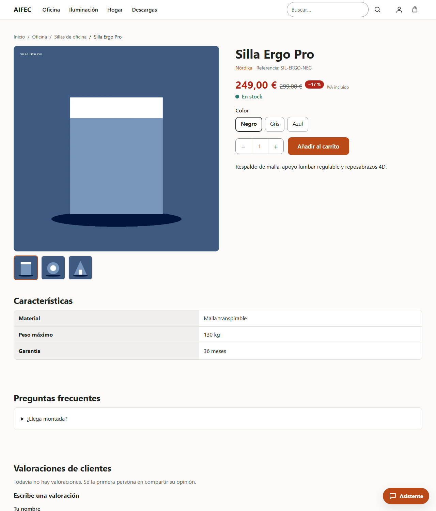

# Una sola verdad por producto

La idea central de AIFEC es esta: **cada producto tiene un único dato, el que tú escribes en su ficha**, y de ese dato salen todas las formas en que se enseña. La página que ve una persona, los datos estructurados que lee un buscador, el texto limpio que lee un asistente de IA, los feeds de producto y la API salen de las mismas funciones. Nadie vuelve a leer la base de datos por su cuenta para «su» formato.

Eso tiene dos consecuencias que importan a un comerciante:

- **Cambias un precio una vez y cambia en todas partes.** No hay una descripción distinta para Google ni un precio aparte para el feed. Los ficheros de feed se rehacen unos minutos después del cambio.
- **Lo que un asistente de IA dice de tu producto es lo que dice tu ficha.** Si la ficha está incompleta, todas las formas salen incompletas. Por eso la [auditoría AIFEC](04-la-auditoria-aifec.md) puntúa las fichas.

Además, hay una regla que se cumple en todas esas salidas: los precios, las existencias y los plazos son **datos**, campos de la ficha, y el texto los acompaña pero no los sustituye. El dinero nunca lo calcula una IA: sale siempre de los servicios de precios, impuestos y envíos de la tienda.

## La misma ficha en sus cinco formas

Tomamos un producto de la demostración, la «Silla Ergo Pro». Estas son sus cinco formas. Todas se pueden abrir ahora mismo en el sitio de demostración.

### 1. La página

Es lo que ve una persona: [`/producto/silla-ergo-pro`](/producto/silla-ergo-pro). Título, fotos, precio («Desde 249,00 €, antes 299,00 €»), variantes (Negro, Gris, Azul), preguntas frecuentes y envío.

### 2. Los datos estructurados, dentro de la misma página

Un buscador no lee el aspecto de la página: lee un bloque de datos que va dentro de ella, en un formato llamado JSON-LD. En esa misma dirección hay tres: el producto con sus variantes (`ProductGroup`, con una oferta por variante, el precio de cada una, si hay existencias y el coste de envío), las preguntas frecuentes (`FAQPage`) y las migas de pan. Para verlo: abre la página, pulsa «Ver código fuente» en tu navegador y busca `application/ld+json`.

El precio de la variante «Negro» sale ahí como `249.00` en euros y con la disponibilidad `InStock`. Es el mismo precio de la página.

### 3. El texto limpio

Un asistente de IA lee mejor un texto sencillo que una página con menús y diseño. Cada página pública tiene su versión en texto: se pide añadiendo `.md` a la dirección, [`/producto/silla-ergo-pro.md`](/producto/silla-ergo-pro.md). Trae el título, el precio, la disponibilidad, un enlace a la página, la descripción, una tabla de «Datos clave», una tabla de variantes con su precio y existencias, las preguntas frecuentes y el envío. También se obtiene la misma versión si se pide la página con la cabecera `Accept: text/markdown`. Con la compra con enlaces encendida (API), la versión en texto de un producto lleva arriba, escrita entera, la dirección que lo mete en un carrito («Comprar con un asistente»), y los listados en texto, la de cada producto: así un asistente que solo abre direcciones que ha leído puede empezar la compra desde la propia ficha. Un dato clave guardado que repita el precio o la disponibilidad no se enseña: esos dos los da siempre la tienda al momento.

La página enlaza a su versión en texto desde su cabecera, para que quien la lea sepa dónde está.

### 4. El feed de productos

Es un fichero con todos los productos para quien quiera cargarlos de golpe: [`/feeds/products.json`](/feeds/products.json). La silla sale ahí con su referencia (`SIL-ERGO`), su marca, su precio en céntimos (24900), el precio sin impuestos y el importe del impuesto, si está rebajado, las existencias y las preguntas frecuentes. Hay otros dos feeds: uno para Google Merchant y otro para asistentes de compra (ver [qué ofrece tu tienda a las máquinas](02-lo-que-publica-tu-tienda.md)).

### 5. La API

Un programa puede pedirle a la tienda el producto sin leer ninguna página: [`/api/v1/products/1`](/api/v1/products/1). Devuelve el nombre, el precio (24900 céntimos y «249,00 €»), la disponibilidad, las categorías, las variantes y su resumen, en JSON. Se identifica por el número del producto, no por su dirección. El servidor MCP y el asistente de compra usan las mismas herramientas que la API: lo que cuenta un asistente de IA cuando le preguntas por esta silla sale de ahí.

## Qué no cambia entre una forma y otra

El precio, la disponibilidad, el nombre, la marca y las variantes son los mismos en las cinco. Lo que cambia es el nivel de detalle y el formato.

## Qué te toca a ti

Rellena bien la ficha una sola vez. Los datos que más pesan están en la pestaña «Principal» y en «SEO e IA» de la ficha de producto: descripción, resumen, «Datos clave», «Preguntas frecuentes», marca, referencia, peso y medidas, plazo de entrega y texto alternativo de las imágenes.

## Si algo no sale

- **La versión en texto da «Página no encontrada».** Solo existen para las páginas públicas y publicadas. Un borrador no tiene versión en texto.
- **El feed da «Página no encontrada».** Los feeds se generan como ficheros, en segundo plano, y no existen hasta que la tarea los crea la primera vez. Puedes esperar a la tarea programada, o ver [qué ofrece tu tienda a las máquinas](02-lo-que-publica-tu-tienda.md).
- **La API dice «Not found» al pedir un producto por su nombre.** La API usa el número del producto (`/api/v1/products/1`), no la dirección de la página.
- **Cambié un precio y el feed enseña el anterior.** Los feeds se rehacen con unos minutos de retraso tras un cambio de precio o de existencias. Es normal.
