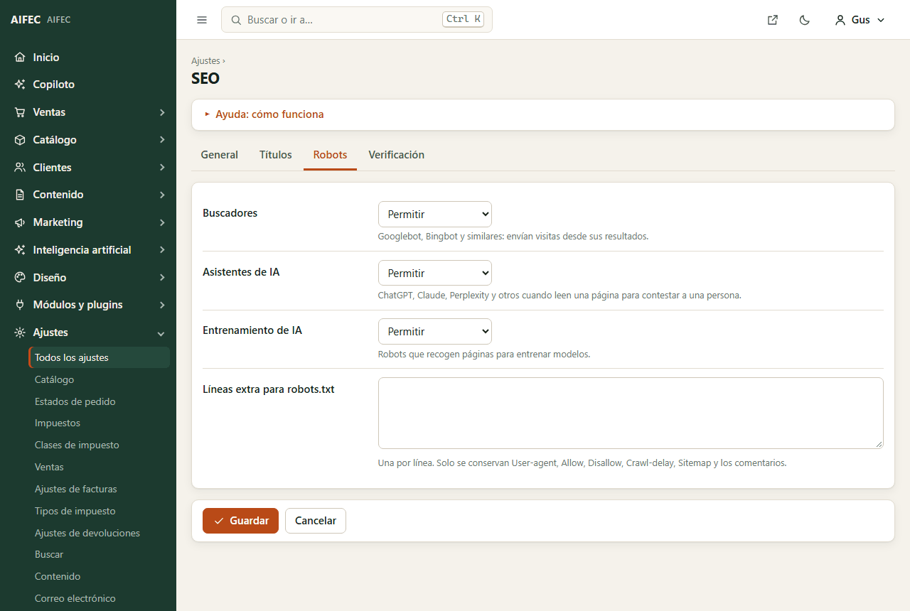
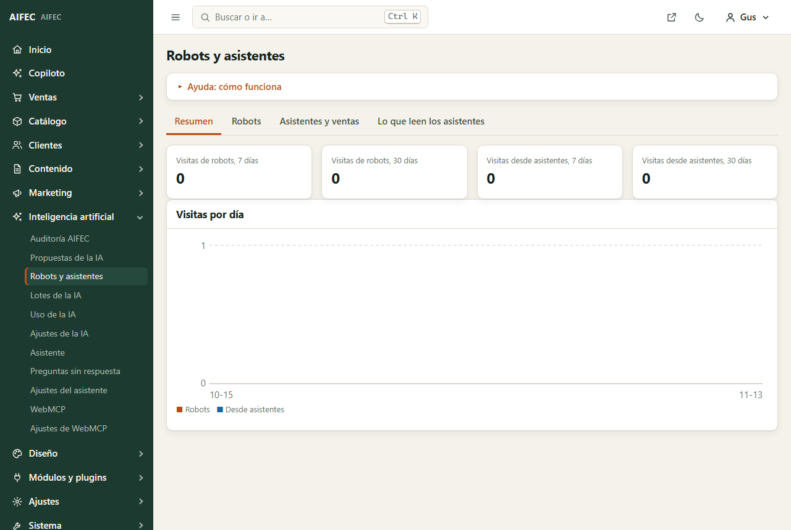

# Robots de IA

Un robot es un programa que lee páginas web sin que haya una persona delante. Unos son de buscadores, otros de asistentes de IA, y otros recogen páginas para entrenar modelos. AIFEC reconoce a los más habituales, te deja decidir quién puede leer tu tienda y te enseña quién ha venido.

## Las tres familias

En «Ajustes» → «SEO», pestaña «Robots», hay tres interruptores. Cada uno tiene dos valores: «Permitir» y «Bloquear». Por defecto, los tres están en «Permitir».

| Familia | Qué hacen | Los reconocidos |
|---|---|---|
| «Buscadores» | Envían visitas desde sus resultados. | Googlebot, Storebot-Google, Bingbot, Applebot, DuckDuckBot, YandexBot, Baiduspider, PetalBot |
| «Asistentes de IA» | Leen una página para contestar a una persona que se lo ha preguntado. | ChatGPT-User, OAI-SearchBot (OpenAI), Claude-User, Claude-SearchBot (Anthropic), Perplexity-User, PerplexityBot, Amazonbot, DuckAssistBot, MistralAI-User |
| «Entrenamiento de IA» | Recogen páginas para entrenar modelos. | GPTBot, ClaudeBot, Google-CloudVertexBot, Meta-ExternalAgent, Cohere, Bytespider, CCBot |

Además, el sistema reconoce otros robots solo para contarlos, sin que tengan interruptor: GoogleOther, el de vista previa de Facebook y las herramientas de SEO (SemrushBot, AhrefsBot, MJ12bot, DotBot).

## Dejar pasar o no

1. Entra en «Ajustes» → «SEO» y abre la pestaña «Robots».
2. Elige «Permitir» o «Bloquear» en cada familia.
3. Si quieres reglas propias, escríbelas en «Líneas extra para robots.txt», una por línea. Solo se conservan `User-agent`, `Allow`, `Disallow`, `Crawl-delay`, `Sitemap` y los comentarios.
4. Pulsa «Guardar».

El resultado se ve en `/robots.txt`: cada familia aparece con su rótulo («Search engines: allowed», «AI assistants: allowed», «AI training: allowed») y la lista de sus robots, seguida de «Allow» o «Disallow». Ábrelo para comprobar lo que has guardado.

Qué conviene saber al decidir:

- **Los tres son independientes.** Bloquear el entrenamiento no afecta a los buscadores ni a los asistentes.
- **Bloquear a los asistentes** significa que un asistente de IA no podrá leer tu tienda para contestar a una persona que pregunta por tus productos. Es una decisión tuya. La [auditoría AIFEC](04-la-auditoria-aifec.md) resta puntos si los asistentes están bloqueados, y la pantalla de robots avisa de ello.
- **`robots.txt` es una petición, no una cerradura.** Los robots serios la respetan; la tienda no puede obligar a ninguno. Si quieres evitar que alguien lea algo, no lo publiques.
- `«Ocultar todo el sitio a los buscadores»` (pestaña «General») añade «noindex» a todas las páginas y bloquea a los buscadores y a los robots de entrenamiento. Es para el tiempo en que montas la tienda. Los lectores que abren una página porque una persona se lo acaba de pedir a su asistente (ChatGPT-User, Claude-User, Perplexity-User…) siguen pudiendo leer la tienda: no la recorren ni la indexan, y así puedes probar con tu propio asistente una tienda que todavía no enseñas a nadie. Se les cierra bloqueando «Asistentes de IA».

Las zonas privadas (`/admin`, `/carrito`, `/finalizar-compra`, `/mi-cuenta`, `/buscar`) se cierran a todos los robots, digas lo que digas en las tres familias.

## Ver quién ha venido

«Inteligencia artificial» → «Robots y asistentes» cuenta las visitas. Tiene cuatro pestañas:

- **«Resumen»**: las visitas de robots y las visitas llegadas desde asistentes en los últimos 7 y 30 días, y una gráfica por día.
- **«Robots»**: una tabla con cada robot, su familia, sus visitas en 30 días, la última visita y qué lee.
- **«Asistentes y ventas»**: las personas que han llegado a tu tienda desde ChatGPT, Perplexity, Gemini, Copilot, Claude y otros, con sus visitas, los pedidos y el importe. Un pedido se atribuye a un asistente cuando la persona llegó desde él y compró en la misma sesión.
- **«Lo que leen los asistentes»**: qué clase de páginas leen los robots de asistentes y cuáles abren las personas que llegan desde un asistente: fichas de producto, categorías, versiones en texto (`.md`), `llms.txt`, feeds, API y MCP.

Cómo se cuenta:

- Las visitas se leen del registro de la tienda **una vez por hora**. Una visita nueva tarda hasta una hora en salir.
- Solo se cuentan los robots que el sistema conoce y las personas que llegan desde un asistente.
- **No se guarda ninguna dirección IP ni ninguna identificación del navegador.**

En el sitio de demostración todos los contadores salen a cero: nadie ha visitado todavía. «Ningún robot ha visitado la tienda todavía» y «Nadie ha llegado desde un asistente todavía» son las respuestas correctas, no un fallo.

## Si algo no sale

- **Los contadores están a cero.** En una tienda nueva es normal. Salen en la hora siguiente a la primera visita. Si pasan días y tu tienda tiene visitas, mira que las tareas en segundo plano corren («Sistema» → «Tareas programadas»).
- **Un robot que no está en la lista no sale.** Solo se cuentan los reconocidos.
- **Bloqueé una familia y sigue entrando un robot.** Un robot que no respeta `robots.txt` no se detiene con él. Si lo ves en «Robots», es que ha entrado.
- **«Los robots de los asistentes de IA están bloqueados en robots.txt».** Es el aviso de la pantalla cuando has puesto «Bloquear». Pulsa «Cambiarlo» si no era tu intención.
