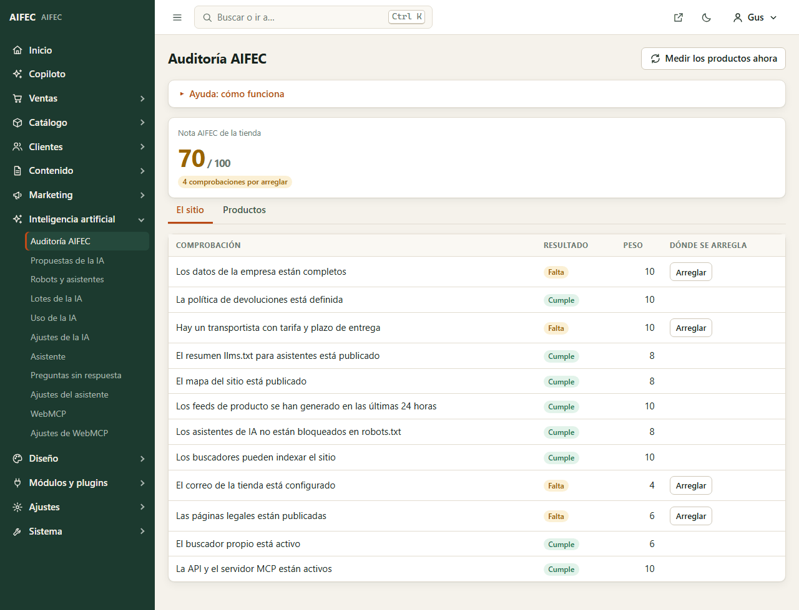

# La auditoría AIFEC

La auditoría pone una nota de 0 a 100 a tu tienda y otra a cada producto, y dice qué falta para subirla. Está en «Inteligencia artificial» → «Auditoría AIFEC».

## Cómo se calcula

Cada comprobación tiene un peso. La nota es 100 menos el peso de las que no se cumplen. La tienda de la demostración saca 60: le faltan cinco comprobaciones que suman 40.

La pantalla tiene dos pestañas:

- **«El sitio»**: doce comprobaciones sobre la tienda entera. Se miden cada vez que abres la pantalla.
- **«Productos»**: catorce comprobaciones por producto. Se miden en segundo plano una vez al día y otra vez cada vez que guardas un producto. Pulsa «Medir los productos ahora» para no esperar.

Arriba ves la nota de la tienda. En la pestaña de productos, cuántos hay en cada tramo (0 a 49, 50 a 69, 70 a 89 y 90 a 100) y los 50 con peor nota. Cada comprobación que falla lleva un botón «Arreglar» que te lleva a donde se resuelve.

## Las comprobaciones del sitio

| Comprobación | Peso | Qué hacer si falta |
|---|---|---|
| Los datos de la empresa están completos | 10 | Rellenar la razón social, el teléfono y la dirección de la tienda, y tener un logotipo. |
| La política de devoluciones está definida | 10 | En «Ajustes» → «Datos para máquinas», pestaña «Devoluciones», pon los «Días para devolver un producto». Con 0 no se ofrece ninguna política. |
| Hay un transportista con tarifa y plazo de entrega | 10 | Crear un transportista con precio y plazo de entrega (días) para el país de la tienda. |
| El resumen llms.txt para asistentes está publicado | 8 | Se cumple mientras el módulo «Datos para máquinas» esté activo. |
| El mapa del sitio está publicado | 8 | Se cumple con el módulo de SEO activo. Si lo apagas, esta comprobación desaparece de la lista. |
| Los feeds de producto se han generado en las últimas 24 horas | 10 | Que corran las tareas en segundo plano y que haya algún feed encendido. |
| Los asistentes de IA no están bloqueados en robots.txt | 8 | Poner «Permitir» en «Asistentes de IA» (ver [robots de IA](03-robots-de-ia.md)). |
| Los buscadores pueden indexar el sitio | 10 | Apagar `«Ocultar todo el sitio a los buscadores»` en «Ajustes» → «SEO». Un sitio marcado como demostración nunca pasa esta comprobación. |
| El correo de la tienda está configurado | 4 | Poner un correo válido como correo de la tienda, en los ajustes generales. |
| Las páginas legales están publicadas | 6 | Crear y publicar las cinco páginas de «Contenido» → «Páginas legales». Si falta una sola, no se cumple. |
| El buscador propio está activo | 6 | Tener activo el módulo «Buscar», en «Diseño» → «Módulos y plugins». |
| La API y el servidor MCP están activos | 10 | Tener activos los módulos API y MCP, en «Diseño» → «Módulos y plugins». |

## Las comprobaciones de un producto

La ficha de cada producto enseña su nota y lo que le falta en la pestaña «SEO e IA» (el cuadro «Nota AIFEC»). La «Silla Ergo Pro» de la demostración saca 56 sobre 100: le faltan el código de barras, una descripción de 300 caracteres o más, tres datos clave, peso y medidas, y plazo de entrega.

| Comprobación | Peso |
|---|---|
| Tiene código de barras, o marca y referencia de fabricante | 12 |
| Su descripción tiene 300 caracteres o más | 12 |
| Tiene al menos una imagen | 10 |
| Tiene marca | 8 |
| Tiene tres o más datos clave | 8 |
| Está en una categoría | 6 |
| Todas sus imágenes tienen texto alternativo | 6 |
| Tiene un resumen | 6 |
| Los atributos de su tipo de producto están rellenados | 6 |
| Tiene peso y medidas | 6 |
| Tiene plazo de entrega | 6 |
| Tiene preguntas frecuentes | 6 |
| Su precio es mayor que cero | 4 |
| Está traducido a todos los idiomas de la tienda | 4 |

Empieza por lo que más pesa: el identificador y la descripción. Para escribir descripciones, resúmenes o preguntas frecuentes con ayuda, mira [IA en el panel](../03-contenido-y-diseno/07-ia-en-el-panel.md): la IA propone y tú apruebas. Los pesos vienen con AIFEC y no se cambian desde el panel.

## Desde la consola

`php aifec aifec:audit` escribe la nota de la tienda, cada comprobación con «OK» o «MISSING», y mide los productos. Con `--queue`, deja esa medición para las tareas en segundo plano.

La nota mide si la información está completa, no si venderás más.

## Si algo no sale

- **La nota no sube tras arreglar algo.** Los productos se miden una vez al día y al guardarlos. Pulsa «Medir los productos ahora».
- **Una comprobación del sitio sigue en «Falta».** Recarga la pantalla: esas se miden al abrirla.
- **Fallan los feeds de las últimas 24 horas.** Los crea una tarea en segundo plano. Ver [qué ofrece tu tienda a las máquinas](02-lo-que-publica-tu-tienda.md).
- **Los productos salen sin nota.** Aún no se ha medido ninguno: pulsa «Medir los productos ahora».
