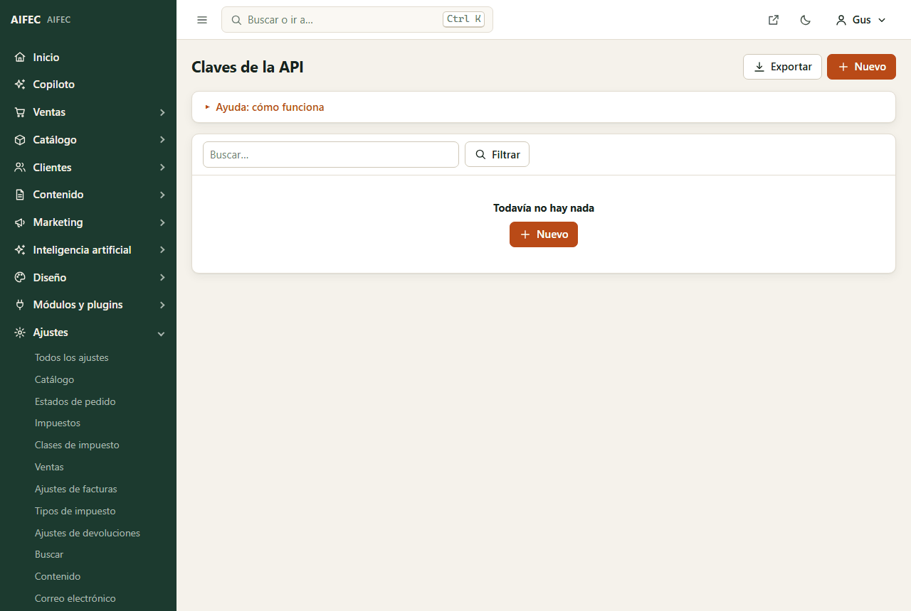

# API y MCP, para no técnicos

Tu tienda tiene, además de la web que ve la gente, dos puertas para programas: la **API** y el **servidor MCP**. Las dos hacen lo mismo con distinto lenguaje. Esta página explica para qué sirven, qué puede hacer un asistente de IA que se conecte y qué no, y cómo controlas quién entra.

## Qué son, sin tecnicismos

- La **API** es una forma de pedirle datos a la tienda desde un programa, sin abrir una página: pregunta «¿qué sillas tenéis?» y recibe la lista.
- El **servidor MCP** es lo mismo, pero hablando el lenguaje que usan los asistentes de IA (Claude, ChatGPT y otros). Una persona le da la dirección de tu tienda a su asistente y éste puede buscar productos, montar un carrito y llevar la compra hasta el final.
- **WebMCP** es la versión para asistentes que trabajan dentro del navegador de una persona: la tienda les cuenta qué botones y formularios tiene y para qué sirven.

Las tres puertas usan las mismas herramientas que el [asistente de compra](../03-contenido-y-diseno/08-asistente-de-compra.md) de tu web y los mismos datos que el resto de salidas ([una sola verdad](01-una-sola-verdad.md)).

## Qué puede hacer un asistente conectado

Sin ninguna clave, un programa o un asistente puede:

- buscar productos y ver su ficha: variantes, precio, existencias y plazo de entrega;
- listar las categorías y comprobar la disponibilidad;
- calcular el envío a un destino y leer las políticas de la tienda;
- preparar un carrito: añadir productos y cambiar cantidades;
- pedir la dirección para terminar el pago en tu web.

Con la herramienta de estado de un pedido puede decir cómo va uno si le dan el número y el correo del cliente. En el MCP viene apagada por defecto.

## Qué no puede hacer

- **No puede fijar precios.** El precio es siempre el de la tienda. Lo mismo con impuestos, envíos y totales.
- **No puede crear un pedido sin la confirmación de una persona.** Antes tiene que pedir la revisión: la tienda devuelve un resumen exacto con el total y, por seguridad, manda al correo del comprador un código de verificación de seis cifras con ese total. La tienda se lo dice al asistente, que tiene que pedírselo a la persona y esperar. El pedido solo se hace cuando el asistente devuelve ese código: así es la persona, y no el programa, quien confirma. Si tienes una pasarela de WhatsApp (mensajero) o WhatsApp Business de Meta por 360dialog, puedes hacer que el código llegue también por WhatsApp al teléfono del comprador (API → Pedidos → «Enviar el código también por WhatsApp»). Si algo cambia después (una cantidad, la dirección, el envío, el pago, un cupón o el total), el código deja de valer y hay que revisar otra vez. Tú decides en «Pedidos hechos por agentes de IA» (API → Pedidos) si lo permites así a cualquier asistente, solo a los que tengan una clave tuya, o a ninguno.
- **No cobra.** Paga la persona. La transferencia y el contra reembolso dan instrucciones; el pago en línea da la dirección de la pasarela donde paga el cliente. Nada se cobra sin ella.
- **No toca el carrito de otra persona.** Cada conexión tiene su propio carrito.
- **No cambia tu catálogo.** Las puertas son de lectura y de carrito.

## Tus controles

### Encender y apagar

- «Ajustes» → «API»: «Encender la API». Apagada, todas sus direcciones contestan con un error 404 (no encontrada).
- «Ajustes» → «MCP»: «Encender el servidor MCP». Apagado, también.
- «Ajustes» → «WebMCP»: «Ofrecer las herramientas de la tienda a los agentes de IA en el navegador».
- «Ajustes» → «MCP», pestaña «Herramientas»: marca las herramientas que quieres ofrecer. Por defecto salen todas menos el estado de un pedido.
- «Dejar que el asistente tome el pedido en el chat», en «Ajustes del asistente»: este interruptor también gobierna los pedidos por API y por MCP. Apagado, ningún programa puede hacer pedidos.

### Límites

En «Ajustes» → «API», pestañas «Límites» y «Pedidos»:

- «Peticiones por minuto sin clave» y «con clave»: con 0 no hay límite.
- «Pedido más alto que puede hacer un programa»: por encima, lleva a la persona a la caja de la web.
- «Pedidos por clave y hora».

### Las claves

Una clave sirve para dos cosas: subir el límite de uso, y, con el permiso `orders:create`, dejar que un programa de tu confianza haga pedidos sin el código que se manda al comprador. Leer la tienda, preparar un carrito y hacer un pedido con el código del comprador no necesitan clave.

Para crear una:

1. Entra en «Claves de la API» (en el menú «Ajustes») y pulsa «Nuevo».
2. Escribe un «Nombre» que te recuerde para qué es.
3. Marca `orders:create` solo si ese programa tiene que poder hacer pedidos.
4. Deja «Activo» marcado y pulsa «Guardar».
5. **Copia la clave en ese momento.** La clave se enseña una sola vez. De ella solo se guarda un resumen: si la pierdes, no se puede recuperar; crea otra.

Para revocarla, abre la clave y desmarca «Activo»: deja de valer en el momento. La lista enseña el estado de cada una («Activo» o «Apagado»).

Trata las claves como contraseñas.

## Si algo no sale

- **Un asistente dice que la tienda «no responde».** Mira que la API y el MCP estén encendidos y su módulo activo en «Módulos y plugins».
- **«Not found» en una dirección de la API.** Pides algo que no existe (un producto por su nombre en vez de por su número) o la API está apagada.
- **El asistente puede preparar el carrito pero no hacer el pedido.** La persona no le ha dado el código que recibió por correo (o ha caducado: vale 15 minutos), o «Pedidos hechos por agentes de IA» (API → Pedidos) está en «No» o en «Solo con clave» y falta la clave con `orders:create`, o el interruptor «Dejar que el asistente tome el pedido en el chat» está apagado, o el pedido pasa del importe máximo.
- **Perdí una clave.** No se puede ver otra vez: crea una nueva y desactiva la vieja.
