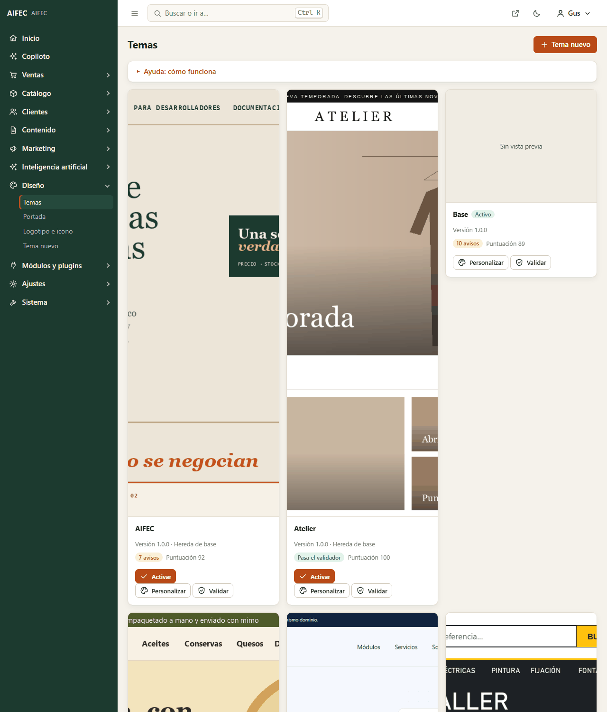

# Tu primer tema hijo

Vas a crear **Escaparate**, un tema hijo de `base` con colores propios, una cabecera con franja de aviso, una tarjeta de producto que avisa de las últimas unidades y una sección de categorías distinta en la portada. Al final lo compruebas, lo pruebas y lo activas. Cada fichero de esta página es el que se ha usado de verdad: pasa `theme:check` con 100 y sus pruebas en verde con PHP 7.4, 8.3 y 8.4.

Antes de empezar: hace falta una instalación de AIFEC en marcha, aunque sea un sitio de pruebas; la guía para montarla es [Instalar AIFEC](../08-operacion/02-instalar.md).

Los ficheros reales llevan la cabecera de autor y licencia del proyecto en un comentario al principio. Aquí se omite para que quepa.

## 1. Crear el tema

```
php aifec theme:create escaparate --name="Escaparate" --parent=base --accent="#1f5f8b"
```

La orden escribe `themes/escaparate/` y lo comprueba:

```
Created themes/escaparate
Validator: OK · score 100
```

Crea cuatro ficheros: `theme.json`, `assets/css/theme.css`, `lang/es.php` y `templates/LEEME.md`. Con `--parent=base` el tema es hijo del tema base.

## 2. Colores y una opción propia

Sustituye el contenido de `theme.json`. Cambia el fondo y el acento y añade un grupo «Notice strip» con tres opciones para la franja de aviso:

```json
{
    "name": "Escaparate",
    "version": "1.0.0",
    "description": "Example child theme of the developer guide: its own colours, a header with a notice strip and a product card that warns about the last units.",
    "parent": "base",
    "settings": {
        "colors": {
            "fields": {
                "bg": {"default": "#f7f9fb"},
                "accent": {"default": "#1f5f8b"},
                "accent_ink": {"default": "#ffffff"}
            }
        },
        "strip": {"label": "Notice strip", "fields": {
            "strip_show": {"type": "toggle", "label": "Show the notice strip", "default": 1},
            "strip_text": {"type": "text", "label": "Notice strip text", "default": ""},
            "strip_bg": {"type": "color", "label": "Notice strip background", "default": "#16405e", "var": "--strip-bg"}
        }}
    }
}
```

Los textos del manifiesto van en inglés y se traducen en el paso 7. Para cambiar un color que ya existe en el padre basta con su `default`. Más sobre las opciones en [Opciones y personalizador](04-opciones-y-personalizador.md).

## 3. Los estilos

`assets/css/theme.css` se carga encima de la hoja del tema base. Escribe solo lo nuevo:

```css
.es-strip {
    background: var(--strip-bg);
    color: #ffffff;
    font-size: 0.875rem;
    text-align: center;
    padding: 0.5rem 1rem;
}

.es-chips {
    display: flex;
    flex-wrap: wrap;
    gap: 0.5rem;
    margin: 0;
    padding: 0;
    list-style: none;
}

.es-card .af-product-card-link {
    display: flex;
    flex-direction: column;
    gap: 0.5rem;
    border: 1px solid var(--line);
    border-radius: var(--radius);
    background: var(--surface);
    overflow: hidden;
}

.es-card .af-product-card-body {
    display: flex;
    flex-direction: column;
    gap: 0.25rem;
    padding: 0 0.75rem 0.75rem;
}

.es-card-alert {
    align-self: flex-start;
    font-size: 0.8125rem;
    font-weight: 600;
    color: var(--warn);
}
```

Los colores salen de variables (`--line`, `--surface`, `--warn`, `--strip-bg`): así el comerciante los cambia desde el personalizador sin tocar la hoja.

## 4. Una cabecera propia

Crea `templates/partials/header.php`. Es la del tema base con una franja de aviso encima:

```php
<?php
$es_strip = (int) theme_option('strip_show', 1) === 1 ? trim((string) theme_option('strip_text', '')) : '';
$es_main = menu('main');
?>
<?php if ($es_strip !== '') : ?>
<div class="es-strip"><?= e($es_strip) ?></div>
<?php endif; ?>
<header class="af-header af-header-classic">
    <div class="af-container af-header-inner">
        <?php if ($es_main !== []) : ?>
            <button type="button" class="af-icon-btn af-show-sm af-header-burger" data-af-drawer-open="af-menu" aria-controls="af-menu" aria-expanded="false" aria-label="<?= e(t('Open the menu')) ?>">
                <svg viewBox="0 0 24 24" width="22" height="22" aria-hidden="true" focusable="false"><path d="M4 6h16M4 12h16M4 18h16"/></svg>
            </button>
        <?php endif; ?>
        <a class="af-logo" href="<?= e(url('/')) ?>"><?= shop_logo() ?></a>
        <?php if ($es_main !== []) : ?>
            <nav class="af-nav af-hide-sm" aria-label="<?= e(t('Main menu')) ?>">
                <?= $this->partial('partials/nav', ['items' => $es_main]) ?>
            </nav>
        <?php endif; ?>
        <?php if (base_theme_can('search')) : ?>
            <form class="af-search af-hide-sm" role="search" action="<?= e(base_theme_link('search')) ?>" method="get">
                <label class="af-sr" for="es-q-header"><?= e(t('Search')) ?></label>
                <input id="es-q-header" class="af-input" type="search" name="q" placeholder="<?= e(t('Search…')) ?>" autocomplete="off">
                <button type="submit" class="af-icon-btn" aria-label="<?= e(t('Search')) ?>">
                    <svg viewBox="0 0 24 24" width="22" height="22" aria-hidden="true" focusable="false"><circle cx="11" cy="11" r="7"/><path d="m20 20-3.5-3.5"/></svg>
                </button>
            </form>
        <?php endif; ?>
        <div class="af-header-actions">
            <?= hook('header.actions') ?>
            <?php if (base_theme_can('account')) : ?>
                <a class="af-icon-btn af-hide-sm" href="<?= e(base_theme_link('account')) ?>" aria-label="<?= e(t('My account')) ?>" data-af-account>
                    <svg viewBox="0 0 24 24" width="22" height="22" aria-hidden="true" focusable="false"><circle cx="12" cy="8" r="4"/><path d="M4 21c0-4 3.5-6 8-6s8 2 8 6"/></svg>
                </a>
            <?php endif; ?>
            <?php if (base_theme_can('cart')) : ?>
                <a class="af-icon-btn af-hide-sm" href="<?= e(base_theme_link('cart')) ?>" data-af-drawer-open="af-cart" aria-controls="af-cart" aria-label="<?= e(t('Cart')) ?>">
                    <svg viewBox="0 0 24 24" width="22" height="22" aria-hidden="true" focusable="false"><path d="M6 7h12l1 13H5L6 7Z"/><path d="M9 10V6a3 3 0 0 1 6 0v4"/></svg>
                    <span class="af-cart-count" data-af-cart-count hidden></span>
                </a>
            <?php endif; ?>
        </div>
    </div>
</header>
```

Tres cosas que conservas del original: el botón del menú (`data-af-drawer-open="af-menu"`), el contador del carrito (`data-af-cart-count`) y el hueco `header.actions`. Sin ellas, el menú del móvil, el contador y los módulos que se enganchan a la cabecera dejan de funcionar. `base_theme_can()` y `base_theme_link()` las define el tema base y están disponibles siempre.

## 5. Una tarjeta de producto propia

Crea `templates/partials/product-card.php`:

```php
<?php
$es_p = isset($product) && is_array($product) ? $product : [];
$es_url = isset($es_p['url']) ? (string) $es_p['url'] : '';
$es_name = isset($es_p['name']) ? (string) $es_p['name'] : '';
$es_image = isset($es_p['image']) && is_array($es_p['image']) ? $es_p['image'] : null;
$es_price = isset($es_p['price']) && is_array($es_p['price']) ? $es_p['price'] : [];
$es_status = isset($es_p['availability']['status']) ? (string) $es_p['availability']['status'] : '';
$es_class = 'af-product-card es-card' . ($es_status === 'out_of_stock' ? ' is-out' : '');
?>
<article class="<?= e($es_class) ?>">
    <a class="af-product-card-link" href="<?= e($es_url) ?>">
        <span class="af-product-card-media">
            <?= image_tag($es_image, 'card', ['class' => 'af-product-card-img', 'alt' => '']) ?>
        </span>
        <span class="af-product-card-body">
            <h3 class="af-product-card-name"><?= e($es_name) ?></h3>
            <?= $this->partial('partials/price', ['price' => $es_price, 'size' => 'sm']) ?>
            <?php if ($es_status === 'low_stock') : ?>
                <span class="es-card-alert"><?= e(t('Last units')) ?></span>
            <?php endif; ?>
        </span>
    </a>
</article>
```

El precio no lo pintas tú: llamas a la pieza `partials/price`, que sabe tachar el precio anterior y enseñar el «IVA incluido». La clase calculada va en una variable y se imprime con `e()`: así el validador no avisa de «variable sin escapar».

## 6. Sustituir una plantilla de un módulo

La portada pinta las categorías con la plantilla `catalog::front/home/categories`. Para cambiarla, crea el fichero con el mismo camino dentro del tema: `templates/modules/catalog/front/home/categories.php`.

```php
<section aria-labelledby="es-categories-title" class="af-section">
    <h2 id="es-categories-title"><?= e((string) $title) ?></h2>
    <ul class="es-chips">
        <?php foreach ($categories as $es_category) : ?>
            <li><a class="af-btn af-btn-ghost" href="<?= e((string) $es_category['url']) ?>"><?= e((string) $es_category['name']) ?></a></li>
        <?php endforeach; ?>
    </ul>
</section>
```

Recibe los mismos datos que la del módulo (`$title` y `$categories`). Más sobre esto en [Plantillas y piezas](03-plantillas-y-piezas.md).

## 7. Traducir

Los textos van en inglés en el código y se traducen en `lang/es.php`. Comprueba qué falta:

```
php aifec i18n:check themes/escaparate
```

Con el catálogo vacío, la orden sale con código 1 y lista lo que falta (8 cadenas la primera vez), por ejemplo:

```
    'Last units' => '',   // themes/escaparate/templates/partials/product-card.php
    'Notice strip' => '',   // themes/escaparate/theme.json
I18N themes/escaparate [es]: 12 strings, 8 missing
```

Rellena `lang/es.php`:

```php
<?php

declare(strict_types=1);

return [
    'Cart' => 'Carrito',
    'Example child theme of the developer guide: its own colours, a header with a notice strip and a product card that warns about the last units.' => 'Tema hijo de ejemplo de la guía del desarrollador: colores propios, una cabecera con franja de aviso y una tarjeta de producto que avisa de las últimas unidades.',
    'Last units' => 'Últimas unidades',
    'Notice strip' => 'Franja de aviso',
    'Notice strip background' => 'Fondo de la franja de aviso',
    'Notice strip text' => 'Texto de la franja de aviso',
    'Open the menu' => 'Abrir el menú',
    'Show the notice strip' => 'Enseñar la franja de aviso',
];
```

La clave es la cadena inglesa tal cual, sin tocarla. Más en [Traducir un tema](07-traducir-un-tema.md).

## 8. Validar

```
php aifec theme:check escaparate
```

Cada línea empieza por `[ OK ]`, `[WARN]` o `[FAIL]`. La última resume:

```
Score 100 · errors 0 · warnings 0
```

Si sale con avisos o fallos, [El contrato de un tema](06-el-contrato-de-un-tema.md) explica cada uno.

## 9. Probar

Las pruebas de un tema van en `themes/escaparate/tests/EscaparateTest.php`. Estas comprueban que pasa el validador, que la franja se pinta escapada, que la tarjeta avisa solo con pocas unidades, que la plantilla de categorías es la del tema y que el color sale como variable:

```php
<?php

declare(strict_types=1);

use Aifec\Kernel\App;

function escaparateSite(string $strip = ''): App
{
    $settings = ['theme.active' => 'escaparate'];
    if ($strip !== '') {
        $settings['theme.options'] = ['escaparate' => ['strip_text' => $strip]];
    }
    $app = testApp(['modules' => ['themes', 'catalog'], 'settings' => $settings]);
    $app->boot();

    return $app;
}

function escaparateCard(string $status): array
{
    return [
        'id' => 7, 'name' => 'Lámpara «Sol & Luna»', 'url' => 'https://tienda.test/producto/lampara', 'image' => null,
        'price' => ['amount' => 4990, 'currency' => 'EUR', 'with_tax' => true, 'compare' => null, 'from' => false],
        'availability' => ['status' => $status, 'label' => ''], 'brand' => '', 'rating' => null, 'badges' => [], 'has_variants' => false,
    ];
}

test('escaparate pasa el validador de temas, también en vivo', function (): void {
    $app = escaparateSite();
    $report = $app->service('themes')->validate('escaparate', true);
    $failed = [];
    foreach ($report['checks'] as $check) {
        if (!$check['ok']) {
            $failed[] = $check['id'] . ': ' . $check['message'];
        }
    }
    same([], $failed);
    same(true, $report['ok']);
    same(100, $report['score']);
});

test('la cabecera pinta la franja de aviso con su texto escapado, y sin texto no pinta nada', function (): void {
    $web = new TestClient(escaparateSite('Envío gratis desde 50 € & devolución fácil'));
    $body = $web->get('/')->body;
    contains('class="es-strip"', $body);
    contains('Envío gratis desde 50 € &amp; devolución fácil', $body);
    notContains('50 € & devolución', $body);

    $empty = (new TestClient(escaparateSite()))->get('/')->body;
    notContains('es-strip"', $empty);
});

test('la tarjeta avisa solo cuando quedan pocas unidades y escapa el nombre', function (): void {
    $app = escaparateSite();
    $low = $app->view()->render('partials/product-card', ['product' => escaparateCard('low_stock')]);
    contains('Últimas unidades', $low);
    contains('Lámpara «Sol &amp; Luna»', $low);
    notContains('Sol & Luna', $low);

    $plenty = $app->view()->render('partials/product-card', ['product' => escaparateCard('in_stock')]);
    notContains('Últimas unidades', $plenty);
    notContains('es-card-alert', $plenty);
});

test('la sección de categorías de la portada la pinta la plantilla del tema, no la del módulo, y escapa los nombres', function (): void {
    $app = escaparateSite();
    $html = $app->view()->render('catalog::front/home/categories', [
        'title' => 'Categorías',
        'categories' => [['name' => 'Sillas & mesas', 'url' => 'https://tienda.test/categoria/sillas', 'image' => null]],
    ]);
    contains('class="es-chips"', $html);
    contains('Sillas &amp; mesas', $html);
    notContains('Sillas & mesas', $html);
    notContains('af-cols-4', $html);
});

test('el color de la franja sale como variable CSS en el head', function (): void {
    $body = (new TestClient(escaparateSite()))->get('/')->body;
    contains('--strip-bg:#16405e', $body);
    contains('--accent:#1f5f8b', $body);
});
```

Lánzalas:

```
php tests/run.php themes/escaparate
```

El resultado:

```
PRUEBAS: 5 OK, 0 FALLAN
```

Los textos de prueba llevan un «&» a propósito: si una plantilla olvida `e()`, la prueba lo ve.

## 10. Activar

Desde el panel: «Diseño» › «Temas», tarjeta de Escaparate, botón «Activar». El panel comprueba el tema antes de activarlo y, si tiene un fallo que bloquea, no lo activa.



Desde la consola no hay una orden `theme:activate`. El tema activo es el ajuste `theme.active`:

```
php aifec setting:set theme.active escaparate
```

Esa vía **no comprueba nada**. Pasa antes `theme:check`. Después, borra las páginas guardadas con `php aifec cache:clear`.

## Si algo no sale

- **`theme:check` avisa «imprime una variable sin escaparla».** Tienes un `<?= $variable ?>` sin `e()`. Calcula el valor en una variable y imprímelo como `<?= e($variable) ?>`.
- **`i18n:check` pide traducir «Cart» o «Open the menu» aunque el tema base ya las traduce.** El comprobador solo mira el catálogo del propio tema y el del núcleo. Repite en tu `lang/es.php` las cadenas que uses en tus plantillas.
- **El panel no deja activar.** Abre «Validar» en la tarjeta del tema: el informe dice qué línea bloquea.
