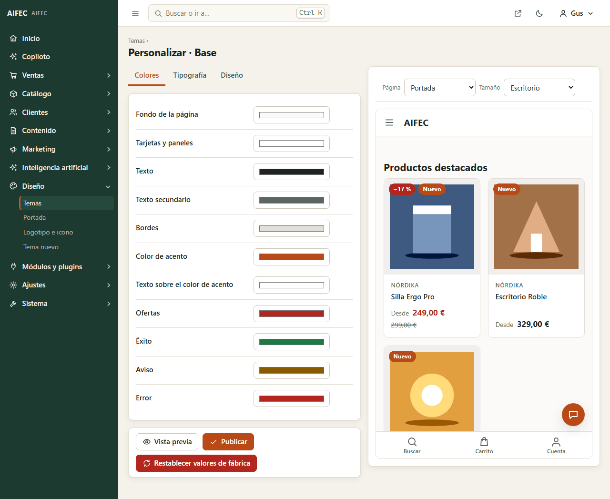

# Opciones y personalizador

Las opciones de un tema son los valores que el comerciante cambia sin tocar código: colores, tipografía, anchos, textos de una franja. Las declaras en `theme.json`; el panel las pinta en un formulario («Personalizar») y tu tema las lee con `theme_option()` o las recibe como variables CSS.

## Declarar una opción

Las opciones viven en `settings`, agrupadas. Cada grupo es una pestaña del personalizador:

```json
"settings": {
    "strip": {"label": "Notice strip", "fields": {
        "strip_show": {"type": "toggle", "label": "Show the notice strip", "default": 1},
        "strip_text": {"type": "text", "label": "Notice strip text", "default": ""},
        "strip_bg": {"type": "color", "label": "Notice strip background", "default": "#16405e", "var": "--strip-bg"}
    }}
}
```

La clave de cada opción usa minúsculas, números y guiones bajos, y empieza por letra. Los textos `label` van en inglés y se traducen en `lang/es.php`.

| Clave del campo | Qué significa |
|---|---|
| `type` | Uno de la tabla de abajo. Si falta, es `text`. |
| `label` | Lo que lee el comerciante. |
| `default` | El valor de fábrica. |
| `var` | Nombre de una variable CSS (`--strip-bg`). Si la pones, el valor sale solo en `:root`. |
| `options` | Para `select` y `font`: `{"valor": "Etiqueta"}`. |
| `min`, `max`, `unit` | Para `number`. `unit` admite `px`, `rem`, `em`, `%`, `vw`, `vh`, `ms` y `s`. |

## Los tipos

| Tipo | Valor válido | Qué devuelve `theme_option()` |
|---|---|---|
| `color` | `#rrggbb` (seis cifras hexadecimales) | El color en minúsculas. |
| `number` | Un número dentro de `min` y `max` | Un entero o decimal. |
| `toggle` | Marcado o no | `1` o `0`. |
| `select` | Una de las claves de `options` | Esa clave, como texto. |
| `font` | Una de las claves de `options`, que son claves de `font_stacks` | Esa clave. Con `var`, la variable lleva la pila de fuentes completa. |
| `image` | El identificador de una imagen de la biblioteca de medios | El identificador. |
| cualquier otro | Texto | El texto, sin espacios en los extremos y de hasta 500 caracteres. |

Un valor que no cumple su tipo (un color de tres cifras, un número fuera de rango, una opción que no existe) se descarta y se usa el de fábrica.

## Leer una opción

En una plantilla:

```php
$es_strip = (int) theme_option('strip_show', 1) === 1 ? trim((string) theme_option('strip_text', '')) : '';
```

El segundo argumento es el valor por defecto si la opción no existe. Un `toggle` llega como `1` o `0`: compáralo con `(int)`.

## Variables CSS

Un campo con `var` se escribe solo en el `<head>`, dentro de `page_head()`:

```css
:root{--accent:#1f5f8b;--strip-bg:#16405e;}
```

Un `number` con `unit` lleva la unidad pegada (`--container:1200px`). Se omite un valor vacío o con alguno de estos caracteres: `; { } < > \`. En tu hoja usa la variable con `var(--strip-bg)`: el validador avisa de una opción con `var` que ninguna hoja de la cadena usa.

Mejor una variable que un color escrito en la hoja: así el comerciante cambia el aspecto desde el panel y el tema sigue siendo coherente.

## Cambiar lo que declara el padre

Un hijo no repite los campos del padre. Para cambiar un valor de fábrica escribe solo su `default`:

```json
"colors": {"fields": {"accent": {"default": "#1f5f8b"}}}
```

Para añadir opciones a un grupo existente, usa el mismo nombre de grupo. Para una pestaña nueva, un grupo nuevo. Las opciones de un `select` o `font` del padre se pueden ampliar escribiendo solo las nuevas en `options`.

## El personalizador

Está en «Diseño» › «Temas», botón «Personalizar» de cada tema. Cada grupo es una pestaña. Al pie hay tres botones:

| Botón | Qué hace |
|---|---|
| «Vista previa» | Enseña la tienda con los valores del formulario, sin guardarlos. Se puede elegir la página (portada, carrito, una categoría, un producto) y el tamaño (escritorio, tableta, móvil). |
| «Publicar» | Guarda los valores. |
| «Restablecer valores de fábrica» | Borra lo que el comerciante cambió en ese tema. |



Los valores se guardan **por sitio y por tema**, en el ajuste `theme.options` (`{"escaparate": {"strip_text": "…"}}`). Un valor igual al de fábrica no se guarda. Cada «Publicar» queda en el registro de actividad.

## Probar las opciones

Las pruebas fijan el ajuste y miran el HTML. Es lo que hace Escaparate ([Tu primer tema hijo](02-tu-primer-tema-hijo.md)):

```php
$settings['theme.options'] = ['escaparate' => ['strip_text' => 'Envío gratis desde 50 € & devolución fácil']];
$app = testApp(['modules' => ['themes', 'catalog'], 'settings' => $settings + ['theme.active' => 'escaparate']]);
```

## Si algo no sale

- **El validador avisa «La opción «strip_bg» declara --strip-bg, pero ninguna hoja de estilos la usa».** Escribe `var(--strip-bg)` en alguna regla de `assets/css/theme.css`, o quita `var` del campo.
- **Mi opción no sale en el personalizador.** La clave tiene mayúsculas o guiones, o el campo no está dentro de `fields` de un grupo.
- **Cambio un color en el panel y la tienda no cambia.** El color solo cambia si tu hoja usa la variable. Y las páginas se guardan en caché: «Publicar» las renueva, pero un cambio hecho en `theme.json` necesita `php aifec cache:clear`.
