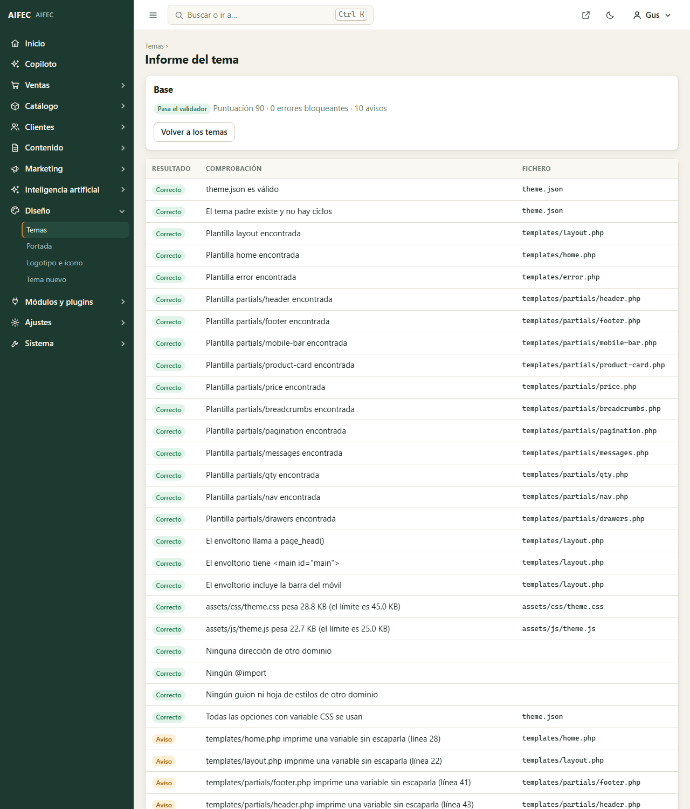

# El contrato de un tema

Un tema no puede romper lo que AIFEC garantiza: una portada que carga rápido, un `<head>` con canónica, una tienda que no llama a dominios ajenos, textos traducidos. El **validador de temas** comprueba lo que puede medir sin navegador. Esta página dice qué comprueba, cómo se lee su informe y qué reglas del contrato quedan para ti.

## Cómo se pasa

```
php aifec theme:check escaparate
```

También con el botón «Validar» de la tarjeta del tema en «Diseño» › «Temas», que abre el informe. La orden sale con código 1 si hay algún fallo que bloquea, así que sirve en un guion.



El informe de la consola es una línea por comprobación:

```
[ OK ] css-size (assets/css/theme.css) assets/css/theme.css pesa 39.9 KB (el límite es 45.0 KB)
[WARN] escaping (templates/partials/product-card.php) templates/partials/product-card.php imprime una variable sin escaparla (línea 19)
[FAIL] imports (assets/css/theme.css) assets/css/theme.css usa @import
Score 80 · errors 5 · warnings 2
```

- `[ OK ]` la comprobación pasa.
- `[WARN]` es un aviso: no impide activar el tema, pero resta nota.
- `[FAIL]` es un fallo que **bloquea la activación** desde el panel.
- Entre paréntesis, el fichero. Al final, el resumen.

La nota va de 0 a 100 y es el porcentaje de comprobaciones superadas; las de nivel fallo pesan el triple que los avisos. Un tema válido es el que no tiene ningún `[FAIL]`.

## Qué comprueba

Primero las comprobaciones estáticas (solo leen ficheros) y, si no hay ningún fallo, las «en vivo» (piden páginas al propio sitio).

| Comprobación | Nivel | Qué mira |
|---|---|---|
| `manifest` | fallo | `theme.json` existe, es JSON válido y tiene `name`. |
| `parent` | fallo | El tema padre existe, no hay ciclos y la cadena no pasa de seis. |
| `template:…` | fallo | Existen las 14 plantillas obligatorias, propias o heredadas. |
| `wrapper-head` | fallo | El envoltorio llama a `page_head()`. |
| `wrapper-main` | fallo | El envoltorio tiene `<main id="main">`. |
| `wrapper-mobile-bar` | fallo | El envoltorio incluye `partials/mobile-bar`. |
| `css-size`, `js-size` | fallo | `assets/css/theme.css` ≤ 45 KB y `assets/js/theme.js` ≤ 25 KB, sin comprimir. |
| `external-urls` | fallo | Ninguna dirección `http(s)://` de otro dominio en plantillas, hojas, guiones o SVG. Solo se tolera `www.w3.org`. |
| `imports` | fallo | Ningún `@import`. |
| `external-tags` | fallo | Ningún `<script>` ni `<link>` que cargue de otro dominio. |
| `option-vars` | aviso | Cada opción propia con `var` se usa en alguna hoja. |
| `escaping` | aviso | Ningún `<?= $variable` sin pasar por una función de escape. |
| `gallery` | fallo | Si sustituyes la ficha de producto, `af-product-gallery` va antes de `af-product-buy`. |
| `i18n` | fallo | Todas las cadenas del tema están en `lang/es.php`. |
| `contrast:…` | aviso | Contraste AA (4,5:1) de los colores de fábrica: texto sobre fondo, acento sobre fondo, texto sobre acento y precio anterior sobre fondo. |
| `live-home` | fallo | La portada responde 200 con este tema. |
| `live-error` | fallo | Una página que no existe responde 404 y dentro de `<main id="main">`. |
| `live-head` | fallo | El `<head>` de la portada lleva la canónica y la etiqueta robots. |
| `live-links` | fallo | La portada no tiene ningún `<a href="">`. |

Las comprobaciones en vivo usan los valores de fábrica del tema, sin caché. Si el `functions.php` de la cadena declara funciones sin `if (!function_exists(…))`, no se pueden cargar dos veces y las «en vivo» se saltan con un aviso `live-skipped`. Protege tus funciones como hace el tema base.

## Un informe con fallos de verdad

Este tema rompe las reglas a propósito (un `@import` de una fuente externa, una ficha con la compra antes que la galería, un texto sin traducir, un color de texto casi igual al fondo):

```
[FAIL] external-urls (assets/css/theme.css) assets/css/theme.css apunta a una dirección de otro dominio
[FAIL] imports (assets/css/theme.css) assets/css/theme.css usa @import
[WARN] escaping (templates/modules/catalog/front/product.php) … imprime una variable sin escaparla (línea 13)
[FAIL] gallery (templates/modules/catalog/front/product.php) La plantilla de producto tiene que poner la galería (af-product-gallery) antes del bloque de compra (af-product-buy)
[FAIL] i18n (templates/modules/catalog/front/product.php) Falta la traducción en lang/es.php: «Buy it now»
[WARN] contrast:text (theme.json) Texto sobre el fondo de la página: contraste 1.61:1, y AA pide 4,5:1
Score 80 · errors 5 · warnings 2
```

Con cinco fallos, el panel no activa el tema y las comprobaciones en vivo ni se ejecutan.

El tema base entrega con 10 avisos `escaping` y nota 90: la comprobación es una búsqueda de texto y avisa de cualquier `<?= $variable`, aunque esa variable ya esté escapada. En tu tema evita imprimir una variable directamente: guárdala escapada o pásala por `e()`.

## Lo que el validador no mide y tú debes cumplir

El contrato de un tema pide más de lo que comprueba la orden. Estas reglas se revisan abriendo la tienda en escritorio y en móvil:

**Móvil**

- Cabecera fija o pegajosa arriba y barra de acciones fija abajo, con accesos reales a Buscar y Carrito (con su contador) y Cuenta. Filtros solo donde hay filtros que funcionan.
- La barra no tapa nada: el contenido reserva su alto y respeta `env(safe-area-inset-bottom)`.
- Áreas táctiles de 44 × 44 píxeles como mínimo y foco visible.
- Cero desbordamiento horizontal entre 360 y 430 píxeles. Las tablas, dentro de un contenedor con desplazamiento.
- En escritorio, la galería de la ficha a la izquierda y la compra a la derecha. Siempre.

**Peso y recursos**

- Fuentes del sistema o `woff2` propias con `font-display: swap`. Nada de bibliotecas ni de iconos como fuente: los iconos, SVG en línea.
- Toda imagen con `width` y `height`. `theme.js` con `defer`.

**Accesibilidad**

- Un solo `<h1>` por página, `<main id="main">` y enlace «Saltar al contenido».
- Contraste AA también en el precio anterior tachado y en las insignias. El validador solo mide los colores de fábrica.
- `prefers-reduced-motion` respetado.

**Nada personal en el HTML**: las páginas se guardan en caché y se sirven a todo el mundo.

Para los estilos, usa las clases `af-*` del tema base (`af-container`, `af-grid`, `af-btn`, `af-product-card`, `af-price`…): las plantillas de los módulos solo usan esas clases, y un tema que no les da estilo las deja sin formato. El tema base las define todas; un hijo las hereda.

## Si algo no sale

- **`css-size` falla.** Quita reglas, o aprovecha la hoja del padre en vez de copiarla: un hijo que no usa `"css": "replace"` solo escribe lo que cambia.
- **`external-urls` falla y no tengo dominios.** La búsqueda mira cualquier `https://` en tus ficheros, también en comentarios y en un SVG con enlaces. Quita la dirección o déjala sin esquema.
- **`live-home` falla.** La portada da error con tu tema: un fallo de PHP en una plantilla. Activa la depuración o mira el registro («Sistema» › «Registro»).
- **`i18n` falla.** Ver [Traducir un tema](07-traducir-un-tema.md).
