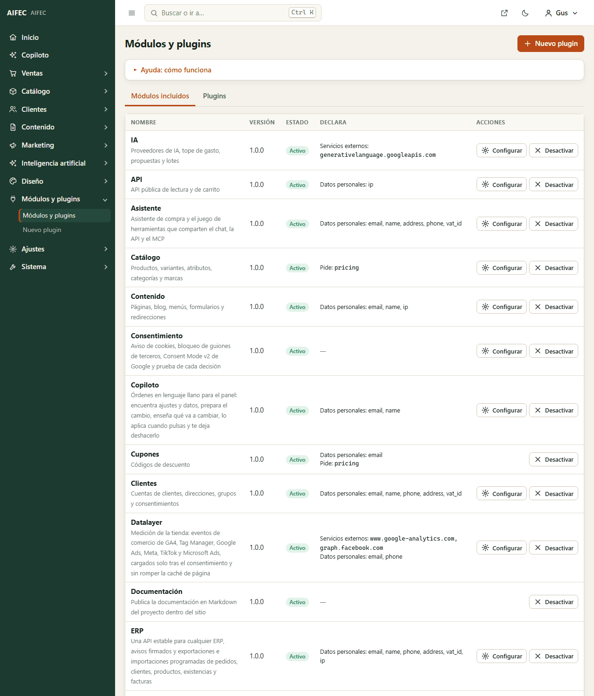
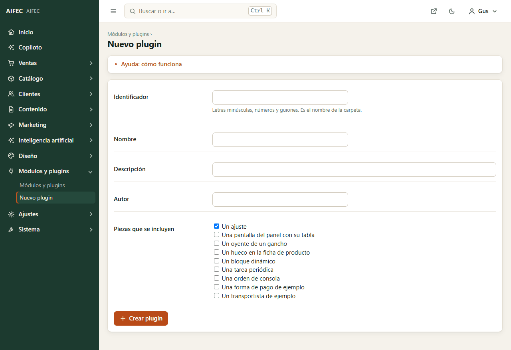

# Cómo funciona un plugin

Un plugin es una ampliación de AIFEC que se instala, se activa, se configura y se quita sin tocar el núcleo. Tiene la misma forma y usa la misma API que un módulo incluido: la diferencia es que un plugin declara su propio espacio de nombres y pasa el **Contrato AIFEC** antes de poder activarse. Esta página explica las carpetas, cada campo de `plugin.json` y el ciclo de vida.

## Las carpetas

Un plugin vive en `plugins/<id>/`. El `<id>` usa minúsculas, números y guiones, de 2 a 40 caracteres, y es el nombre de la carpeta. Todos los ficheros menos `plugin.json` son opcionales; el sistema los recoge por convenio.

```
plugins/consejos-producto/
  plugin.json          manifiesto: identidad, requisitos y declaración del contrato
  hooks.php            ganchos, huecos y servicios:  return function (App $app): void { … };
  routes.php           rutas:                        return function (Router $r, App $app): void { … };
  settings.php         ajustes con pestañas:         return ['title' => …, 'tabs' => […]];
  admin.php            permisos, menú y recursos:    return ['caps' => …, 'menu' => …, 'resources' => …];
  jobs.php             trabajos y tareas:            return ['handlers' => …, 'cron' => …];
  cli.php              órdenes de consola:           return ['orden' => ['help' => …, 'run' => fn];
  blocks.php           bloques de contenido dinámicos
  emails.php           plantillas de correo
  migrations/          0001_nombre.php: tablas propias
  src/                 clases, en el espacio de nombres del plugin
  views/front/         plantillas de la tienda   →  consejos-producto::front/tip
  views/admin/         plantillas del panel      →  consejos-producto::admin/summary
  lang/es.php          traducciones
  assets/              CSS, JS e imágenes propios
  tests/               pruebas
```

Las clases de `src/` se cargan solas: `Plugins\ConsejosProducto\Tips` es `src/Tips.php`. Sin Composer. Las plantillas se nombran con el id del plugin, dos puntos dobles y la ruta dentro de `views/`, sin `.php`.

## plugin.json

```json
{
    "name": "Product tips",
    "version": "1.0.0",
    "description": "Example plugin of the developer guide…",
    "namespace": "Plugins\\ConsejosProducto",
    "essential": false,
    "default": false,
    "requires": {
        "php": ">=7.4",
        "aifec": ">=1.0.0",
        "modules": ["catalog"]
    },
    "contract": {
        "hosts": [],
        "personal_data": [],
        "tables": ["consejos_producto_tips"],
        "capabilities": []
    }
}
```

| Campo | Qué es |
|---|---|
| `name` | Obligatorio. El nombre que ve el comerciante. En inglés, se traduce en `lang/es.php`. |
| `version` | Obligatorio. Tres números separados por puntos (`1.0.0`), con sufijo opcional (`1.0.0-beta.1`). |
| `description` | Una frase. También en inglés. |
| `namespace` | Obligatorio si hay carpeta `src/`. Empieza por mayúscula, usa segmentos con `\` y **no puede empezar por `Aifec\`**. Por convención, `Plugins\<Nombre>`. |
| `essential`, `default` | Como en un módulo. En un plugin, déjalos en `false`: viene apagado y se puede quitar. |
| `requires.php` | Versión mínima de PHP. Admite `>=`, `<=`, `>`, `<`, `==`, `!=` y varias separadas por comas. |
| `requires.aifec` | Lo mismo para la versión de AIFEC. |
| `requires.modules` | Los módulos que tienen que estar activos. El plugin no se activa sin ellos, y esos módulos no se pueden apagar mientras el plugin esté activo. |
| `contract.hosts` | Dominios externos a los que llama. Vacío si ninguno. |
| `contract.personal_data` | Datos personales que lee (`email`, `name`, `phone`, `address`, `vat_id`, `ip`…). |
| `contract.tables` | Las tablas que crea, sin el prefijo de la base de datos. |
| `contract.capabilities` | Capacidades que pide (hoy, `pricing`). |

Las cuatro listas de `contract` son obligatorias, aunque estén vacías. Cada una se explica en [El Contrato AIFEC](08-el-contrato-aifec.md).

**Los nombres propios llevan el id del plugin.** Para `consejos-producto`: tablas `consejos_producto_…`, ajustes `consejos_producto.…`, permisos `consejos_producto.…`. Al desinstalar, el sistema borra los ajustes que empiezan por `consejos-producto.` o por `consejos_producto.`. No te llames como un área del sistema (`shop`, `store`, `mail`, `theme`, `modules`, `plugins`, `jobs`, `media`, `seo`, `catalog`, `orders`, `customers`, `tax`, `shipping`, `ai`, `cms`, `settings`…): esos ajustes no se limpian al desinstalar.

## El ciclo de vida

| Paso | Orden de consola | Botón del panel | Qué pasa |
|---|---|---|---|
| Crear | `php aifec plugin:create <id>` | «Módulos y plugins» › «Nuevo plugin» | Genera la carpeta con su manifiesto, su catálogo castellano, una prueba y un LEEME. Queda apagado. |
| Instalar | `php aifec plugin:install <fichero.zip>` | «Subir un plugin» › «Subir ZIP» | Comprueba el ZIP entero y lo deja en `plugins/<id>/`. No lo activa. |
| Activar | `php aifec plugin:enable <id>` | «Activar» | Pasa el validador. Si falla, no se activa. Si pasa, aplica las migraciones y lo apunta en el ajuste `modules.active`. |
| Desactivar | `php aifec plugin:disable <id>` | «Desactivar» | Lo saca de `modules.active`. Los datos se quedan. |
| Validar | `php aifec contract:check <id>` | «Validar» | Pasa el validador y enseña el informe sin activar nada. |
| Desinstalar | `php aifec plugin:uninstall <id> [--keep-data]` | «Desinstalar» | Solo si está apagado. Borra sus tablas declaradas, sus ajustes y su registro de migraciones, y **borra la carpeta `plugins/<id>/`**. Con `--keep-data` conserva las tablas y los ajustes. En el panel, la casilla «Conservar los datos» **viene marcada**: desmárcala para borrar las tablas y los ajustes. |



El generador del panel, «Nuevo plugin», pide el id, el nombre y las piezas que quieres de ejemplo:



Un ejemplo de cada paso, tal como responde la consola:

```
$ php aifec plugin:enable consejos-producto
«consejos-producto» está activo
$ php aifec plugin:disable consejos-producto
«consejos-producto» está apagado
$ php aifec plugin:uninstall consejos-producto
«consejos-producto» se ha desinstalado
```

`plugin:uninstall` borra el código, no solo los datos: si lo estás desarrollando, guarda una copia de la carpeta antes de probarlo.

Un plugin que no pasa el contrato no se activa y la consola dice por qué:

```
$ php aifec plugin:enable mal-ejemplo
ERROR: «mal-ejemplo» no pasa el contrato AIFEC y no se puede activar
  - P1: Llama a la función prohibida shell_exec() (src/Net.php:23)
  - C1: Escribe en la tabla «products», que no es suya (src/Net.php:21)
```

Para ver qué módulos y plugins hay y cuáles están cargados: `php aifec modules`.

## Qué pasa si falla

Un fallo al cargar un plugin no tumba la tienda: se anota en el registro y el plugin queda sin cargar en esa petición. Lo mismo con un oyente de un gancho que lanza una excepción: se anota y los demás siguen. En las pruebas, en cambio, un oyente que lanza hace fallar la prueba; ver [Pruebas](09-pruebas.md).

## Si algo no sale

- **«Necesita que el módulo … esté activo» o «Necesita el módulo …, que no está instalado».** Un módulo de `requires.modules` está apagado o no existe. Actívalo antes.
- **«Han fallado las migraciones de …».** Una migración da un error de SQL. El mensaje lleva el texto del error; revisa `migrations/`.
- **El plugin no aparece en «Módulos y plugins».** Falta `plugins/<id>/plugin.json`. Si el JSON está mal escrito, el listado enseña el plugin aparte con «El manifiesto no es un JSON válido».
- **Cambio un fichero del plugin y no se nota.** Lanza `php aifec cache:clear`, o abre el panel: el arranque de la tienda se guarda en caché y el panel y la consola lo revisan.
