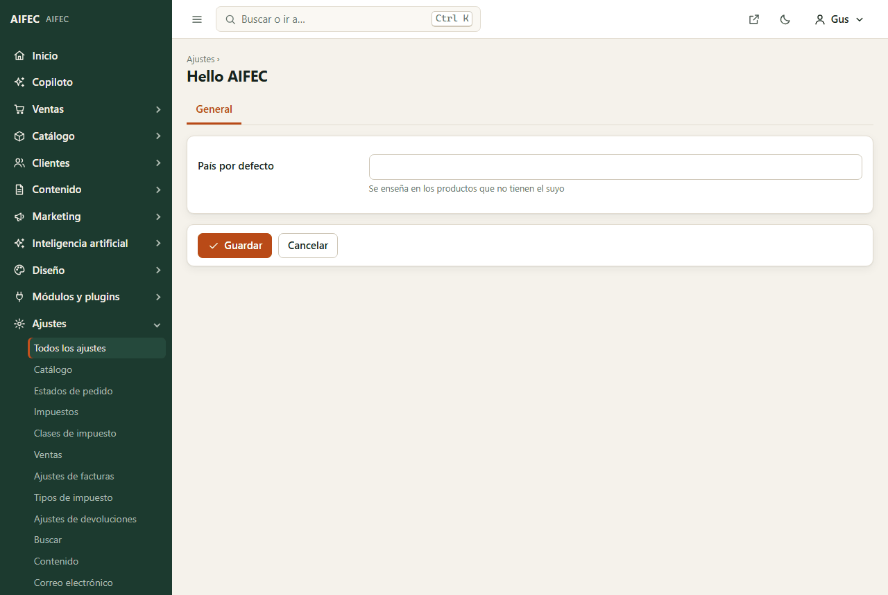

# Tu primer plugin

Vas a escribir **Consejos de producto**: el comerciante escribe un consejo breve por producto («Lava a mano con agua fría») y la ficha lo enseña bajo el resumen. Usa lo básico de un plugin: una tabla propia, un ajuste, una pantalla en el panel, un hueco en la ficha de producto y una prueba. Cada fichero de esta página es el que se ha usado de verdad: pasa el contrato con 100/100 y sus siete pruebas en verde con PHP 7.4, 8.3 y 8.4.

Antes de empezar: hace falta una instalación de AIFEC en marcha, aunque sea un sitio de pruebas; la guía para montarla es [Instalar AIFEC](../08-operacion/02-instalar.md).

Los ficheros reales llevan la cabecera de autor y licencia del proyecto en un comentario al principio. Aquí se omite para que quepa. `php aifec plugin:create` genera un esqueleto, pero conviene escribir los ficheros a mano una vez para saber qué hace cada uno.

## 1. El manifiesto

Crea la carpeta `plugins/consejos-producto/` y dentro `plugin.json`:

```json
{
    "name": "Product tips",
    "version": "1.0.0",
    "description": "Example plugin of the developer guide: a short tip under the summary of each product, with its own table, a setting and a screen in the panel",
    "namespace": "Plugins\\ConsejosProducto",
    "essential": false,
    "default": false,
    "requires": {
        "php": ">=7.4",
        "aifec": ">=1.0.0",
        "modules": ["catalog"]
    },
    "contract": {
        "hosts": [],
        "personal_data": [],
        "tables": ["consejos_producto_tips"],
        "capabilities": []
    }
}
```

Declara que usa una tabla (`tables`), que no llama a ningún dominio (`hosts`), que no lee datos personales (`personal_data`) y que no toca precios (`capabilities`). Cada campo se explica en [Cómo funciona un plugin](01-como-funciona-un-plugin.md).

## 2. La tabla propia

`migrations/0001_tips.php` crea la tabla. Se aplica sola al activar el plugin:

```php
<?php

declare(strict_types=1);

use Aifec\Db\Db;
use Aifec\Db\Schema;
use Aifec\Db\TableDef;

return static function (Schema $schema, Db $db): void {
    $schema->create('consejos_producto_tips', static function (TableDef $t): void {
        $t->id();
        $t->bigInteger('product_id');
        $t->string('body', 300);
        $t->datetime('created_at');
        $t->datetime('updated_at');
        $t->index(['product_id']);
    });
};
```

El nombre de la tabla lleva el id del plugin y va sin prefijo: el sistema pone el de la base de datos. Más sobre migraciones en [Datos y migraciones](05-datos-y-migraciones.md).

## 3. La clase que guarda y lee

`src/Tips.php`. Las consultas llevan siempre sus valores como parámetros (`?`) y las tablas entre llaves:

```php
<?php

declare(strict_types=1);

namespace Plugins\ConsejosProducto;

use Aifec\Kernel\App;

final class Tips
{
    /** @var App */
    private $app;

    public function __construct(App $app)
    {
        $this->app = $app;
    }

    public function enabled(): bool
    {
        return $this->app->settings()->bool('consejos_producto.enabled', true);
    }

    public function title(): string
    {
        $title = trim($this->app->settings()->str('consejos_producto.title', 'Tip'));

        return $title !== '' ? $title : 'Tip';
    }

    public function latest(int $productId): string
    {
        if ($productId < 1) {
            return '';
        }
        $row = $this->app->db()->row('SELECT body FROM {consejos_producto_tips} WHERE product_id = ? ORDER BY id DESC LIMIT 1', [$productId]);

        return $row !== null ? trim((string) $row['body']) : '';
    }

    public function recent(int $limit): array
    {
        return $this->app->db()->select('SELECT id, product_id, body, created_at FROM {consejos_producto_tips} ORDER BY id DESC LIMIT ?', [max(1, $limit)]);
    }

    public function count(): int
    {
        return (int) $this->app->db()->value('SELECT COUNT(*) FROM {consejos_producto_tips}');
    }
}
```

`recent()` la usará la pantalla de resumen que añades en [El panel](04-panel.md).

## 4. Un ajuste

`settings.php` declara el ajuste. El panel pinta un formulario con una pestaña:

```php
<?php

declare(strict_types=1);

return [
    'title' => 'Product tips',
    'cap' => 'settings.edit',
    'tabs' => [
        'cpgeneral' => ['label' => 'General', 'fields' => [
            'consejos_producto.enabled' => ['type' => 'toggle', 'label' => 'Show the tips in the product page', 'default' => true],
            'consejos_producto.title' => ['type' => 'text', 'label' => 'Title of the tip', 'hint' => 'Shown before the text, for example «Tip»', 'default' => 'Tip', 'rules' => 'required|max:40'],
        ]],
    ],
];
```

Las claves de ajuste empiezan por el id del plugin con guion bajo. La clave de la pestaña (`cpgeneral`) lleva las iniciales del plugin: no uses nombres sueltos como `general`, que pueden chocar con otros elementos de la pantalla.

## 5. Un hueco en la ficha

La ficha de producto pinta `product.summary.after` bajo el resumen. `hooks.php` rellena ese hueco:

```php
<?php

declare(strict_types=1);

use Aifec\Kernel\App;
use Plugins\ConsejosProducto\Tips;

return static function (App $app): void {
    $app->hooks()->slot('product.summary.after', static function ($product) use ($app): string {
        $tips = new Tips($app);
        if (!$tips->enabled() || !is_array($product) || !isset($product['id'])) {
            return '';
        }
        $text = $tips->latest((int) $product['id']);

        return $text === '' ? '' : $app->view()->render('consejos-producto::front/tip', ['title' => $tips->title(), 'text' => $text]);
    });
};
```

El oyente comprueba lo que recibe (`is_array`, `isset`) porque un gancho nunca debe romper la página. El HTML sale de una plantilla, `views/front/tip.php`, que escapa todo:

```php
<p class="af-small af-muted consejos-producto-tip"><strong><?= e(t($title)) ?>:</strong> <?= e($text) ?></p>
```

## 6. Una pantalla en el panel

No hace falta controlador: `admin.php` declara un **recurso** y el panel da el listado, el alta, la edición y el borrado:

```php
<?php

declare(strict_types=1);

return [
    'caps' => [
        'consejos_producto.view' => 'See the product tips',
        'consejos_producto.edit' => 'Create and change the product tips',
    ],
    'menu' => [
        ['group' => 'catalog', 'items' => [
            ['label' => 'Product tips', 'resource' => 'consejos_producto_tips', 'cap' => 'consejos_producto.view', 'order' => 60],
        ]],
    ],
    'resources' => [
        'consejos_producto_tips' => [
            'table' => 'consejos_producto_tips', 'title' => 'Product tips', 'singular' => 'Tip', 'label_field' => 'body', 'cap' => 'consejos_producto',
            'tags' => ['catalog'],
            'timestamps' => true,
            'list' => [
                'columns' => [
                    'body' => ['label' => 'Tip', 'link' => true, 'limit' => 80],
                    'product_id' => ['label' => 'Product', 'type' => 'int', 'sort' => true],
                    'created_at' => ['label' => 'Created', 'type' => 'datetime', 'sort' => true, 'hide_sm' => true],
                ],
                'search' => ['body'],
                'sort' => ['id', 'desc'],
            ],
            'form' => ['fields' => [
                'product_id' => ['type' => 'relation', 'resource' => 'products', 'label' => 'Product', 'rules' => 'required'],
                'body' => ['type' => 'textarea', 'label' => 'Tip', 'rules' => 'required|max:300', 'hint' => 'One sentence, up to 300 characters'],
            ]],
        ],
    ],
];
```

Tres detalles: `'cap' => 'consejos_producto'` hace que `consejos_producto.view` sirva para ver y `consejos_producto.edit` para todo lo demás; `'tags' => ['catalog']` renueva las fichas guardadas en caché cuando cambia un consejo; y `'type' => 'relation'` da un selector con búsqueda que apunta al recurso de productos. El menú aparece en «Catálogo» › «Consejos de producto».

## 7. Traducir

Todo texto de definiciones, plantillas y manifiesto va en inglés. Crea `lang/es.php` con las traducciones:

```php
<?php

declare(strict_types=1);

return [
    'Create and change the product tips' => 'Crear y cambiar los consejos de producto',
    'Example plugin of the developer guide: a short tip under the summary of each product, with its own table, a setting and a screen in the panel' => 'Plugin de ejemplo de la guía del desarrollador: un consejo breve bajo el resumen de cada producto, con su tabla propia, un ajuste y una pantalla en el panel',
    'One sentence, up to 300 characters' => 'Una frase, de hasta 300 caracteres',
    'Product' => 'Producto',
    'Product tips' => 'Consejos de producto',
    'See the product tips' => 'Ver los consejos de producto',
    'Show the tips in the product page' => 'Enseñar los consejos en la ficha de producto',
    'Shown before the text, for example «Tip»' => 'Se enseña delante del texto, por ejemplo «Consejo»',
    'Tip' => 'Consejo',
    'Title of the tip' => 'Título del consejo',
];
```

Comprueba que no falta nada:

```
$ php aifec i18n:check plugins/consejos-producto
I18N plugins/consejos-producto [es]: 12 strings, 0 missing
```

Si falta alguna cadena, la orden la escribe lista para copiar y sale con código 1. El contrato también lo exige (regla C8).

## 8. La prueba

`tests/ConsejosProductoTest.php`. Un sitio de pruebas nuevo, con el plugin activo, para cada prueba:

```php
<?php

declare(strict_types=1);

use Aifec\Kernel\App;
use Plugins\ConsejosProducto\Tips;

require_once dirname(__DIR__, 3) . '/modules/catalog/tests/helpers.php';

function consejosSite(array $settings = []): App
{
    $active = ['plugins', 'catalog', 'consejos-producto'];
    $app = testApp(['modules' => $active, 'settings' => $settings + ['modules.active' => $active]]);
    $app->migrate(true);
    $app->boot();

    return $app;
}

function consejosAdd(App $app, int $productId, string $body): int
{
    $now = $app->clock()->sql();

    return $app->db()->insert('consejos_producto_tips', ['product_id' => $productId, 'body' => $body, 'created_at' => $now, 'updated_at' => $now]);
}

test('consejos-producto se activa, se carga y crea su tabla', function (): void {
    $app = consejosSite();
    check($app->modules()->isLoaded('consejos-producto'), 'el plugin está cargado');
    check(!isset($app->modules()->failed()['consejos-producto']), 'no falló al cargar');
    check($app->db()->tableExists('consejos_producto_tips'), 'su migración creó la tabla');
});

test('el hueco de la ficha pinta el consejo más reciente con su título y lo escapa', function (): void {
    $app = consejosSite();
    $id = aifecProduct($app, ['name' => 'Silla']);
    consejosAdd($app, $id, 'Viejo');
    consejosAdd($app, $id, 'Lava con agua & jabón <suave>');
    $html = $app->hooks()->render('product.summary.after', ['id' => $id]);
    contains('<strong>Consejo:</strong> Lava con agua &amp; jabón &lt;suave&gt;', $html);
    notContains('<suave>', $html);
    notContains('Viejo', $html);
    same('', $app->hooks()->render('product.summary.after', ['id' => $id + 99]), 'un producto sin consejo no pinta nada');
    same('', $app->hooks()->render('product.summary.after', ['sin' => 'id']), 'sin id de producto tampoco');
});

test('el ajuste apaga los consejos y el otro cambia el título', function (): void {
    $off = consejosSite(['consejos_producto.enabled' => false]);
    $id = aifecProduct($off, ['name' => 'Mesa']);
    consejosAdd($off, $id, 'No se ve');
    same('', $off->hooks()->render('product.summary.after', ['id' => $id]));

    $app = consejosSite(['consejos_producto.title' => 'Truco']);
    $id = aifecProduct($app, ['name' => 'Cama']);
    consejosAdd($app, $id, 'Voltéala cada mes');
    contains('Truco', $app->hooks()->render('product.summary.after', ['id' => $id]));
});

test('el formulario del panel guarda el consejo en la base de datos y lo valida', function (): void {
    $app = consejosSite();
    $product = aifecProduct($app, ['name' => 'Estantería']);
    $web = adminClient($app);
    $web->get('/admin/r/consejos_producto_tips/new');
    $r = $web->post('/admin/r/consejos_producto_tips/save', ['_token' => aifecToken($web), 'f' => ['product_id' => (string) $product, 'body' => 'Fíjala a la pared & revisa los tornillos']]);
    same(302, $r->status);
    same('Fíjala a la pared & revisa los tornillos', (new Tips($app))->latest($product), 'se guardó tal cual, releído de la base de datos');

    $web->get('/admin/r/consejos_producto_tips/new');
    $bad = $web->post('/admin/r/consejos_producto_tips/save', ['_token' => aifecToken($web), 'f' => ['product_id' => (string) $product, 'body' => '']]);
    same(422, $bad->status, 'sin texto no se guarda: el formulario vuelve con su error');
    same(1, (new Tips($app))->count());
});

test('la pantalla de ajustes abre con su pestaña, guarda en la base de datos y se niega a quien no puede cambiar ajustes', function (): void {
    $app = consejosSite();
    $web = adminClient($app);
    $page = $web->get('/admin/settings/consejos-producto');
    same(200, $page->status);
    contains('cpgeneral', $page->body, 'la clave de la pestaña lleva las iniciales del plugin');
    $r = $web->post('/admin/settings/consejos-producto', ['_token' => aifecToken($web), 'f' => ['consejos_producto.enabled' => '0', 'consejos_producto.title' => 'Truco & más']]);
    same(302, $r->status);
    $settings = $app->settings();
    $settings->reload();
    same(false, $settings->bool('consejos_producto.enabled'));
    same('Truco & más', $settings->str('consejos_producto.title'), 'el texto con «&» se guarda tal cual');
    same(403, adminClient($app, 'support')->get('/admin/settings/consejos-producto')->status);
});

test('consejos-producto se desactiva y el consejo deja de salir', function (): void {
    $app = consejosSite();
    $id = aifecProduct($app, ['name' => 'Banco']);
    consejosAdd($app, $id, 'Aceita las bisagras');
    $r = $app->service('plugins')->disable('consejos-producto');
    same(true, $r['ok'], (string) $r['message']);
    $off = testApp(['modules' => ['plugins', 'catalog', 'consejos-producto'], 'settings' => ['modules.active' => $app->settings()->arr('modules.active')]]);
    $off->boot();
    check(!$off->modules()->isLoaded('consejos-producto'), 'no se carga');
});

test('consejos-producto pasa el contrato AIFEC, también el ciclo entero de instalar y desinstalar', function (): void {
    $app = consejosSite();
    $plugins = $app->service('plugins');
    $plugins->useTempBase(tmpDir());
    $report = $plugins->validate('consejos-producto');
    $errors = [];
    foreach ($report['checks'] as $check) {
        if (!$check['ok']) {
            $errors[] = $check['rule'] . ': ' . $check['message'] . ' ' . $check['file'] . ':' . $check['line'];
        }
    }
    same([], $errors);
    same(true, $report['ok']);
    same(true, $report['dynamic']);
    same(100, $report['score']);
});
```

Lánzalas:

```
$ php tests/run.php plugins/consejos-producto
PRUEBAS: 7 OK, 0 FALLAN
```

La prueba del hueco espera «Consejo» aunque el código devuelva «Tip»: el sitio de pruebas va en castellano y `t($title)` de la plantilla (paso 5) traduce «Tip» con el `lang/es.php` del paso 7. Sin ese fichero, o con otro idioma, la prueba vería «Tip».

Las pruebas escapan, guardan y releen **la base de datos**, no el HTML, y llevan un «&» a propósito. Más en [Pruebas](09-pruebas.md).

## 9. Validar el contrato

```
$ php aifec contract:check consejos-producto
[ OK ] M1 Manifiesto y declaración
[ OK ] P1 Código prohibido
[ OK ] C1 El dinero, solo por los cauces oficiales
[ OK ] C2 Datos del producto declarados y tipados
[ OK ] C3 Salida ligera y cacheable
[ OK ] C4 Todo escapado y por plantillas
[ OK ] C5 Servicios externos y datos personales declarados
[ OK ] C6 IA, correo y tareas por los cauces comunes
[ OK ] C7 Datos estructurados intactos
[ OK ] C8 Textos traducidos
[ OK ] C9 Se desinstala limpio
[ OK ] C10 No tumba la tienda
CONTRACT consejos-producto: score 100/100, 0 errors, 0 warnings — OK
```

## 10. Activarlo y verlo

```
$ php aifec plugin:enable consejos-producto
«consejos-producto» está activo
```

O desde «Módulos y plugins», pestaña «Plugins», botón «Activar». Después:

1. «Catálogo» › «Consejos de producto» › «Nuevo»: elige un producto, escribe el consejo y pulsa «Guardar».
2. Abre la ficha del producto: el consejo aparece bajo el resumen, con el título «Consejo».
3. «Configurar» en la fila del plugin abre sus ajustes: apaga los consejos o cambia el título.



## Si algo no sale

- **`plugin:enable` dice «Necesita que el módulo «catalog» esté activo».** El plugin requiere el catálogo en `requires.modules`. Actívalo antes.
- **El consejo no sale en la ficha.** Tres causas: el ajuste «Enseñar los consejos en la ficha de producto» está apagado, el tema no pinta `product.summary.after` (el tema base sí), o la ficha se sirve de la caché: lanza `php aifec cache:clear`.
- **La prueba da «Call to undefined function aifecProduct».** Falta el `require_once` de `modules/catalog/tests/helpers.php`. El lanzador no carga las ayudas de los módulos solo.
- **El validador dice «Texto sin traducción al castellano».** Falta una cadena en `lang/es.php`. Lanza `i18n:check`.
