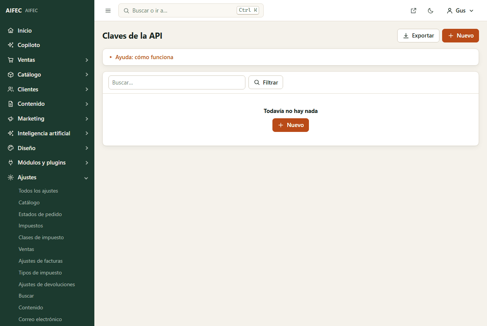

# El panel

Un plugin aporta pantallas al panel de administración con un fichero, `admin.php`: permisos, entradas de menú y **recursos**, que son listados y formularios declarados con un array, sin controlador. Para lo que un recurso no cubre hay pantallas propias, y para la configuración, `settings.php`, un formulario con pestañas. Esta página usa el plugin de [Tu primer plugin](02-tu-primer-plugin.md) y le añade una pantalla de resumen.

## admin.php

```php
return [
    'caps' => ['consejos_producto.view' => 'See the product tips', 'consejos_producto.edit' => 'Create and change the product tips'],
    'menu' => [['group' => 'catalog', 'items' => [
        ['label' => 'Product tips', 'resource' => 'consejos_producto_tips', 'cap' => 'consejos_producto.view', 'order' => 60],
    ]]],
    'resources' => ['consejos_producto_tips' => [ … ]],
    'dashboard' => [],
];
```

### Permisos

Un permiso se llama `área.acción` y se declara en `caps` con su descripción en inglés. Los papeles tienen permisos sueltos, `área.*` (toda un área) o `*` (todo). Los papeles de serie son `admin`, `manager`, `editor`, `support` y `demo`; **solo `admin` tiene `*`**, así que los permisos de tu plugin los verá al principio el administrador. Para darlos a otro papel: «Equipo» › «Papeles».

En el código:

```php
$this->app->auth()->can('consejos_producto.edit');          // true o false
$this->app->auth()->requireCap('consejos_producto.view');   // lanza un 403 si no
```

### El menú

Los grupos de serie son `home`, `sales`, `catalog`, `customers`, `content`, `marketing`, `ai`, `design`, `plugins`, `settings` y `system`. Cada elemento apunta a algo con una de estas claves:

| Clave | Apunta a |
|---|---|
| `resource` | Un recurso del mismo `admin.php`. |
| `url` | Una ruta del panel, que empieza por `/admin/`. |
| `settings` | La pantalla de ajustes de un módulo o plugin. |
| `route` | Una ruta por su nombre. |

`cap` es el permiso que hace falta para ver la entrada y `order` ordena dentro del grupo. Lo que la persona no puede ver, no sale.

### Piezas del inicio

`'dashboard' => [['id' => 'consejos.total', 'cap' => '…', 'size' => 3, 'order' => 40, 'render' => [Clase::class, 'metodo']]]` añade una tarjeta al inicio del panel. `render(App $app): string` devuelve HTML (una `af-card`). `size` es 3, 4, 6, 8, 9 o 12 doceavos.

## Recursos: listado y formulario sin controlador

Un recurso da, con su nombre en la dirección, estas pantallas: listado `/admin/r/<nombre>`, alta `/new`, edición `/<id>`, guardado, borrado, acciones en bloque, exportación a CSV y buscador. Todo pasa por permisos, ficha de formulario, auditoría e invalidación de caché.

| Clave del recurso | Qué hace |
|---|---|
| `table` | La tabla (sin prefijo). Obligatoria. |
| `title`, `singular` | Los títulos, en inglés. |
| `label_field` | La columna que da nombre a una fila. |
| `cap` | `'consejos_producto'` → `.view` para ver, `.edit` para lo demás. Con `caps` se pueden dar otros por acción. |
| `tags` | Etiquetas de caché que se renuevan al cambiar algo. |
| `timestamps` | `true`: rellena `created_at` y `updated_at`. |
| `list` | `columns`, `search`, `filters`, `sort`, `per_page`. |
| `form` | `tabs` y `fields`. |
| `before_save`, `after_save`, `before_delete` | Funciones que cambian los valores, reaccionan o impiden un borrado (devolviendo el motivo). |
| `can_create`, `can_delete`, `readonly`, `bulk`, `side`, `actions`, `help` | Opciones de comportamiento. |

Columnas de un listado: `type` es `text`, `int`, `money`, `bool`, `badge` (con `map`), `date`, `datetime`, `image` o `html`; además `sort`, `link`, `limit`, `hide_sm` y `render`.

Campos de un formulario (`type`): `text`, `email`, `url`, `tel`, `slug`, `password`, `secret`, `number`, `money` (céntimos), `percent`, `textarea`, `code`, `markdown`, `richtext`, `blocks`, `json`, `toggle`, `select`, `radio`, `checks`, `tags`, `date`, `datetime`, `time`, `color`, `hidden`, `image`, `images`, `file`, `relation`, `repeater`, `html`, `heading` y `readonly`. Opciones comunes: `label`, `hint`, `default`, `rules`, `tab`, `options`, `show_if`, `store`.

Las `rules` se separan con `|`: `required`, `nullable`, `int`, `number`, `email`, `url`, `slug`, `min:n`, `max:n`, `between:a,b`, `in:a,b`, `regex:/…/`, `same:campo`, `unique:tabla,columna`, `exists:tabla,columna`…

Los importes se guardan como **céntimos enteros** y las fechas, en UTC. Los textos de un recurso (`title`, `label`, `hint`, `help`) van en inglés y se traducen en `lang/es.php`.

Un formulario con un dato inválido vuelve con su error y el código 422; guardado bien, redirige (302).



## Ajustes con pestañas

`settings.php` es un **único formulario con pestañas** y un solo botón. Al guardar vuelve a la misma pestaña. Se abre en `/admin/settings/<id-del-plugin>`; en la fila del plugin, el botón «Configurar» lleva ahí.

```php
return [
    'title' => 'Product tips',
    'cap' => 'settings.edit',
    'tabs' => [
        'cpgeneral' => ['label' => 'General', 'fields' => [
            'consejos_producto.enabled' => ['type' => 'toggle', 'label' => '…', 'default' => true],
            'consejos_producto.title' => ['type' => 'text', 'label' => '…', 'default' => 'Tip', 'rules' => 'required|max:40'],
        ]],
    ],
];
```

- La clave de la pestaña lleva las iniciales del plugin (`cpgeneral`).
- El valor de fábrica es el `default`. Se lee con `$app->settings()->bool('clave')`, `str`, `int`, `arr` o `get`.
- Un campo `secret` se guarda cifrado y se lee con `$app->secret('clave')`. Nunca lo pongas en un ajuste normal.
- Al guardar se dispara la acción `settings.saved` con el módulo y las claves cambiadas.
- Los ajustes son **por sitio**.

## Una pantalla propia

Cuando un recurso no basta, escribe la pantalla. Añade al plugin la entrada de menú:

```php
['label' => 'Tips summary', 'url' => '/admin/consejos-producto/resumen', 'cap' => 'consejos_producto.view', 'order' => 61],
```

`routes.php` registra la ruta dentro del grupo `admin`, que ya exige sesión del panel y, en los envíos, origen y ficha válidos:

```php
<?php

declare(strict_types=1);

use Aifec\Kernel\App;
use Aifec\Kernel\Router;
use Plugins\ConsejosProducto\TipsController;

return static function (Router $r, App $app): void {
    $r->group(['prefix' => '/admin/consejos-producto', 'middleware' => ['admin']], static function (Router $r): void {
        $r->get('/resumen', [TipsController::class, 'summary'])->name('admin.consejos_producto.summary');
    });
};
```

El controlador, `src/TipsController.php`, comprueba el permiso y pinta con `Admin::page()`:

```php
<?php

declare(strict_types=1);

namespace Plugins\ConsejosProducto;

use Aifec\Admin\Admin;
use Aifec\Kernel\App;
use Aifec\Kernel\Request;
use Aifec\Kernel\Response;

final class TipsController
{
    /** @var App */
    private $app;

    public function __construct(App $app)
    {
        $this->app = $app;
    }

    public function summary(Request $request, array $params): Response
    {
        $this->app->auth()->requireCap('consejos_producto.view');
        $tips = new Tips($this->app);

        return Admin::page($this->app, 'consejos-producto::admin/summary', ['count' => $tips->count(), 'recent' => $tips->recent(5)], [
            'title' => t('Tips summary'),
            'crumbs' => [[t('Product tips'), Admin::resourceUrl($this->app, 'consejos_producto_tips')]],
            'active' => '/admin/consejos-producto/resumen',
        ]);
    }
}
```

La plantilla, `views/admin/summary.php`, solo pinta el contenido: el marco (menú, cabecera) lo pone `Admin::page()`.

```php
<?php

use Aifec\Admin\Admin;

?>
<div class="af-card">
    <div class="af-card-body">
        <p class="af-stat"><span class="af-stat-label"><?= e(t('Tips')) ?></span> <span class="af-stat-value"><?= e($count) ?></span></p>
        <?php if ($recent === []) : ?>
            <p class="af-empty"><?= e(t('There are no tips yet.')) ?></p>
        <?php else : ?>
            <div class="af-table-wrap">
                <table class="af-table">
                    <thead>
                        <tr><th><?= e(t('Tip')) ?></th><th><?= e(t('Product')) ?></th></tr>
                    </thead>
                    <tbody>
                        <?php foreach ($recent as $row) : ?>
                            <tr>
                                <td><a href="<?= e(Admin::resourceUrl(app(), 'consejos_producto_tips', (int) $row['id'])) ?>"><?= e($row['body']) ?></a></td>
                                <td class="af-num"><?= e($row['product_id']) ?></td>
                            </tr>
                        <?php endforeach; ?>
                    </tbody>
                </table>
            </div>
        <?php endif; ?>
    </div>
</div>
```

Añade a `lang/es.php` las tres cadenas nuevas:

```php
    'There are no tips yet.' => 'Todavía no hay consejos.',
    'Tips' => 'Consejos',
    'Tips summary' => 'Resumen de consejos',
```

Y esta prueba al final de `tests/ConsejosProductoTest.php`:

```php
test('la pantalla de resumen la ve quien tiene permiso, escapa los datos y se niega a quien no', function (): void {
    $app = consejosSite();
    $product = aifecProduct($app, ['name' => 'Lámpara']);
    consejosAdd($app, $product, 'Usa bombillas <LED> & ahorra');
    $web = adminClient($app);
    $r = $web->get('/admin/consejos-producto/resumen');
    same(200, $r->status);
    contains('Usa bombillas &lt;LED&gt; &amp; ahorra', $r->body);
    notContains('<LED>', $r->body);
    same(403, adminClient($app, 'support')->get('/admin/consejos-producto/resumen')->status);
});
```

Con esto, el plugin pasa a 8 pruebas y sigue con 100/100 en `contract:check`.

Reglas para una pantalla propia:

- **Todo `<form method="post">` lleva `<?= Admin::tokenField(app()) ?>`.** Las peticiones de JavaScript mandan la cabecera `X-CSRF-Token`, que ya pone `Aifec.post`.
- Dentro de una pantalla se reutilizan `new Form($app, $definicion)` y `new Table($app, $config)`, los mismos que mueven los recursos.
- Un aviso para la pantalla siguiente: `Admin::flash($app, 'ok', t('…'))` y `Response::redirect(…)`. Los tipos son `ok`, `bad`, `warn` e `info`.
- Auditoría de lo que no pasa por un recurso: `Admin::audit($app, 'refund', 'order', (string) $id, 'Resumen', ['campo' => [antes, después]])`.
- Las direcciones, con `$app->url()->plain('/admin/…')`; los datos, con `e()`; los textos, con `t()`.

## Cómo debe verse

- Arriba, avisos de **una frase** y solo los que piden hacer algo. Los botones, siempre a la vista. Las explicaciones largas, plegadas en `<details class="af-help">`.
- Nada de una página interminable: cada apartado en su pestaña o en su pantalla.
- **Tres juegos de medidas y nada más.** El panel se dibuja con 5 colores, 8 espacios y 5 tamaños de letra. Si tu pantalla necesita una regla propia, usa solo estas variables:

  | Qué | Variables | Para qué |
  |---|---|---|
  | Color | `--bg` · `--surface` · `--ink` · `--muted` · `--accent` | fondo de la página · tarjetas y campos · texto · texto secundario y bordes de los campos · acción principal, enlaces, foco y lo que pide atención |
  | Espacio | `--s0` (2 px) · `--s1` (4) · `--s2` (8) · `--s3` (12) · `--s4` (16) · `--s5` (24) · `--s6` (32) · `--s7` (48) | márgenes, rellenos y huecos |
  | Letra | `--f1` (notas, insignias, cabeceras de tabla) · `--f2` (texto) · `--f3` (título de tarjeta) · `--f4` (título de página) · `--f5` (cifras grandes) | tamaños de letra |

  Ni un color escrito a mano (`#fff`, `rgb(…)`), ni un degradado, ni una sombra: el tema oscuro solo cambia el valor de los cinco colores, y una regla con un color fijo se queda ilegible. Las variables de antes (`--line`, `--ok`, `--warn`, `--bad`, `--info`, `--surface-2`, `--accent-soft`…) **ya no existen**: una raya dentro de una tarjeta es `var(--bg)`, el borde de un campo es `var(--muted)` y lo que avisa es `var(--accent)`.
- **Un estado no se distingue solo por el color.** Las insignias cambian de forma: `af-badge-ok` (relleno suave), `af-badge-info` (contorno), `af-badge-warn` (contorno del color de acento) y `af-badge-bad` (relleno pleno). Escribe siempre el estado con palabras.
- **Tableta y móvil.** Hasta 900 px el menú es un cajón y todo lo que se pulsa mide 44 px (lo hacen `af-btn`, `af-input`, `af-tab`… por sí solos: no fijes alturas). Por debajo de 768 px **cada fila de una `af-table` es una tarjeta**: la celda enseña el nombre de su columna, que sale de la cabecera (`<thead>`), así que toda tabla necesita la suya. No hay desplazamiento de lado en ningún ancho: ni la página ni las pestañas.
- **Accesible.** Un botón que solo lleva un icono necesita `aria-label`. No quites el marco de foco (`outline: none`) sin pintar otro. Lo que se mueve, con `transition`: el panel lo apaga solo cuando la persona pide «reducir movimiento».

### Varias pantallas en una entrada del menú

El menú tiene un tope de 60 entradas. Si tu plugin trae varias pantallas hermanas (un listado, sus ajustes, su registro), júntalas en un conjunto: el menú enseña **una** entrada y cada pantalla pinta arriba una barra de pestañas con las demás.

```php
'menu' => [['group' => 'marketing', 'items' => [
    ['label' => 'Tips', 'resource' => 'consejos_producto_tips', 'cap' => 'consejos_producto.view', 'order' => 60, 'tabs' => 'consejos', 'menu_label' => 'Product tips'],
    ['label' => 'Settings', 'settings' => 'consejos_producto', 'cap' => 'consejos_producto.edit', 'order' => 61, 'tabs' => 'consejos'],
]]],
```

`tabs` es el nombre del conjunto; `label`, el de la pestaña (`tab` si quieres otro distinto); `menu_label`, el de la entrada del menú (va en la primera pantalla del conjunto). `'hidden' => true` deja una pantalla fuera del menú, pero el buscador (Ctrl K) la sigue encontrando. Las direcciones y los permisos no cambian.

Piezas de interfaz: `af-card`, `af-grid` con `af-col-3|4|6|8|9|12`, `af-stat`, `af-table`, `af-btn` (`af-btn-primary`, `af-btn-danger`, `af-btn-ghost`, `af-btn-sm`), `af-badge` (`af-badge-ok|warn|bad|info`), `af-alert`, `af-empty`, `af-tabs`, `af-toolbar`. Iconos con `Admin::icon('nombre')`.

El JavaScript del panel funciona **por delegación** con atributos `data-af-*`: `data-af-confirm="texto"` pide confirmación, `data-af-tabs` hace pestañas, `data-af-show-if` enseña un campo según otro, `data-af-copy` copia al portapapeles, `form[data-af-ajax]` envía por `fetch`. Lo que se pinta después (filas nuevas, ventanas) funciona sin conectar nada. Un plugin con JavaScript propio lo carga con `$this->push('admin.foot', '<script src="…" defer></script>')` desde su plantilla.

## Si algo no sale

- **La entrada de menú no sale.** Tu papel no tiene el permiso de `cap`. Solo `admin` los tiene al principio.
- **La pantalla da 404.** La ruta está fuera del grupo `/admin/…` o `routes.php` no devuelve la función. Con la ruta bien, un `php aifec cache:clear` renueva el arranque.
- **Mi formulario dice «El formulario ha caducado».** Falta `Admin::tokenField(app())` dentro del `<form>`, o la sesión del panel ha caducado.
- **Guardo y el campo vuelve vacío.** La clave del campo no coincide con la columna de la tabla, o el campo lleva `'store' => false`.
