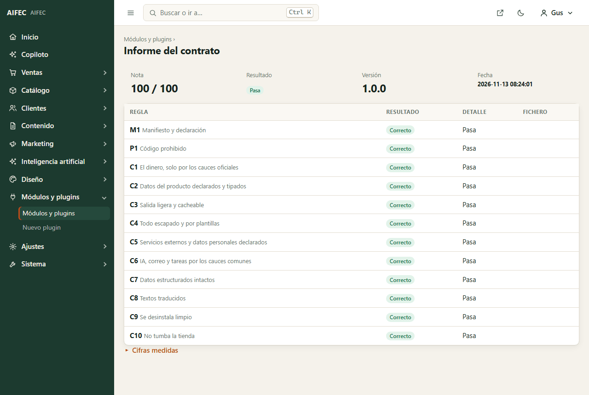

# El Contrato AIFEC

El Contrato AIFEC es la lista de reglas que un plugin cumple para poder activarse: no cambia precios a escondidas, no carga recursos de fuera, no deja basura al desinstalarse, no tumba la tienda. Se comprueba con un validador y el resultado es un informe con cifras. Esta página recorre las reglas una a una, con un ejemplo que las cumple y otro que no, y la línea que saca el validador.

## Cómo se pasa

```
php aifec contract:check consejos-producto
```

También con el botón «Validar» de la fila del plugin en «Módulos y plugins». La orden sale con código 1 si hay algún fallo. **`plugin:enable` y el botón «Activar» pasan el validador antes de activar**: un plugin con un fallo no se activa. El informe de la última pasada queda guardado y se reutiliza mientras no cambien los ficheros del plugin.

Cada línea empieza por `[ OK ]`, `[WARN]` o `[FAIL]`. Un fallo bloquea la activación; un aviso no, pero resta nota. La nota va de 0 a 100: cada regla que pasa suma uno, cada regla con solo avisos suma medio y cada regla con un fallo, nada.

En el panel, la fila de cada plugin enseña su nota («100 / 100») y el botón «Validar» abre el informe:



El informe de un plugin correcto, en la consola:

```
[ OK ] M1 Manifiesto y declaración
[ OK ] P1 Código prohibido
[ OK ] C1 El dinero, solo por los cauces oficiales
[ OK ] C2 Datos del producto declarados y tipados
[ OK ] C3 Salida ligera y cacheable
[ OK ] C4 Todo escapado y por plantillas
[ OK ] C5 Servicios externos y datos personales declarados
[ OK ] C6 IA, correo y tareas por los cauces comunes
[ OK ] C7 Datos estructurados intactos
[ OK ] C8 Textos traducidos
[ OK ] C9 Se desinstala limpio
[ OK ] C10 No tumba la tienda
CONTRACT consejos-producto: score 100/100, 0 errors, 0 warnings — OK
```

## Las dos partes

- **Estática** (M1, P1, C1 a C6, C8 y C9 en parte): lee el código por fichas de PHP, así que una palabra prohibida dentro de un comentario o de una cadena de ayuda no salta.
- **Dinámica** (C1, C3, C7, C9 y C10): ejecuta el plugin en un **sitio de pruebas desechable**, con datos mínimos y sin red; nunca en el tuyo. Mide un carrito de referencia, las páginas de referencia (la portada y, si existen, una ficha, un listado y el carrito) con y sin el plugin, y el ciclo de instalar y desinstalar.

La parte dinámica no se ejecuta si el código ya tiene un fallo de M1 o de P1.

## M1. Manifiesto y declaración

Qué pide: `plugin.json` válido con `name`, `version` (`1.0.0`), el espacio de nombres si hay `src/` (y no `Aifec\`), un id con minúsculas, números y guiones, y la declaración `contract` con sus cuatro listas (`hosts`, `personal_data`, `tables`, `capabilities`), aunque estén vacías. Las tablas declaradas tienen un nombre válido y no son del sistema ni de otro módulo. Una capacidad desconocida da aviso.

Cumple: el manifiesto de [Tu primer plugin](02-tu-primer-plugin.md). No cumple: un `plugin.json` sin la lista `tables`:

```
[FAIL] M1 El contrato tiene que declarar «tables» (una lista vacía si no usa ninguno)
```

## P1. Código prohibido

Qué pide: nada de `eval()`, de comillas invertidas, de `shell_exec`, `exec`, `system`, `passthru`, `proc_open`, `popen`, `create_function` ni `pcntl_exec`, de `assert()` con una cadena, de descodificar base64 y ejecutar el resultado, de un `include` cuya ruta viene de la petición, ni de escribir ficheros fuera de la carpeta de datos del sitio.

```php
shell_exec('ls');
```

```
[FAIL] P1 Llama a la función prohibida shell_exec() (src/Net.php:23)
```

Si necesitas escribir un fichero (`file_put_contents`, `mkdir`, `unlink`, `rename`, `copy`…), hazlo dentro de la carpeta de datos del sitio y prepara la ruta en una variable:

```php
$dir = $app->site()->path('private', true);
$file = $dir . '/prueba.txt';
file_put_contents($file, 'x');
```

El validador lee los argumentos de la llamada: `__DIR__`, `dirname()`, `sys_get_temp_dir()`, una ruta que contiene `..` o que empieza por `/` o por una letra de unidad se toman por una ruta de fuera. Por eso `file_put_contents($app->site()->path('private') . '/x.txt', …)` falla aunque escriba en el sitio: es una limitación de la comprobación. Con la ruta en una variable pasa.

## C1. El dinero, solo por los cauces oficiales

Qué pide: no escribir en tablas del comercio ni del sistema (`products`, `orders`, `customers`…), y no engancharse a un filtro sellado (`product.price`, `product.availability`, `tax.rate`, `shipping.options`, `cart.adjustments`) sin declarar y tener concedida la capacidad `pricing`. Con `pricing`, el total de un carrito de referencia con y sin el plugin solo puede diferir en **líneas de ajuste con nombre** y con importe en céntimos.

```php
$app->hooks()->filter('product.price', static function ($price) { return $price; });
$app->db()->update('products', ['price' => 1], ['id' => 1]);
```

```
[FAIL] C1 Se engancha al gancho sellado «product.price» sin declarar la capacidad «pricing» (hooks.php:16)
[FAIL] C1 Escribe en la tabla «products», que no es suya (src/Net.php:21)
```

Cumple: la tasa de [Ganchos](03-ganchos.md), con la capacidad declarada y una línea de ajuste con nombre. Dinámicamente, un ajuste sin nombre o sin importe, o un carrito que cambia sin línea de ajuste, también es un fallo («El carrito de referencia cambia en … céntimos sin una línea de ajuste con nombre»).

## C2. Datos del producto declarados y tipados

Qué pide: lo que un plugin añade a un producto con `product.extra` lleva su `label`, su `type` y si es `public`. Así aparece en los datos del producto, en el JSON-LD y en la API, o queda marcado como interno.

```php
$extra['garantia'] = ['value' => '2 años'];
```

```
[FAIL] C2 Los datos que se añaden al producto tienen que declarar label, type y public (falta: label, type, public) (hooks.php:19)
```

Cumple:

```php
$extra['made_in'] = ['label' => t('Made in'), 'value' => 'España', 'type' => 'text', 'public' => true];
```

## C3. Salida ligera y cacheable

Qué pide: ningún `<script>` ni `<link>` de otro dominio en las vistas, ningún `@import` ni recurso externo en las hojas, y recursos propios de hasta 60 KB (aviso por encima) y 200 KB (fallo por encima). Dinámicamente, las páginas de referencia no crecen más de un 15 % (y más de 1 KB) ni tardan más de 50 ms de más por culpa del plugin (avisos) y **siguen siendo cacheables** (fallo).

```php
<script src="https://cdn.ejemplo.test/a.js"></script>
```

```
[FAIL] C3 Carga un guion o una hoja de estilo de otro dominio (views/front/x.php:13)
```

Cumple: los recursos propios van en `assets/` y se cargan con `url()->asset('m', '<id>', '<fichero>')`; ver [La tienda](06-tienda.md).

## C4. Todo escapado y por plantillas

Qué pide: ningún `echo`, `print`, `header()`, `exit` o `die` fuera de las vistas, ningún HTML escrito en el PHP, y en las vistas todo valor pasa por `e()` u otra función segura.

```php
echo '<b>' . t('Hello bad') . '</b>';
```

```php
<p><?= $name ?></p>
```

```
[FAIL] C4 Escribe salida directamente fuera de las vistas (hooks.php:25)
[WARN] C4 Imprime un valor que no pasa por e() ni por otra función segura (views/front/x.php:14)
```

Cumple: el HTML sale de una plantilla de `views/` con `<?= e($name) ?>`.

## C5. Servicios externos y datos personales declarados

Qué pide: ninguna conexión propia (`fsockopen`, `stream_socket_client`…) ni lectura de una dirección web con `file_get_contents()`: todo por `$app->http()`. Cada dominio que se nombra está en `contract.hosts`. Si lees clientes, direcciones o pedidos, `contract.personal_data` no está vacío.

```php
$data = file_get_contents('https://api.ejemplo.test/precios');
```

```
[FAIL] C5 Lee una dirección web con file_get_contents(); tiene que usar $app->http() (src/Net.php:20)
[FAIL] C5 Usa el dominio «api.ejemplo.test», que no está declarado en contract.hosts (src/Net.php:20)
```

Cumple, con `"hosts": ["api.ejemplo.test"]` en el manifiesto:

```php
use Aifec\Http\HttpException;
use Aifec\Http\HttpRequest;

try {
    $response = $app->http()->send(HttpRequest::get('https://api.ejemplo.test/precios', [], 5.0));
} catch (HttpException $e) {
    return [];
}
$data = $response->ok() ? $response->json() : null;
```

`send()` lanza `HttpException` si no hay respuesta (DNS, conexión, tiempo agotado); un 4xx o un 5xx **no** lanza: se mira con `ok()`. `json()` da `null` si el cuerpo no es JSON. En las pruebas el cliente es `FakeHttpClient`, que contesta lo que le encoles: así se probó este ejemplo, con 3 pruebas en verde.

## C6. IA, correo y tareas por los cauces comunes

Qué pide: el correo, por el servicio `mailer`; la IA, por el servicio `ai`; nada de `mail()`, de transportes propios, de `set_time_limit(0)` ni de parar la petición. Una tarea no lee todo el histórico de pedidos o clientes sin límite de fecha (aviso).

```php
mail('ana@ejemplo.test', 'Hola', $data);
```

```
[FAIL] C6 Envía correo con mail(); tiene que usar el servicio de correo (src/Net.php:22)
```

Cumple: [Tareas, correo e IA](07-tareas-correo-e-ia.md).

## C7. Datos estructurados intactos

Dinámica. El JSON-LD de la ficha de producto sigue siendo válido y no pierde objetos con el plugin activo. Si un filtro como `page.meta` rompe, la ficha pierde sus datos estructurados:

```
[FAIL] C7 Los datos estructurados (JSON-LD) de la ficha de producto dejan de ser válidos con el plugin
```

## C8. Textos traducidos

Qué pide: todas las cadenas del plugin (código, plantillas y manifiesto) están en `lang/es.php`. Es la comprobación de `php aifec i18n:check plugins/<id>`.

```
[FAIL] C8 Texto sin traducción al castellano: «Hello bad» (hooks.php)
```

Cumple: el catálogo de [Tu primer plugin](02-tu-primer-plugin.md). Con más de 40 textos sin traducir, el informe resume el resto.

## C9. Se desinstala limpio

Estática: toda tabla que crea una migración está en `contract.tables`. Dinámica: instala, desactiva y desinstala sin conservar datos y compara el esquema y los ajustes con los de antes.

```
[FAIL] C9 Crea la tabla «mal_ejemplo_datos» sin declararla en contract.tables (migrations/0001_x.php:17)
```

Otros fallos de esta regla: «Deja la tabla «…» sin borrar al desinstalar», «Cambia las columnas de la tabla «…»», «Deja el ajuste «…» sin borrar al desinstalar», «Borra la tabla «…», que no es suya». Cumple: tablas declaradas y ajustes con el prefijo del plugin; ver [Datos y migraciones](05-datos-y-migraciones.md).

## C10. No tumba la tienda

Dinámica. Con el plugin activo, las páginas de referencia responden 200 y se cargan sin error. Además se ejecutan **con cada oyente del plugin lanzando una excepción**: la tienda tiene que seguir en pie. Un oyente que lanza da un aviso por página, y una página que deja de responder 200, un fallo:

```
[WARN] C10 Un gancho del plugin falla: body.end: RuntimeException: Boom
```

Es el aviso de un plugin cuyo hueco `body.end` lanza una excepción a propósito (el informe lo repite una vez por cada página de referencia). Ese plugin llevaba además un filtro `page.meta` roto, que sacó el `[FAIL] C7` de arriba.

## El informe de un plugin que falla

Un plugin de usar y tirar (`mal-ejemplo`), escrito para romper el contrato a propósito en varios sitios a la vez, saca este informe:

```
[ OK ] M1 Manifiesto y declaración
[FAIL] P1 Llama a la función prohibida shell_exec() (src/Net.php:23)
[FAIL] C1 Se engancha al gancho sellado «product.price» sin declarar la capacidad «pricing» (hooks.php:16)
[FAIL] C1 Escribe en la tabla «products», que no es suya (src/Net.php:21)
[FAIL] C2 Los datos que se añaden al producto tienen que declarar label, type y public (falta: label, type, public) (hooks.php:19)
[FAIL] C3 Carga un guion o una hoja de estilo de otro dominio (views/front/x.php:13)
[FAIL] C4 Escribe salida directamente fuera de las vistas (hooks.php:25)
[WARN] C4 Imprime un valor que no pasa por e() ni por otra función segura (views/front/x.php:14)
[FAIL] C5 Lee una dirección web con file_get_contents(); tiene que usar $app->http() (src/Net.php:20)
[FAIL] C5 Usa el dominio «api.ejemplo.test», que no está declarado en contract.hosts (src/Net.php:20)
[FAIL] C6 Envía correo con mail(); tiene que usar el servicio de correo (src/Net.php:22)
[FAIL] C8 Texto sin traducción al castellano: «Bad example» (plugin.json)
[FAIL] C8 Texto sin traducción al castellano: «Hello bad» (hooks.php)
[FAIL] C8 Texto sin traducción al castellano: «Plugin that breaks the contract on purpose, for the guide» (plugin.json)
[FAIL] C9 Crea la tabla «mal_ejemplo_datos» sin declararla en contract.tables (migrations/0001_x.php:17)
CONTRACT mal-ejemplo: score 10/100, 13 errors, 1 warnings — FAIL
```

Con el P1 en pie, la parte dinámica ni se ejecuta. Se arregla de arriba abajo, volviendo a lanzar `contract:check` hasta que salga limpio.

## Si algo no sale

- **El informe dice «Text without Spanish translation» o «Texto sin traducción al castellano» en `plugin.json`.** El `name` y la `description` también se traducen: añádelos a `lang/es.php`.
- **Falla C9 y mis tablas están declaradas.** Mira el ajuste: una clave que no empieza por el id del plugin con guion bajo o con guion no se borra al desinstalar.
- **El validador tarda.** La parte dinámica arranca un sitio de pruebas y mide páginas con y sin el plugin: son varios segundos.
- **Un aviso de C3 («La página … crece … %»).** Tu hueco añade mucho HTML a una página que se sirve a todos. Hazlo más pequeño o cárgalo bajo demanda.
