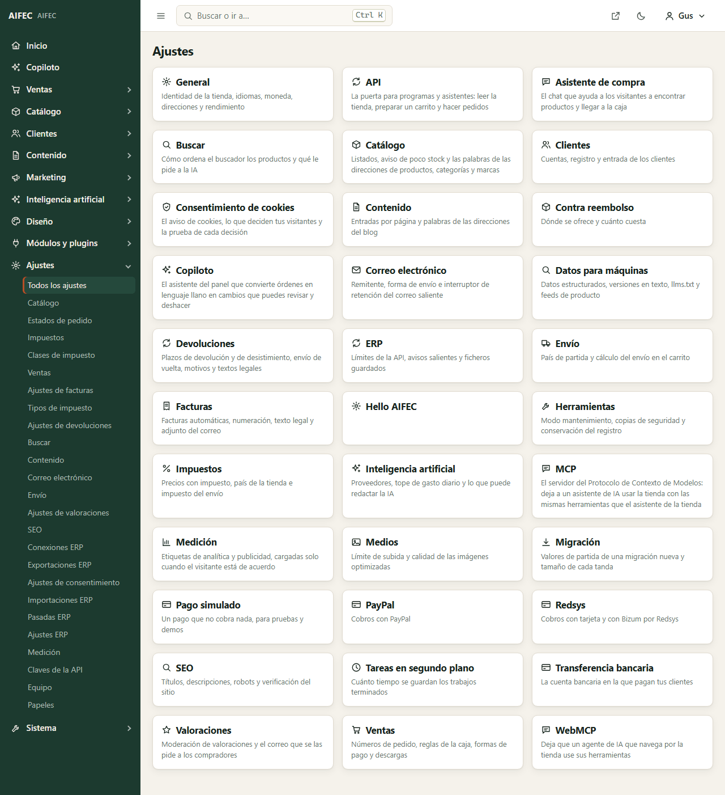

# Ajustes

Los ajustes son los valores que el comerciante (o tú, por consola) cambia sin tocar código: el nombre de la tienda, la moneda, el modo del correo, los minutos que espera un pedido sin pagar. Cada módulo y cada plugin declara los suyos en su `settings.php`. Esta página explica cómo leer la tabla de ajustes, que sale de lo que declaran y no se copia aquí: [Ajustes](_generado/ajustes.md).

## Las columnas

| Columna | Qué dice |
|---|---|
| **Clave** | El nombre del ajuste, en minúsculas con puntos: `store.name`, `mail.mode`, `orders.pending_minutes`. La primera parte es la **zona**: el módulo que manda sobre él. |
| **Módulo** | Quién lo declara (`core` es el núcleo). |
| **Pestaña** | La pestaña de la pantalla de ajustes donde se cambia. |
| **Tipo** | El tipo de campo del formulario: `text`, `number`, `toggle`, `select`, `textarea`, `secret`, `money`, `url`, `email`, `image`… |
| **Por defecto** | El valor de fábrica, como JSON (`"EUR"`, `120`, `true`). Un secreto sale como `(secret)`. |
| **Etiqueta** | El texto del campo, en inglés (se traduce en el panel). |

La tabla no enseña los campos que no guardan nada (`heading`, `html`, `store => false`) ni los ajustes internos sin formulario: el sistema también guarda `modules.active` (qué módulos y plugins están activos), `theme.active`, `theme.options` y `plugins.granted`, que se gestionan desde sus propias pantallas.

## Cómo se leen y se cambian

En código:

```php
$app->settings()->str('store.name', 'AIFEC');          // texto
$app->settings()->int('orders.pending_minutes', 120);  // entero
$app->settings()->bool('mail.system_always');          // sí o no
$app->settings()->arr('modules.active');               // lista
$app->settings()->set('clave', $valor);                // escribir
```

En plantillas, `setting('clave', $defecto)`. El valor es el que haya guardado en la base del sitio o, si no hay ninguno, el valor de fábrica que declara el `settings.php`.

Por consola:

```
php aifec setting:get store.name
php aifec setting:set orders.pending_minutes 240
php aifec setting:set store.name "Mi tienda" --text
```

`setting:set` entiende `true`, `false`, números y JSON; con `--text` guarda el valor como texto tal cual. **Esta vía no comprueba** lo que escribes: el panel sí aplica las reglas del campo.

En el panel: «Ajustes» › «Todos los ajustes» lista los módulos con ajustes; cada uno abre `/admin/settings/<módulo>`.



## Reglas que conviene saber

- **Son por sitio.** Con varios sitios en una instalación, cada uno tiene los suyos.
- **Un secreto no es un ajuste normal.** Un campo `secret` se guarda cifrado con el secreto del sitio, no vuelve nunca a la pantalla y se lee con `$app->secret('clave')`. En la tabla, su valor sale como `(secret)`.
- Al guardar desde el panel o por consola se dispara la acción `settings.saved` con el módulo y las claves cambiadas.
- Al desinstalar un plugin sin conservar los datos, se borran sus ajustes: los que empiezan por su id con punto o con guion bajo.

## Dónde se declaran

`settings.php` de cada módulo o plugin: un formulario con pestañas. Lo explica [El panel](../06-plugins/04-panel.md). La clave de cada pestaña lleva las iniciales del módulo y las claves de ajuste, su zona: `consejos_producto.enabled`.

## Si algo no sale

- **Mi ajuste no está en la tabla.** Falta en `settings.php`, o es un ajuste interno sin formulario. La tabla se regenera con `php aifec docs:reference`.
- **Cambio un ajuste y la tienda no cambia.** Las páginas se guardan en caché: `php aifec cache:clear`. Guardar desde el panel ya renueva lo suyo.
- **`setting:get` enseña un valor distinto del «Por defecto».** Alguien lo cambió en este sitio. Los valores de fábrica son solo el punto de partida.
