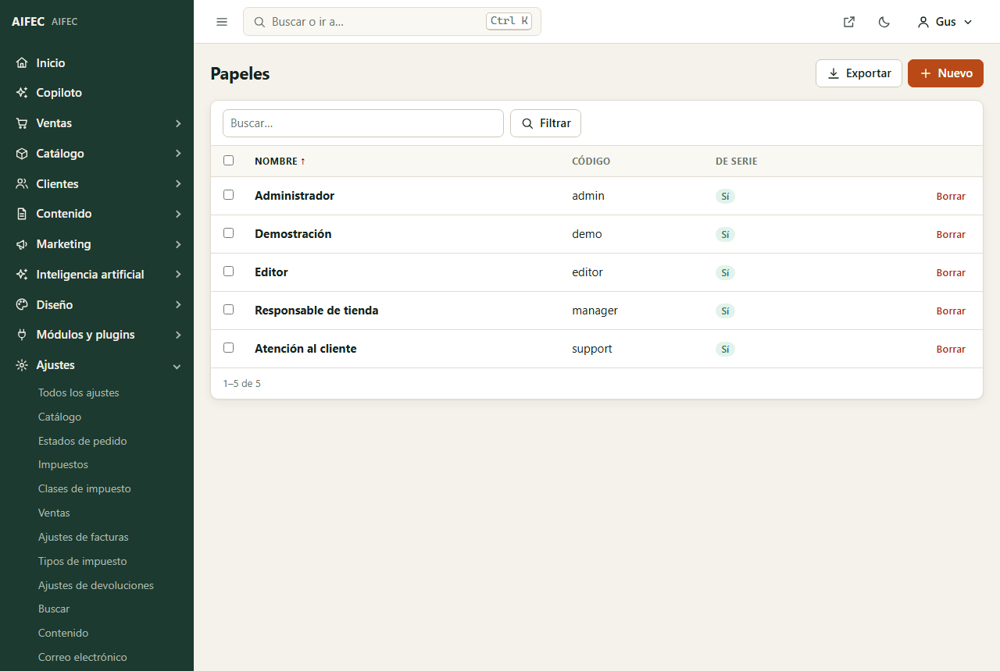

# Permisos

Un permiso decide quién puede ver o hacer algo en el panel. Esta página explica cómo funcionan los permisos y cómo leer la tabla que los lista, que se genera de lo que declaran los módulos y no se copia aquí: [Permisos](_generado/permisos.md).

## Cómo funcionan

- Un permiso se llama **`área.acción`**: `catalog.edit`, `orders.view`, `settings.edit`. Cada módulo declara los suyos en el `caps` de su `admin.php`, con su descripción.
- Una persona del equipo tiene un **papel**, y un papel es una lista de permisos. Puede llevar permisos sueltos (`orders.view`), toda un área (`orders.*`) o todo (`*`).
- Lo que una persona no puede ver, no sale en el menú. Y aunque escriba la dirección a mano, el servidor responde 403.
- En el código: `$app->auth()->can('catalog.edit')` devuelve sí o no, y `$app->auth()->requireCap('catalog.edit')` lanza un 403 si falta.

## Los papeles de serie

| Papel | Qué puede |
|---|---|
| `admin` (Administrador) | Todo (`*`). Es el único que lo tiene. |
| `manager` (Gestor de la tienda) | Todo lo de panel de control, pedidos, clientes, catálogo, cupones, valoraciones, facturas, medios, contenido y SEO; ver búsqueda, envíos, impuestos, asistente y IA; y usar la IA. |
| `editor` (Editor) | Contenido, medios y SEO; ver valoraciones; usar la IA y ver el panel de control. |
| `support` (Soporte) | Ver el panel de control, los pedidos, los clientes, las valoraciones y las facturas, y escribir notas en los pedidos. |
| `demo` | Un papel para sitios de demostración: casi todo de la tienda y de la apariencia, y solo ver los plugins y las herramientas. |

Se gestionan en «Equipo» › «Papeles».



Un papel solo ve lo que se le da: **al añadir un permiso nuevo, solo el administrador lo tiene** hasta que alguien se lo da a otro papel.

## Las columnas de la tabla

| Columna | Qué dice |
|---|---|
| **Permiso** | El nombre: `catalog.view`, `catalog.*`, `*`. |
| **Área** | La parte que va antes del punto. |
| **Dónde se pide** | Una lista de usos. |

En «Dónde se pide», cada línea es una de estas:

| Línea | Significa |
|---|---|
| `declared in <módulo>` | El módulo lo declara en su `caps`. |
| `menu <módulo>` | Una entrada de menú lo exige para verse. |
| `resource <nombre>` | Un recurso (listado y formulario) lo exige. Ver permiso para mirar, editar para cambiar. |
| `settings <módulo>` | La pantalla de ajustes lo exige. |
| `dashboard <módulo>` | Una pieza del inicio del panel lo exige. |
| `role <papel>` | Un papel de serie lo trae concedido. |

Un permiso que sale **sin** `declared in` es un comodín (`catalog.*`) o uno que alguien usa sin declararlo.

## Cómo usarla

**Voy a crear un permiso.** Mira qué áreas existen, para no pisar una. Declara los tuyos con el id de tu plugin como área (`consejos_producto.view`, `consejos_producto.edit`).

**Quiero que un papel vea mi pantalla.** El permiso tiene que estar en el papel: o el permiso suelto, o el comodín de su área (`consejos_producto.*`), desde «Equipo» › «Papeles».

**Una persona dice que no ve una pantalla.** Busca la pantalla en la tabla («Dónde se pide») y mira qué permiso exige. Después mira el papel de esa persona.

## Un permiso para un plugin: el recurso

Con un recurso, un solo permiso base sirve para todo:

```php
'consejos_producto_tips' => [ …, 'cap' => 'consejos_producto', … ],
```

`consejos_producto.view` permite ver el listado; `consejos_producto.edit`, crear, cambiar y borrar. Si quieres otros por acción, se da `'caps' => ['view' => …, 'edit' => …, 'delete' => …]`.

## Si algo no sale

- **Entro como administrador y no veo mi pantalla.** El permiso de `cap` no es el que declaraste (una errata) o la entrada de menú apunta a un recurso que no existe.
- **Un papel ve el menú y la pantalla da 403.** El menú pide `.view` y la pantalla, `.edit`. Dale los dos.
- **Mi permiso no sale en la tabla.** Está en el `admin.php` de un plugin apagado, o la tabla es anterior: `php aifec docs:reference`.
