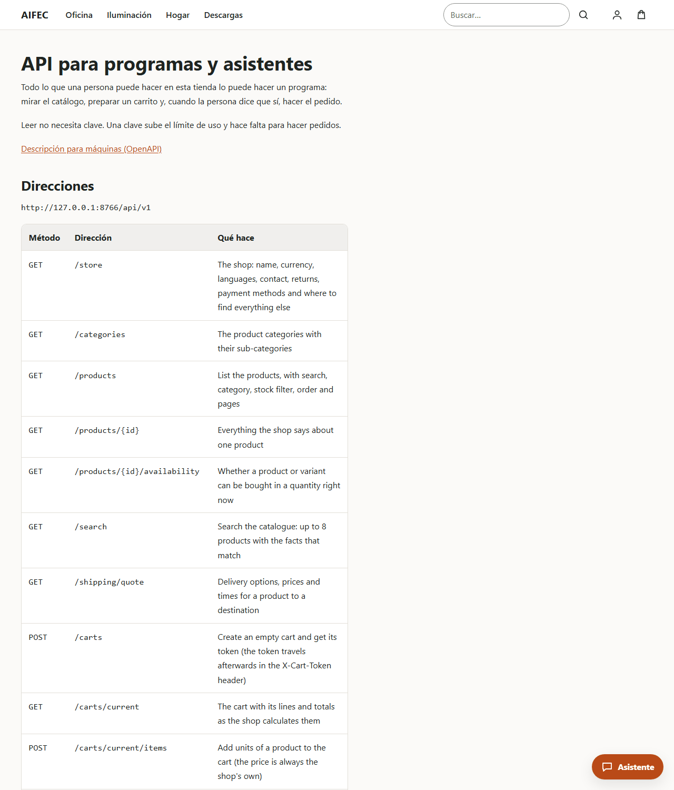

# API

AIFEC tiene dos API de HTTP con JSON. La **API pública** (`/api/v1`) es la puerta para programas y asistentes: leer la tienda, preparar un carrito y, con una clave y la confirmación de una persona, hacer un pedido. La **API de gestión** (`/api/v1/erp`) es la de un ERP: pedidos, productos, existencias, precios, clientes y facturas. Esta página dice cómo se autentican, qué formato tienen, cómo fallan y qué límites aplican, con tres ejemplos de `curl` que se probaron contra un sitio local.



La lista de rutas vive en cada API y no se repite aquí: abre `/api` (y `/api/openapi.json`) en la tienda, o `/api/v1/erp/` (y `/api/v1/erp/openapi.json`) en la de gestión. Salen de la misma tabla que registra las rutas, así que lo documentado y lo que existe no pueden diferir.

## La API pública

### Autenticación

- **Leer la tienda y preparar un carrito no necesita clave.**
- Una **clave** sube el límite de uso: `Authorization: Bearer aifec_api_…`.
- Cualquier programa puede hacer un pedido si la persona lo confirma: al revisar, la tienda manda al comprador un código por correo, y el pedido solo se hace con ese código. Una clave que tenga el ámbito `orders:create` no necesita el código. Lo decide el ajuste «Pedidos hechos por agentes de IA» (API → Pedidos).
- Las claves se crean en «Claves de la API» del panel. La clave en claro se enseña **una sola vez**; del sistema solo guarda su resumen SHA-256. Si se pierde, se crea otra.
- Con una clave mala, 401. La API pide la clave en la cabecera `Authorization`.

### Formato

Una respuesta correcta lleva siempre `data` y, a veces, `meta`:

```json
{"data": {"name": "AIFEC", "currency": "EUR", "…": "…"}}
```

Los importes salen en **céntimos** y, junto a ellos, ya formateados: `"price": 8900` y `"price_formatted": "89,00 €"`.

Un error lleva siempre esta forma y el código HTTP que corresponde:

```json
{"error": {"status": 404, "message": "Product not found"}}
```

| Código | Cuándo |
|---|---|
| 400 | Falta un parámetro obligatorio o es inválido. |
| 401 | La clave no vale. |
| 403 | En las rutas del carrito, el origen de la petición no es el de la tienda ni uno de los permitidos. |
| 404 | No existe, o la API está apagada. |
| 429 | Se pasó el límite de uso. |
| 500 | Un imprevisto, sin detalles. |

### Límites y caché

- Sin clave, **120 peticiones por minuto y dirección**. Con clave, **600 por minuto y clave**. Cero en el ajuste significa sin límite. Se cambian en «Ajustes» › «Todos los ajustes» › «API», pestaña de límites (`api.rate_per_minute`, `api.rate_per_minute_key`).
- Las rutas de lectura del catálogo llevan `Cache-Control: public, max-age=60` y `Access-Control-Allow-Origin: *`.
- Las rutas del carrito solo se aceptan desde el origen de la propia tienda o desde los orígenes que el comerciante liste en «Orígenes que pueden usar el carrito desde un navegador» (ajuste `api.cors_origins`).
- Un pedido hecho por programa tiene sus propios topes: `api.max_order_cents` (importe máximo, 0 = sin tope) y `api.max_orders_per_hour` (por clave y hora, 10 por defecto).
- El código del comprador también: `api.codes_per_email_hour` es cuántas veces por hora se manda a la misma dirección de correo (5 por defecto, entre 1 y 60). Súbelo solo en una tienda de pruebas en la que todas las compras usen el mismo buzón; en una tienda de verdad, el tope es lo que impide usar tu tienda para llenar de correo a alguien.

### Las rutas

| Método | Ruta | Qué hace |
|---|---|---|
| GET | `/api/v1/store` | La tienda: nombre, moneda, idiomas, contacto, devoluciones, formas de pago y dónde está todo lo demás. |
| GET | `/api/v1/categories` | Las categorías con sus subcategorías. |
| GET | `/api/v1/products` | Lista de productos: `q`, `category`, `page`, `per_page` (1 a 48; el tope va en `meta.per_page_max`), `sort`, `in_stock`. |
| GET | `/api/v1/products/{id}` | Todo lo que la tienda dice de un producto. |
| GET | `/api/v1/products/{id}/availability` | Si un producto o variante se puede comprar en una cantidad ahora mismo. |
| GET | `/api/v1/search` | Busca en el catálogo (hasta 8 productos con lo que coincide): `q` (obligatorio), `limit`, `category`, `max_price_cents`, `in_stock`. |
| GET | `/api/v1/shipping/quote` | Opciones, precios y plazos de envío de un producto a un destino. |
| POST | `/api/v1/carts` | Crea un carrito vacío y da su token. |
| GET | `/api/v1/carts/current` | El carrito con sus líneas y totales. |
| POST | `/api/v1/carts/current/items` | Añade un producto al carrito. |
| PATCH / DELETE | `/api/v1/carts/current/items/{clave}` | Cambia la cantidad de una línea (0 la quita) o la borra. |
| GET | `/api/v1/carts/current/checkout-link` | La dirección que abre ese carrito en el navegador de la persona. |
| POST | `/api/v1/carts/checkout/…` | Los pasos de la compra: `status`, `customer`, `shipping-options`, `shipping`, `payment-options`, `payment`, `review` y `place`. |

El carrito se identifica con la cabecera `X-Cart-Token`, que da `POST /api/v1/carts`. **El precio es siempre el de la tienda**: un programa no puede fijar un precio. Hacer el pedido (`place`) exige el `confirm_token` que devuelve `review`, `buyer_confirmed: true` y una de dos cosas: `buyer_code`, el código de seis cifras que la tienda manda por correo al comprador al revisar, o una clave con el ámbito `orders:create`. `review` lo dice en `confirmation` y en `next`: «la tienda ha enviado un código de verificación al comprador; pídeselo y espera». El código vale 15 minutos y solo para ese pedido con ese total. Si en API → Pedidos enciendes «Enviar el código también por WhatsApp» y eliges el sistema (una pasarela de texto como mensajero, con su dirección y su clave, o WhatsApp Business de Meta por 360dialog, con su clave y una plantilla aprobada), el código llega además por WhatsApp al teléfono del comprador; `confirmation.channels` dice por dónde ha salido. **El WhatsApp sale de tu número hacia el teléfono que escribe el comprador**: en una tienda de pruebas rellena «Enviar WhatsApp solo a estos teléfonos» con el tuyo, o un teléfono de relleno hará que el código le llegue a un desconocido. El cliente paga por su cuenta y nada se cobra sin él. Cuando la forma de pago cobra en una pasarela (Redsys, Bizum, PayPal), la respuesta de `place` trae en `payment.pay_url` una dirección de la tienda, `/pedido/{número}/{ficha}/pay`: el asistente se la da a la persona tal cual y, al abrirla, la tienda la lleva a la pasarela. Vale mientras el pedido siga sin pagar, las veces que haga falta, y la página del pedido enseña el mismo enlace como «Pagar este pedido ahora».

### Comprar con enlaces

Muchos asistentes de chat no pueden enviar formularios: solo abren direcciones. Para ellos, cada paso de la compra es también una dirección que se abre con `GET`, y cada respuesta trae escritas las direcciones del paso siguiente. Se enciende y se apaga en API → «Dejar que compren con enlaces los asistentes que solo leen páginas».

| Dirección | Para qué |
|---|---|
| `/buy-with-links` | La guía: qué es y por dónde se empieza. Hay otra entrada igual en `/api/v1/go`. El `llms.txt` la enlaza lo primero. |
| `/buy-with-links/add?product_id=…&qty=1` | Crea el carrito y añade el producto. **Esta dirección va escrita, entera, en la versión en texto de cada ficha (`/producto/….md`, «Comprar con un asistente») y junto a cada producto de los listados en texto (`/categoria/….md`)**: el asistente la abre tal cual, sin montar nada. Con variantes hay una por variante. Un producto agotado no la lleva. |
| `/buy-with-links/add?product_id=…&qty=1&text=…` | Lo mismo y, además, guarda los datos que la persona ha escrito en `text` (nombre, dirección, teléfono y correo, en cualquier orden). |
| `/carrito/retomar/{carrito}` | Para la persona, no para el asistente: abre ese mismo carrito, ya lleno, en la caja de la tienda. La da la respuesta de `add` como segunda salida. |
| `/buy-with-links/status/{carrito}` | Lo que falta por rellenar; si la persona ya terminó en la caja, el número de su pedido. |
| `/buy-with-links/shipping-options/{carrito}`, `…/shipping/{carrito}/{envío}` | Las opciones de envío y la elegida. |
| `/buy-with-links/payment-options/{carrito}`, `…/payment/{carrito}/{forma}` | Las formas de pago y la elegida. |
| `/buy-with-links/review/{carrito}` | El pedido exacto con su total. Aquí la tienda manda el código al comprador. |
| `/buy-with-links/place/{carrito}/{ficha}/{código}` | Hace el pedido. Sin el código de la persona no hace nada. |
| `/buy-with-links/code/{carrito}/{ficha}` | El código tecleado con enlaces, dígito a dígito: cada página trae diez direcciones (de 0 a 9) y las del sexto dígito ya son las del pedido. Las páginas son pequeñas a propósito: un asistente cuyo lector recorta lo que lee las ve enteras. La revisión le pide al asistente que escriba esta dirección en su respuesta, porque algunos la pierden de un turno al siguiente. |

Por defecto cada paso contesta una página de texto; con `Accept: application/json` o `?format=json`, lo mismo en JSON. Las direcciones no llevan `&`, porque hay asistentes que solo abren una dirección si es idéntica, letra a letra, a la que han leído. El paso `code` es para los que tampoco pueden completar una dirección por su cuenta (cambiar `CODE` por el código): lo teclean abriendo seis direcciones que ya vienen escritas, una por dígito. Abrir dos veces la misma dirección no hace daño: añadir no dobla la cantidad y un carrito que ya es pedido contesta ese pedido.

**Tres salidas después de añadir, según lo que pueda el asistente.** El lector de páginas de casi todas las IA de chat solo abre direcciones que ha leído escritas (en un mensaje de la persona o en una página): no puede montar una con el nombre y la dirección del comprador, que son texto libre. Por eso la respuesta de `add` le da tres salidas y le dice que use la primera que pueda:

1. Si puede abrir direcciones que monta él, pide los datos a la persona y abre `customer` con ellos en `text`; después elige envío y pago, revisa y hace el pedido con el código que la tienda manda al comprador.
2. Si no puede, pide igualmente los datos y **escribe en su respuesta** la dirección de `customer` con ellos, como un enlace: él no puede abrirla, la persona sí. Al abrirla, la tienda guarda los datos y le dice a la persona, en el idioma de la tienda, que ya está y que vuelva a su asistente. El asistente abre entonces `status` y sigue con el envío, el pago, la revisión y el código, todo con direcciones que le da la tienda.
3. Si la persona lo prefiere, o el asistente no puede con ninguna de las dos, le da la dirección `/carrito/retomar/{carrito}`: la persona ve el carrito que le ha preparado el asistente en la caja de la tienda, escribe sus datos y paga. Cuando vuelve al chat, el asistente abre `status` y le dice su número de pedido.

En ningún caso el asistente tiene que decirle a la persona que no puede comprar: la tercera salida funciona siempre.

**La ficha normal también lo dice.** Quien pega en su chat el enlace del producto que está mirando le da a su asistente la página HTML, no la versión en texto. Por eso la ficha lleva, a la vista y bajo el resumen, el enlace «Comprar con un asistente de IA» con la misma dirección de `add` (con variantes, el de la versión en texto, que trae una dirección por variante). Si lo pulsa una persona, la página le dice dónde tiene su carrito.

Las páginas de texto de la compra con enlaces y las versiones `.md` de la tienda se sirven como `text/plain`: hay lectores (el de Gemini) que no abren `text/markdown` aunque el servidor conteste 200. Como `text/markdown` solo se sirve la dirección normal de una página a quien lo pide en su cabecera `Accept`.

### Tres ejemplos con curl

Los tres se ejecutaron contra un sitio local de pruebas. Cambia `TIENDA` por la dirección de tu tienda:

```
TIENDA=http://127.0.0.1:8766
```

**1. La tienda.** Qué es, en qué moneda vende y dónde está todo lo demás:

```
curl -s "$TIENDA/api/v1/store"
```

```json
{"data":{"name":"AIFEC","contact":{"email":"tienda@ejemplo.test","phone":""},"account_url":"http://127.0.0.1:8766/mi-cuenta/pedidos","hours":"","returns":"Puedes devolver un producto en 30 días.","returns_days":30,"returns_url":"http://127.0.0.1:8766/desistimiento","returns_payer":"El envío de vuelta lo paga el cliente.","payment_methods":["Contra reembolso","Pago de prueba"],"currency":"EUR","languages":["es"],"default_language":"es","links":{"home":"http://127.0.0.1:8766/","cart":"http://127.0.0.1:8766/carrito","checkout":"http://127.0.0.1:8766/finalizar-compra","openapi":"http://127.0.0.1:8766/api/openapi.json","docs":"http://127.0.0.1:8766/api","mcp":"http://127.0.0.1:8766/mcp","llms":"http://127.0.0.1:8766/llms.txt"}}}
```

`contact` es un objeto con lo que la tienda ha rellenado (correo, teléfono…) y `account_url` lleva a «Mi cuenta». Los campos `returns_days`, `returns_url` y `returns_payer` salen cuando el módulo de devoluciones está encendido; `returns_payer` dice quién paga el envío de vuelta o que la tienda no lo ha dicho. Los campos que la tienda no tiene (`mcp`, `llms`) salen a `null`.

**2. Buscar.** Un producto de silla, en stock, con lo que coincide:

```
curl -s "$TIENDA/api/v1/search?q=silla&limit=1&in_stock=true"
```

```json
{"data":[{"id":2,"name":"Silla Básica Home","price":8900,"price_formatted":"89,00 €","currency":"EUR","availability":{"status":"in_stock","label":"En stock"},"brand":"Nórdika","has_variants":false,"available":true,"matches":["Material: Malla transpirable","Peso máximo: 100 kg","Garantía: 24 meses"],"answer_kind":"exact","…":"…"}],"meta":{"query":"silla","total":3,"answer_kind":"exact"}}
```

La respuesta real lleva más campos (`url`, `image`, `summary`…); aquí se acorta.

**3. Preparar un carrito.** Se crea, se añaden dos unidades y se pide la dirección que lo abre en el navegador:

```
TOKEN=$(curl -s -X POST "$TIENDA/api/v1/carts" | sed 's/.*"token":"\([a-f0-9]*\)".*/\1/')

curl -s -X POST "$TIENDA/api/v1/carts/current/items" \
  -H "X-Cart-Token: $TOKEN" -H "Content-Type: application/json" \
  -d '{"product_id":2,"qty":2}'

curl -s "$TIENDA/api/v1/carts/current/checkout-link" -H "X-Cart-Token: $TOKEN"
```

```json
{"data":{"ok":true,"key":"p2-v0-d75171","name":"Silla Básica Home","cart":{"count":2,"total":18790,"total_formatted":"187,90 €","items_total":17800}}}
{"data":{"url":"http://127.0.0.1:8766/carrito/retomar/<token>","checkout_url":"http://127.0.0.1:8766/finalizar-compra","cart":{"count":2,"total":18790,"total_formatted":"187,90 €","items_total":17800}}}
```

El total de 187,90 € suma 178,00 € de producto y 9,90 € de envío: lo calcula la tienda. La persona abre `url` y llega a su carrito para pagar.

Un error de uso se ve igual de claro:

```
curl -s -i "$TIENDA/api/v1/search"
HTTP/1.1 400 Bad Request
{"error":{"status":400,"message":"The parameter q is required: what the customer is looking for"}}
```

## La API de gestión (ERP)

La aporta el módulo `erp`, que viene **apagado**. Se enciende en «Módulos y plugins», y sus conexiones, exportaciones y webhooks se gestionan en «Conexiones ERP», «Exportaciones ERP», «Importaciones ERP» y «Pasadas ERP».

### Autenticación y ámbitos

**Toda ruta lleva clave.** La clave es la de una **conexión** activa (empieza por `aifec_erp_`) y se manda como `Authorization: Bearer …` o como `X-Api-Key: …`. Cada clave tiene **ámbitos**, que se dan por separado: escribir no implica leer.

| Ámbito | Qué permite |
|---|---|
| `erp:orders`, `erp:orders:write` | Leer pedidos; confirmar su recepción, cambiar su estado y añadir el seguimiento. |
| `erp:products`, `erp:products:write` | Leer productos; crearlos o actualizarlos por SKU y cambiar precios. Nunca borra. |
| `erp:stock`, `erp:stock:write` | Leer y cambiar las existencias (hasta 500 SKU por llamada). |
| `erp:customers`, `erp:customers:write` | Leer clientes; crearlos o actualizarlos por correo. Nunca cambia una contraseña. |
| `erp:invoices` | Leer facturas, abonos y el PDF de cada una. |

Sin clave responde 401; con una clave sin el ámbito de la ruta, 403. Quien prueba claves a ciegas se corta pronto: 30 fallos por minuto y dirección.

```
curl -s -i "$TIENDA/api/v1/erp/orders"
HTTP/1.1 401 Unauthorized
{"error":{"status":401,"code":"missing_key","message":"Send the key of a connection as Authorization: Bearer <key>","field":null}}
```

### Formato, errores y límites

- **Paginación por cursor**: `GET` de listas con `cursor` (el `next_cursor` de la página anterior) y `limit` (de 1 a 200; 50 por defecto).
- **Errores** con una forma más rica: `{"error":{"status","code","message","field"}}`. `code` es un identificador estable (`missing_key`, `invalid_key`, `insufficient_scope`, `too_many_failures`…) y `field` dice qué campo falló.
- **Límite de uso**: 300 peticiones por minuto y clave de fábrica (`erp.rate_per_minute`, de 10 a 6000), con las cabeceras `RateLimit-*` y 429 al pasarse.
- **Idempotencia**: una escritura con la cabecera `Idempotency-Key` no se hace dos veces. Si repites la petición con la misma clave, recibes lo mismo. La clave admite hasta 120 caracteres.
- **Cuerpo**: JSON; un cuerpo roto da 400.

### Las rutas

Todas bajo `/api/v1/erp`:

| Método | Ruta | Ámbito |
|---|---|---|
| GET | `/orders`, `/orders/{número}` | `erp:orders` |
| POST | `/orders/{número}/ack`, `/status`, `/tracking` | `erp:orders:write` |
| GET | `/products`, `/products/{sku}` | `erp:products` |
| PUT | `/products/{sku}` | `erp:products:write` |
| POST | `/prices` | `erp:products:write` |
| GET | `/stock` | `erp:stock` |
| POST | `/stock` | `erp:stock:write` |
| GET | `/customers`, `/customers/{id}` | `erp:customers` |
| PUT | `/customers` | `erp:customers:write` |
| GET | `/invoices`, `/invoices/{número}`, `/invoices/{número}/pdf` | `erp:invoices` |
| GET | `/` y `/openapi.json` | pública |

La ayuda de `/api/v1/erp/` trae un ejemplo de `curl` por cada operación. Aquí no se probaron las rutas con clave porque no hay una conexión de pruebas en el sitio local.

## Si algo no sale

- **Todo da 404.** La API está apagada (`api.enabled`), o es la de gestión y el módulo `erp` está apagado.
- **429.** Se superó el límite. La respuesta dice cuántos segundos esperar («Too many requests: wait N seconds») y trae la cabecera `Retry-After`. Con una clave el límite es mayor.
- **El carrito responde 403 desde mi página web.** El origen de tu web no está en la lista de orígenes permitidos. Añádelo en los ajustes de la API.
- **`place` rechaza el pedido.** Hace falta el `confirm_token` de `review`, `buyer_confirmed: true` y el `buyer_code` que recibió el comprador (o una clave con `orders:create`). Un código mal escrito o caducado da 403; tras cinco fallos ese pedido se bloquea una hora. Si el ajuste «Pedidos hechos por agentes de IA» (API → Pedidos) está en «No», ningún programa hace pedidos; en «Solo con clave», hace falta la clave. Y el importe no debe pasar el máximo de ajustes.
