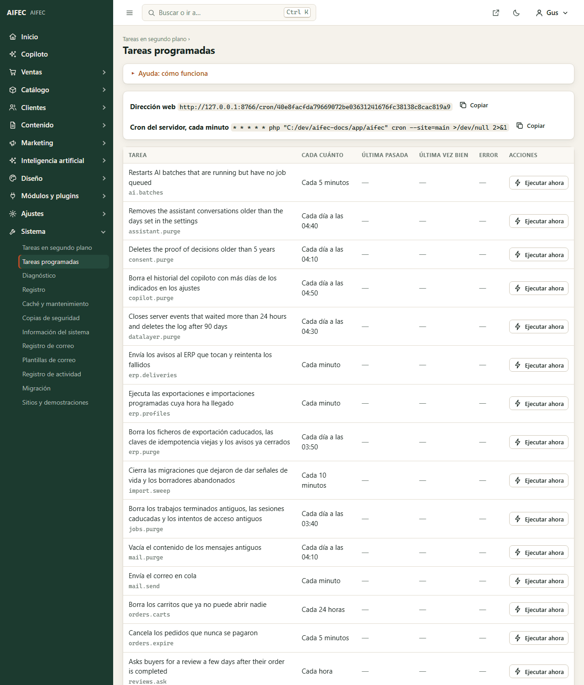

# Tareas programadas

AIFEC hace trabajo en segundo plano: enviar el correo en cola, cancelar los pedidos que nadie pagó, hacer la copia nocturna, limpiar sesiones viejas. Para que ocurra, algo tiene que llamar al sistema cada minuto. Esta página explica las tres formas de hacerlo y cómo saber si funciona.

## Qué hay que programar

Una sola cosa: la orden `cron`, cada minuto. Ella decide qué tareas tocan en ese momento y después trabaja la cola de trabajos pendientes. Una salida real:

```
$ php aifec cron --site=main
cron: ran 17, failed 0, skipped 0 · jobs: done 1, failed 0, retried 0, reclaimed 0
```

«ran» son las tareas que tocaban y se ejecutaron, «skipped» las que todavía no tocaban, «failed» las que dieron error. Una tarea que falla no detiene a las demás.

Algunas tareas de serie y su horario (las horas son **las del sitio**, según su zona horaria):

| Tarea | Cuándo | Qué hace |
|---|---|---|
| `mail.send` | cada minuto | Envía el correo en cola |
| `orders.expire` | cada 5 minutos | Cancela los pedidos que nunca se pagaron |
| `reviews.ask` | cada hora | Pide la valoración a quien compró hace unos días |
| `tools.backup` | cada día a las 03:10 | Copia nocturna de la base de datos |
| `tools.logs` | cada día a las 03:25 | Borra los ficheros del registro demasiado antiguos |
| `jobs.purge` | cada día a las 03:40 | Borra trabajos terminados, sesiones caducadas e intentos de acceso viejos |
| `sites.reset_demos` | cada día a las 04:30 | Restablece las demostraciones (si el módulo de sitios está activo) |

La lista completa y la última vez que corrió cada una están en «Sistema» → «Tareas programadas».



## Forma 1: el cron del servidor (la recomendada)

1. Abre «Sistema» → «Tareas programadas». El recuadro «Cron del servidor, cada minuto» ya trae la línea con la ruta de tu instalación. Pulsa «Copiar».
2. Añádela a la tabla de cron del usuario que ejecuta PHP (`crontab -e`):

```
* * * * * php "/var/aifec/aifec" cron --site=main >/dev/null 2>&1
```

Con varios sitios, el cron lleva una línea por sitio, o un bucle que recorra `php aifec sites`:

```
for s in $(php aifec sites | tail -n +3 | awk '{print $1}'); do php aifec cron --site=$s; done
```

Probado con dos sitios (uno de ellos una demostración): cada uno dio su línea `cron: ran …`.

En un panel de alojamiento, crea la tarea con su opción de «cron» y usa la misma versión de PHP que sirve la web (`php8.3`, por ejemplo).

## Forma 2: una dirección web (alojamiento sin cron)

Si el alojamiento no deja programar nada en el servidor, un servicio externo de cron puede llamar cada minuto a una dirección:

1. En «Tareas programadas», copia la «Dirección web» (tiene la forma `https://tu-tienda/cron/<clave>`).
2. Programa en el servicio de cron externo una petición GET a esa dirección cada minuto.

Cómo responde, comprobado:

- Con la clave buena: `200` y `{"ok":true,"cron":{"ran":[],"failed":[],"skipped":18},"work":{…}}`.
- Una segunda llamada antes de 20 segundos: `200` y `{"skipped":true}`. No se ejecuta dos veces seguidas.
- Con una clave mala: `404`.

La clave da permiso para lanzar las tareas: trátala como una contraseña y no la publiques.

## Forma 3: el panel abierto

Mientras alguien tiene el panel abierto en una pestaña visible, la página llama a `/admin/jobs/tick` cada minuto. Es un apoyo, no un sustituto: si nadie entra, no corre nada.

## Cómo saber si corre

- **Pantalla**: «Sistema» → «Tareas programadas», columnas «Última vez» y «Última vez bien».
- **Inicio del panel**: si hace más de 15 minutos que no corre, sale el aviso «Las tareas en segundo plano no se están ejecutando» con el botón «Ver cómo ponerlas en marcha».
- **Diagnóstico**: la comprobación «Las tareas programadas se están ejecutando» da aviso (naranja) a los 15 minutos y problema (rojo) a las 2 horas, o si nunca han corrido.
- **Consola**: `php aifec jobs:status`.

```
$ php aifec jobs:status
jobs: pending 0, running 0, done 1, failed 0 · last cron: 2026-11-13 07:21:16 UTC
```

## Ejecutar o reintentar a mano

- `php aifec jobs:run mail.send`: ejecuta una tarea ahora. En pantalla, el botón «Ejecutar ahora».
- `php aifec jobs:retry <id>`: un trabajo fallido vuelve a pendiente. En pantalla, «Reintentar» en la ficha del trabajo.
- `php aifec jobs:work --seconds=20`: solo la cola, sin las tareas periódicas.

Un trabajo que falla se intenta de nuevo hasta tres veces antes de darse por fallido. Uno que lleva más de 10 minutos «en curso» se da por colgado y vuelve a la cola.

## Si algo no sale

- **«No se han ejecutado nunca. Añade esto al cron del servidor: …»** (Diagnóstico). No hay cron o no llega a ejecutar `php`. Prueba la línea a mano en la consola del servidor.
- **El cron corre pero no pasa nada.** Si el comando lleva `>/dev/null 2>&1` no verás el error. Quita esa parte unos minutos y redirige a un fichero.
- **El cron usa otra versión de PHP.** Ejecuta `php -v` con el mismo usuario y la misma ruta que usa el cron.
- **La dirección web contesta 404.** La clave no es la actual. Copia otra vez la «Dirección web» de la pantalla «Tareas programadas».
