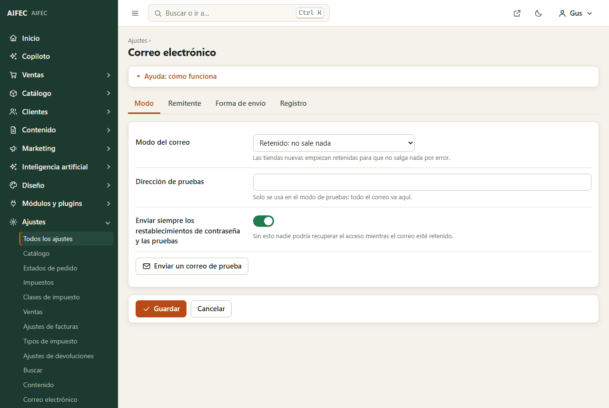

# Correo

Una tienda nueva no envía ningún correo. Esa es la primera sorpresa de quien instala AIFEC y es a propósito: todo el correo que la tienda crea se guarda en el registro y no sale hasta que tú lo permitas. Esta página explica cómo configurar el envío y cómo soltar el correo retenido.



## Los tres modos

Se eligen en «Ajustes» → «Correo electrónico» → pestaña «Modo», campo «Modo del correo».

| Modo | Qué pasa |
|---|---|
| «Retenido: no sale nada» | Es el de una tienda nueva. Todo el correo se guarda con el estado «Retenido» y no sale. |
| «Activo: enviarlo todo» | El correo se envía en cuanto se crea. |
| «Pruebas: enviarlo todo a una dirección» | Todo se envía a la «Dirección de pruebas», con el destinatario real escrito en el asunto. |

La casilla «Enviar siempre los restablecimientos de contraseña y las pruebas» está encendida de serie: esos correos salen aunque el modo sea retenido, porque sin ellos nadie podría recuperar su acceso. «Diagnóstico» avisa en naranja mientras el modo sea «Retenido».

## Configurar el envío

En la pestaña «Forma de envío», campo «Método»:

1. **«Servidor SMTP»** (lo recomendable en producción). Rellena «Servidor SMTP», «Puerto SMTP», «Cifrado» («STARTTLS (normalmente el puerto 587)» o «SSL/TLS (normalmente el puerto 465)»), «Usuario SMTP» y «Contraseña SMTP». La contraseña se guarda cifrada.
2. **«La función de correo del servidor»**: usa `mail()` de PHP. Es el valor de serie, pero depende de que el servidor tenga un sistema de correo configurado. En una máquina sin él, la prueba falla con «The mail() function could not hand the message over» (se vio en la máquina de pruebas de esta guía).
3. **«Guardar en ficheros (no se envía nada)»**: guarda cada mensaje como fichero `.eml` en `<datos>/<sitio>/mail/`. Sirve en local y en demostraciones.

En la pestaña «Remitente» se fijan «Correo del remitente», «Nombre del remitente» y «Responder a». Si «Correo del remitente» queda vacío se usa el correo de contacto de la tienda. En «Registro» se elige cuántos días se conserva el contenido de cada correo (90 de serie); después el contenido se vacía y la línea del registro se queda.

## Probar

1. Pulsa «Enviar un correo de prueba» en la pestaña «Modo», o usa la consola:

```
$ php aifec mail:test destino@cliente.test
Test email sent to destino@cliente.test
```

2. Mira «Sistema» → «Registro de correo». La fila debe salir como «Enviado». Con el método «Guardar en ficheros», la orden anterior dejó un fichero `20261113-072422-5657c8da.eml`.
3. `php aifec mail:status` cuenta los mensajes por estado:

```
STATUS   MESSAGES
-------  --------
pending  0
held     0
sent     1
failed   1
Mode: hold
```

## Soltar el correo retenido

Cambiar el modo a «Activo» **no envía** lo que ya estaba retenido: solo afecta al correo nuevo. Lo retenido se suelta mensaje a mensaje.

1. Abre «Sistema» → «Registro de correo» y filtra por estado «Retenido».
2. Abre un mensaje y pulsa «Liberar». El mensaje sale en menos de un minuto (cuando corre la tarea `mail.send`; véase [Tareas programadas](04-tareas-programadas.md)).

Un correo creado hace más de 24 horas **no se libera**, y uno pendiente que supere las 24 horas **no se envía nunca**: pasa a «Retenido» con el error «expired». Es una protección a propósito: evita que, al encender el correo, salgan avisos viejos («tu pedido ya está en camino») sobre pedidos antiguos. Un mensaje enviado o fallido se puede volver a mandar con «Reenviar» si su contenido no se ha vaciado.

Para una migración desde otra tienda, el sistema compone cero correos por sí mismo: véase [Migrar desde otra tienda](12-migrar-desde-otra-tienda.md).

## SPF y DKIM, en dos párrafos

El correo que sale de tu dominio tiene que demostrar que lo envía alguien autorizado, o los buzones grandes lo mandan a spam. **SPF** es un registro de texto en el DNS que dice qué servidores pueden enviar en nombre de tu dominio: si envías por el SMTP de tu proveedor, ese proveedor te da el valor que debes poner.

**DKIM** es otro registro DNS con una clave pública, y el servidor que envía firma cada mensaje con la clave privada. También lo da el proveedor de SMTP. AIFEC no firma los mensajes por su cuenta: la firma la pone el servidor SMTP al que se los entregas. Con el método `mail()` del servidor, SPF y DKIM dependen de cómo esté configurado ese servidor.

## Si algo no sale

- **No llega ningún correo.** Mira el «Modo del correo»: si es «Retenido», es lo esperado. Después mira el estado en «Registro de correo»: «Fallido» trae el error.
- **«The mail() function could not hand the message over».** El servidor no tiene correo local. Cambia el «Método» a «Servidor SMTP».
- **Todo sale «Pendiente» y no se envía.** No corre el cron. Mira [Tareas programadas](04-tareas-programadas.md).
- **«Liberar» no hace nada o no aparece.** El mensaje pasó de 24 horas o ya no está «Retenido».
- **Los correos de prueba llegan a spam.** Revisa SPF y DKIM con el proveedor de SMTP.
