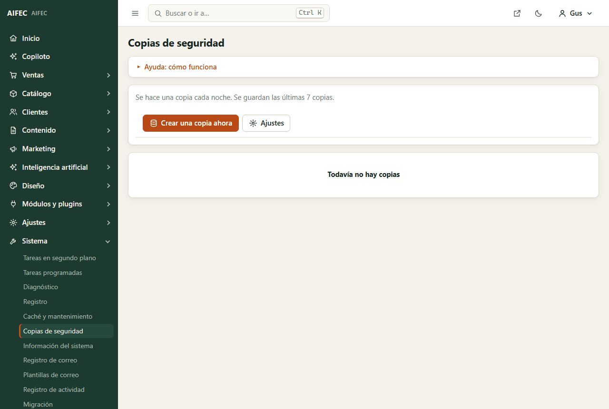

# Copias de seguridad y restaurar

AIFEC hace solo una copia de la base de datos cada noche. Eso no es toda tu tienda: faltan las imágenes, los ficheros privados y la configuración del sitio. Esta página dice qué hay que copiar, cómo restaurar en otra máquina y cómo comprobar que una copia sirve **antes** de necesitarla.



## Qué hay que copiar

| Qué | Dónde está | Lo cubre la copia de AIFEC |
|---|---|---|
| Base de datos | SQLite: `<datos>/<sitio>/db.sqlite`. MySQL o MariaDB: la base del sitio | **Sí**: `.sqlite.gz` o `.sql.gz` |
| Configuración del sitio | `<datos>/<sitio>/config.php` (dirección, clave secreta, datos de la base de datos) | No |
| Lista de sitios | `<datos>/sites.php` | No |
| Imágenes y medios | `public/media/<sitio>/` | No |
| Ficheros privados (facturas en PDF, descargas, importaciones) | `<datos>/<sitio>/private/` | No |
| Código, plugins y temas añadidos | La carpeta del proyecto | No (si lo tienes en un repositorio, ya está) |

La pantalla de copias lo dice: «Una copia de seguridad es una copia de la base de datos de este sitio; las imágenes subidas no van dentro.»

`config.php` importa más de lo que parece. Guarda la clave secreta del sitio, con la que se cifran los secretos (claves de pasarelas de pago, contraseña SMTP). Sin esa clave, una base restaurada no puede descifrarlos: tendrías que volver a escribirlos.

Las copias automáticas están en `<datos>/<sitio>/private/backups/`. Si la máquina se pierde, se pierden con ella: **llévalas a otro sitio**.

## La copia de la base de datos

- **Automática**: una cada noche (tarea `tools.backup`, a las 03:10 hora del sitio) y se guardan las últimas 7. Se cambia con el botón «Ajustes» de la pantalla «Copias de seguridad», pestaña «Copias de seguridad» («Copia nocturna» y «Copias que se guardan»). Necesita el cron: [Tareas programadas](04-tareas-programadas.md).
- **A mano**, en «Sistema» → «Copias de seguridad», botón «Crear una copia ahora». Cada fila trae «Descargar» y «Borrar».
- **Por consola**:

```
$ php aifec backup
Backup backup-20261113-072359-01.sqlite.gz (27,0 KB)
```

Con una base de más de 20 MB la copia se hace en segundo plano. Las copias llevan la fecha en UTC en el nombre y la carpeta no se puede abrir por dirección.

## Restaurar en otra máquina (SQLite)

Esto se probó entero con una copia real, en una carpeta de datos nueva. No hay una orden ni un botón de restaurar: es a mano.

1. Pon el código en la máquina nueva ([Instalar AIFEC](02-instalar.md), sin pasar por el asistente).
2. Crea la carpeta de datos y copia dentro `sites.php` y `<sitio>/config.php` de la máquina vieja.
3. Descomprime la copia como la base de datos del sitio:

```
gzip -dc backup-20261113-072359-01.sqlite.gz > <datos>/main/db.sqlite
```

4. Copia `public/media/<sitio>/` y `<datos>/<sitio>/private/` (sin la subcarpeta `backups`, si no la quieres).
5. Si cambia el dominio: `php aifec site:config main url=https://nuevo-dominio.example`.
6. Comprueba:

```
$ php aifec sites --data=<datos>
$ php aifec setting:get store.name --data=<datos>
store.name = "Marca de la copia"
$ php aifec migrate --data=<datos>
Nothing to migrate.
$ php aifec doctor --data=<datos>
doctor: 30 ok, 2 warnings, 0 problems
```

7. Programa el cron en la máquina nueva y vacía las cachés: `php aifec cache:clear` y `php aifec assets:publish`.

`sites.php` lista todos los sitios de la máquina vieja. Si solo restauras uno, quita del fichero los demás o copia también sus carpetas.

## Restaurar en MySQL o MariaDB

El panel lo resume así: «para el sitio, descomprime el fichero (gunzip) y […] en MySQL o MariaDB, impórtalo con la orden mysql». La copia es un fichero SQL con `DROP TABLE IF EXISTS`, `CREATE TABLE` y `INSERT` de cada tabla del sitio (solo las que llevan su prefijo):

```
gunzip -c backup-AAAAMMDD-HHMMSS-01.sql.gz | mysql -u USUARIO -p NOMBRE_DE_LA_BASE
```

**No probado en esta guía** (la máquina de pruebas no tiene MySQL ni MariaDB). La restauración sustituye las tablas del sitio: hazla sobre una base vacía o con una copia reciente de lo que hay.

## La prueba de restauración

Una copia que no se ha restaurado nunca es una esperanza. Una vez al mes, y siempre antes de una actualización grande:

1. Restaura la última copia en una carpeta de datos **distinta** (`--data=/tmp/prueba-restaurar`), como en los pasos de arriba.
2. Cambia un dato en el sitio vivo después de hacer la copia (un nombre de tienda, por ejemplo) y comprueba que en el restaurado sale el valor **antiguo**: eso demuestra que has restaurado la copia y no el sitio vivo.
3. Pasa `migrate` y `doctor` sobre lo restaurado. Tienen que dar «Nothing to migrate.» y «0 problems».
4. Abre una imagen de un producto: si falla, no has copiado `public/media`.
5. Borra la carpeta de prueba.

Así se hizo para esta guía: nombre «Marca de la copia», copia, otro nombre distinto después, y la base restaurada devolvió «Marca de la copia».

## Si algo no sale

- **«No se ha podido hacer la copia: …»** Mira el error: suele ser permisos de escritura en `<datos>/<sitio>/private/backups`.
- **La copia nocturna no aparece.** No corre el cron, o el ajuste «Copia nocturna» está apagado.
- **Tras restaurar, las contraseñas SMTP o de pasarelas no funcionan.** Falta el `config.php` original (su clave secreta). Vuelve a escribirlas en los ajustes.
- **No puedes entrar al panel tras restaurar.** La base trae las personas de la copia. `php aifec user:password <correo>` cambia una clave; `php aifec user:create` crea otra persona.
