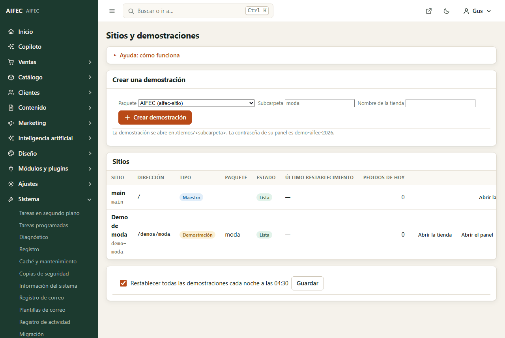

# Varios sitios y demostraciones

Una instalación de AIFEC puede servir varias tiendas con un solo código. Cada una es un «sitio»: tiene su carpeta de datos, su base de datos, su tema, sus plugins y sus personas del panel. Se distinguen por dominio o por una subcarpeta de la dirección. Las demostraciones son sitios en subcarpetas que se vuelven a construir cada noche.



## Cómo se distinguen los sitios

El fichero `<datos>/sites.php` lista los sitios. Cada uno tiene un identificador, un dominio (`*` vale para cualquiera) y una ruta:

```php
return ['sites' => [
    ['id' => 'main',      'host' => '*', 'path' => ''],
    ['id' => 'demo-moda', 'host' => '*', 'path' => '/demos/moda'],
]];
```

Gana el dominio exacto sobre `*` y, dentro de eso, la ruta más larga. Las cookies de cada sitio llevan un sufijo propio: dos sitios en el mismo dominio no comparten sesión ni carrito. Lo normal es no editar el fichero a mano: lo escribe el sistema.

## Crear un sitio

```
php aifec site:create tienda2 --url=https://otra.ejemplo.test --host=otra.ejemplo.test --admin-email=ana@cliente.test --name="Otra tienda"
php aifec site:create blog --url=https://tienda.ejemplo.test/blog --path=/blog --admin-email=ana@cliente.test
```

- `--host` pone el dominio del sitio; sin él vale cualquiera.
- `--path` pone la subcarpeta: empieza por barra, no acaba en barra y solo usa `a-z`, `0-9` y guiones.
- Dos sitios no pueden compartir el mismo dominio y la misma ruta. El primero que no es una demostración queda como **sitio maestro**.
- `php aifec sites` los lista. `php aifec site:config <id> url=… locale=… timezone=… debug=0|1 demo=0|1 master=0|1 modules_only=a,b` cambia su configuración. `php aifec site:delete <id> --yes` borra el sitio y su carpeta; con `--drop-tables` borra también sus tablas en MySQL.

Cada sitio necesita su cron: [Tareas programadas](04-tareas-programadas.md).

## Demostraciones en subcarpetas

Una demostración es una tienda completa construida a partir de un **paquete** de la carpeta `demos/` del proyecto. Hace falta que el módulo «Sitios y demostraciones» esté activo y que el sitio sea el maestro (`master=1`). Probado así:

```
$ php aifec site:config main master=1
Updated: master = true
$ php aifec plugin:enable sites
«sites» está activo
$ php aifec demo:check minimo
Products: 6
Images:   6
Size:     0.01 MB
DEMO minimo: 0 problems
$ php aifec demo:create minimo prueba-moda --name="Demo de prueba" --password=clave-de-mentira-2
Demo demo-prueba-moda is ready
Shop:     http://localhost:8800/demos/prueba-moda/
Panel:    http://localhost:8800/demos/prueba-moda/admin
Email:    demo@tienda.test
Password: clave-de-mentira-2
```

En el panel, «Sistema» → «Sitios y demostraciones»: en «Crear una demostración» eliges el «Paquete», la «Subcarpeta» y el «Nombre de la tienda», y pulsas «Crear demostración». Crear y restablecer se hacen en segundo plano: la tabla muestra el estado («En cola», «Construyéndose», «Lista», «Fallida»).

Las órdenes:

| Orden | Para qué |
|---|---|
| `demo:list` | Lista los sitios y las demostraciones con su paquete y estado |
| `demo:check <paquete>` | Comprueba un paquete sin construir nada |
| `demo:create <paquete> <subcarpeta>` | Construye una demostración en `/demos/<subcarpeta>` (el sitio se llama `demo-<subcarpeta>`) |
| `demo:reset <id>` | La borra y la construye otra vez desde su paquete |
| `package:apply <paquete>` | Aplica páginas, menús y tema de un paquete a un sitio que ya existe, sin borrar nada (`--dry-run` para ver qué haría) |
| `demo:adopt <sitio>` | Anuncia en la página pública de demostraciones un sitio que no salió de un paquete |

## Dos accesos para probar la administración

Al crear una demostración en «Sistema» → «Sitios y demostraciones», marca «Incluir una demostración de administración completa». En consola equivale a:

```
php aifec demo:create minimo administracion --name="Administración de ejemplo" --administration --site=main
```

Es una tienda independiente, con datos ficticios y dos cuentas públicas:

- **Demo de superadministrador:** `admin-demo@<dominio>`. Permite configurar la tienda y la IA, gestionar el catálogo, los pedidos y los planes mensuales de ejemplo, y consultar el equipo.
- **Demo de usuario de prueba:** `demo@<dominio>`. Permite probar el trabajo diario con permisos limitados. Puede evaluar los ajustes específicos de IA y asistente, sin acceso a los ajustes generales ni a las personas del equipo.

Las dos utilizan la contraseña pública de la demostración. Al anunciar los paneles en la página de demos, cada acceso tiene su botón y deja el correo rellenado en el formulario de entrada. Las sesiones y los datos pertenecen solo a esa tienda: estas cuentas no sirven para entrar en el sitio principal.

Las credenciales compartidas permanecen fijas: no se pueden cambiar sus contraseñas, correos o roles, activarles el doble factor ni cerrar las sesiones de otros visitantes. «Mi cuenta» explica esta limitación y muestra sus controles desactivados. El administrador de una tienda real conserva la gestión normal de su cuenta y de su equipo.

La medición de las demostraciones conserva sus ajustes para poder revisarlos, pero no carga etiquetas externas ni código personalizado y no envía conversiones a los proveedores. Así, un ajuste de una demo no introduce código de terceros bajo el mismo dominio que el panel real. Los eventos locales de la capa de datos siguen disponibles.

Esta demostración empieza con el proveedor de IA simulado y no recibe claves ni cuentas reales del operador. Los ajustes de las pasarelas se pueden evaluar, pero el cobro externo permanece cerrado y el correo queda retenido aunque se cambien sus ajustes. La instalación de código, la gestión de otros sitios y la descarga o restauración de copias están cerradas en este entorno público. El reinicio nocturno conserva los dos accesos y reconstruye sus datos de ejemplo.

## Reinicio nocturno

La tarea `sites.reset_demos` corre cada día a las 04:30 (hora del sitio): borra cada demostración y la construye de nuevo, así las visitas pueden hacer lo que quieran. Se apaga con la casilla «Restablecer todas las demostraciones cada noche a las 04:30» y el botón «Guardar». Se puede lanzar ahora:

```
$ php aifec jobs:run sites.reset_demos
Task sites.reset_demos finished: Reset 1 demo(s)
```

## Qué está limitado en una demostración

El sistema lo aplica al construirla y lo comprueba al final:

- El correo queda **retenido**: ni siquiera salen los avisos del sistema.
- Solo se ofrece el pago simulado. Los módulos de pago reales los rechaza el paquete.
- Todo el sitio lleva `noindex`.
- La persona del panel es `demo@<dominio>` (o `demo@tienda.test` con un dominio local) y su contraseña es pública a propósito: `demo-aifec-2026` salvo que pongas otra con `--password`. De serie la página de demostraciones **no anuncia el panel**: enseña solo «Ver la tienda», y el panel de cada demostración sigue respondiendo en su dirección (`<demo>/admin`) para quien la conoce. Si quieres que los visitantes vean el botón «Entrar al panel» con el correo y la contraseña, marca «Enseñar el botón del panel y su contraseña en la página pública de demos» en «Sistema» → «Sitios y demostraciones» y pulsa «Guardar».
- El papel «demo» no puede cambiar personas, ajustes generales (el del correo incluido), plugins ni sitios, y tampoco crear temas nuevos. Los ajustes específicos de IA y asistente tienen sus propios permisos y sí se pueden evaluar.

Una demostración solo lleva los módulos que declara su paquete: por ejemplo, `php aifec doctor --site=demo-prueba-moda` contesta «Unknown command: doctor» porque el paquete mínimo no incluye el módulo de herramientas.

## Si algo no sale

- **«This command only works on the master site».** Las órdenes `demo:*` solo corren en el sitio maestro: pasa `--site=<id>` del maestro o márcalo con `site:config <id> master=1`.
- **«A demo site cannot be the master site».** Una demostración no puede ser maestra. Quita `demo=1` o no la marques.
- **La demostración se queda en «En cola».** No corre el cron del sitio maestro: crear y restablecer se hacen en segundo plano. Mira [Tareas programadas](04-tareas-programadas.md).
- **El sitio nuevo contesta 404.** Mira `php aifec sites`: dominio y ruta tienen que coincidir con la dirección que abres.
