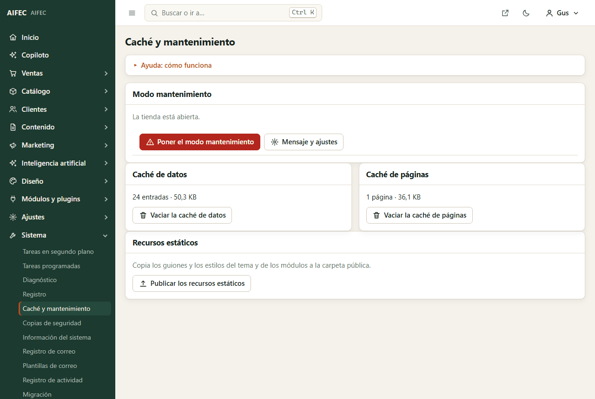

# Rendimiento

AIFEC está pensado para contestar rápido sin ayuda de nada externo: una caché de páginas completa para quien visita sin cuenta, imágenes que se optimizan al subirlas y un buscador que no llama a nadie al buscar. Esta página explica cómo funciona la caché, qué mide el sistema y cómo medir una página tú mismo.



## La caché de páginas

Se activa con «Ajustes» → «General» → pestaña «Rendimiento» → «Caché de páginas» (encendida de serie): quien visita sin carrito ni sesión recibe una copia guardada de cada página. Se sirve antes de arrancar la aplicación: sin base de datos y sin cargar módulos.

Se comprueba con la cabecera `X-Cache`. Medido en la instalación de prueba, tres peticiones seguidas a la portada:

```
petición 1: / -> 200 (146 ms)   X-Cache: MISS
petición 2: / -> 200 (2,6 ms)   X-Cache: HIT
petición 3: / -> 200 (0,8 ms)   X-Cache: HIT
```

Son tiempos de dentro del proceso PHP, en una máquina de desarrollo con SQLite: sirven para ver la proporción, no para prometer una cifra.

Qué se guarda y qué no:

- Solo se guardan las páginas que el controlador marca como guardables (portada, fichas, categorías, páginas de contenido…) y solo si la respuesta no pone cookies. La portada se guarda 300 segundos; el buscador, 60.
- No salen de la caché: las personas con el panel abierto, las que tienen la sesión de cliente abierta, las que traen algo pendiente de pintar en el servidor (un aviso tras una acción) y las que llevan una cabecera `Authorization`. Tampoco quien llega desde un asistente de IA: hay que apuntar de dónde viene.
- Los parámetros de seguimiento (`utm_*`, `gclid`, `fbclid`, `msclkid`…) no multiplican las copias: no cuentan para la clave. Una dirección con más de cuatro parámetros o con una consulta de más de 160 caracteres no se guarda.
- Lo personal (el número de artículos del carrito) no va en el HTML: lo pinta el navegador leyendo una cookie, así que la misma copia vale para todos.

**Etiquetas.** Cada copia lleva etiquetas (`catalog`, `cms`, `settings`, `home`, `product:<id>`…). Cuando algo cambia, el sistema invalida las etiquetas afectadas y solo se rehacen esas páginas: al editar un producto se renueva su ficha y los listados, no toda la tienda. No tienes que vaciar nada a mano. Si quieres hacerlo igualmente, en «Sistema» → «Caché y mantenimiento» están «Vaciar la caché de datos» y «Vaciar la caché de páginas», o por consola `php aifec cache:clear`.

## Recursos y imágenes

- Los estilos y guiones se publican con su versión en la ruta y salen con caché de un año (`Cache-Control: public, max-age=31536000, immutable`). `php aifec assets:publish` los copia a `public/assets/`. Sin publicar, funcionan igual, pero cada petición pasa por PHP. Con los ficheros publicados, los sirve directamente nginx o Apache.
- Al subir una imagen se crean versiones más pequeñas y se escriben en WebP si el servidor sabe (calidad en «Ajustes» → «Medios» → «Calidad WebP», 82 de serie). Una imagen pequeña no se amplía, y los SVG y los GIF animados no se transforman.
- Si el servidor no tiene `gd` ni `imagick`, no se crean esas versiones: el instalador lo marca como «Recomendado».

## Lo que mide el diagnóstico

«Sistema» → «Diagnóstico» mira los «Límites de memoria y de subida» (menos de 128 MB de memoria o subidas de menos de 8 MB), «OPcache» (avisa si está apagada), «La portada se puede guardar en la caché» («Se guarda durante 300 segundos»), el tamaño del registro y de la caché, y el espacio libre en disco.

## Cómo se mide una página

Cada respuesta que genera la aplicación trae la cabecera `Server-Timing`, que reparte el tiempo por tramos. Con `curl -I` o las herramientas de desarrollo del navegador la lees. Un ejemplo real de una página sin caché (primera petición):

```
Server-Timing: app;dur=139.9, db;desc="21 q", manifests;dur=1.0, schema;dur=15.4,
  settings;dur=45.5, theme;dur=0.7, modules;dur=30.9, ready;dur=0.5, route;dur=0.7,
  action;dur=42.9, finish;dur=2.4
```

- `app`: milisegundos totales de la aplicación.
- `db;desc="21 q"`: número de consultas a la base de datos.
- `settings`, `modules`, `theme`, `schema`, `manifests`: el arranque (ajustes, módulos, tema, comprobación del esquema, manifiestos).
- `route` y `action`: encontrar la ruta y ejecutar el controlador. `finish`: cerrar la respuesta (aquí se guarda la copia).

Una página servida desde la caché **no lleva** `Server-Timing`: solo `X-Cache: HIT`.

Para medir bien:

1. Pide la misma página dos veces. La primera es `MISS` y mide el trabajo real; la segunda es `HIT` y mide lo que ve un visitante.
2. Mide siempre sin sesión abierta en el navegador: con el panel abierto, la caché no se usa.
3. Repite varias veces y quédate con la mediana.

## Si algo no sale

- **Todas las respuestas salen `X-Cache: BYPASS`.** La página pone cookies o el ajuste «Caché de páginas» está apagado.
- **La portada nunca llega a `HIT`.** Mira «Diagnóstico» → «La portada se puede guardar en la caché»: dice por qué no se guarda («La portada ha contestado 404» o «La portada no se guarda en la caché de páginas»).
- **Cambias algo y la tienda enseña lo de antes.** Casi siempre es la caché del navegador o de un CDN que tengas delante. Después, «Vaciar la caché de páginas».
- **La tienda va lenta con la caché en `HIT`.** El problema está fuera de AIFEC: red, PHP-FPM saturado, disco.
