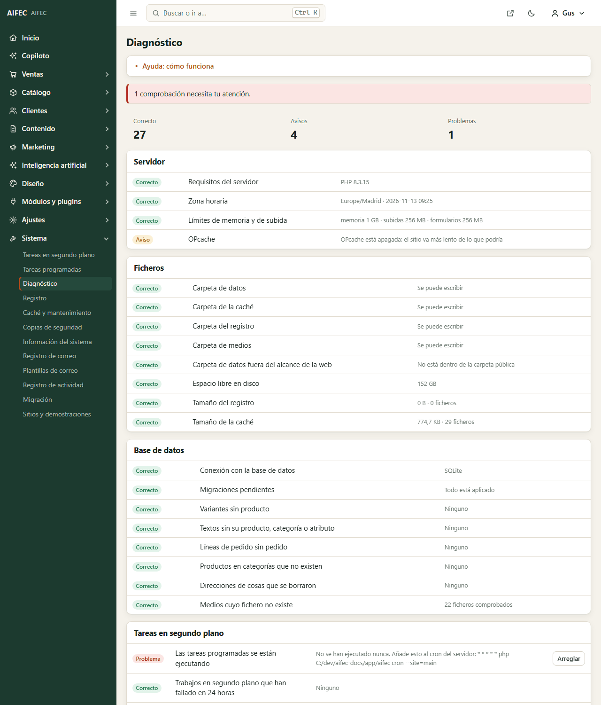

# Diagnóstico y problemas

Cuando algo no va, hay tres sitios donde mirar antes de buscar en el código: la pantalla «Diagnóstico», el registro y la información del sistema. Esta página explica los tres y trae una tabla «síntoma → qué mirar» con los problemas que da el propio sistema.



## La pantalla «Diagnóstico»

«Sistema» → «Diagnóstico» ejecuta comprobaciones sobre el sistema en marcha, no sobre el código, y las reparte en grupos: «Servidor», «Ficheros», «Base de datos», «Tareas en segundo plano» y «Tienda», entre otros. Arriba cuenta los «Correcto», los «Avisos» y los «Problemas». Una comprobación en rojo es algo que no funciona; una en naranja, algo que conviene mirar. Si tiene arreglo, trae un botón «Arreglar».

Por consola sale un resumen y un código de salida que vale 1 si hay algo en rojo:

```
$ php aifec doctor
STATUS  GROUP     CHECK                                          DETAIL
------  --------  ---------------------------------------------  --------------
OK      server    Requisitos del servidor                        PHP 8.3.15
…
BAD     tasks     Las tareas programadas se están ejecutando     No se han ejecutado nunca. Añade esto al cron del servidor: …
WARN    mail      Modo del correo y forma de envío               retenido: no sale nada de la tienda · función de correo del servidor
WARN    security  Administradores y segundo paso                 Un solo administrador y sin segundo paso: …
doctor: 29 ok, 2 warnings, 1 problems
```

Sirve para una vigilancia automática: `php aifec doctor || avisar`.

## El registro

«Sistema» → «Registro» enseña los ficheros `<datos>/<sitio>/logs/app-AAAA-MM-DD.log`. Cada línea es un suceso en JSON con `time`, `level` (`error`, `warning`, `info`), `message` y `context`. Las líneas nuevas salen primero y el fichero se lee desde el final, así que uno enorme se abre al instante. Se filtra por nivel, se busca texto y se descarga el fichero. Los valores que parecen secretos vienen tapados con `***`.

La carpeta `logs/` no existe hasta que se escribe el primer suceso. La tarea `tools.logs` borra a diario los ficheros de más de 30 días («Ajustes» → «Herramientas» → «Registro»).

Cuando una pantalla da un 500, la causa casi siempre está aquí, con la clase del error, el fichero y la línea.

## La información del sistema

«Sistema» → «Información del sistema» lista las versiones (AIFEC, PHP, base de datos, sistema), la dirección y la zona horaria del sitio, el tema, el tamaño de la carpeta de datos, los módulos con su estado y las extensiones de PHP. No enseña claves ni contraseñas: se puede pegar tal cual en una petición de ayuda.

## Síntoma → qué mirar

| Síntoma | Qué mirar |
|---|---|
| **Pantalla en blanco o 500 en todo** | El registro. Lo habitual: PHP viejo, una extensión que falta (`php -m`), `open_basedir` en un alojamiento con panel o permisos de la carpeta de datos. [Servidor web](03-servidor-web.md). |
| **500 solo en una pantalla** | La línea `error` de ese momento en el registro. Si es un plugin: `php aifec modules` y `php aifec contract:check <id>`. |
| **Todo da 404 del servidor menos la portada** | La reescritura (`mod_rewrite`, `try_files`). [Servidor web](03-servidor-web.md). |
| **No llegan correos** | El «Modo del correo»: una tienda nueva está en «Retenido». Después, «Registro de correo». [Correo](05-correo.md). |
| **Los correos se quedan «Pendiente» o no corren las tareas** | «Tareas programadas», columna «Última vez»; `php aifec jobs:status`. [Tareas programadas](04-tareas-programadas.md). |
| **Imágenes rotas** | ¿Se copió `public/media/<sitio>/`? ¿Escribe PHP ahí? «Diagnóstico» → «Medios cuyo fichero no existe». Las imágenes no vienen en la copia de la base de datos. |
| **Sin estilos ni scripts** | `php aifec assets:publish`; que `public/assets/` exista y el servidor entregue esa carpeta. |
| **«El formulario ha caducado. Recarga la página y vuelve a intentarlo.»** (el «token no válido» de los formularios) | Llevaba abierto más de dos horas: recarga y repite. Si pasa siempre, mira si una caché externa (un CDN) guarda páginas con formularios: el panel y la compra no deben pasar por ella. |
| **«Demasiados intentos. Espera quince minutos…»** | Bloqueo por cuenta o por IP. Espera. [Seguridad](09-seguridad.md). |
| **La tienda enseña datos viejos** | «Caché y mantenimiento» → «Vaciar la caché de páginas». [Rendimiento](10-rendimiento.md). |
| **Errores raros tras actualizar** | `php aifec migrate`, `cache:clear`, `assets:publish` y reiniciar PHP-FPM. [Actualizar](07-actualizar.md). |
| **«No site is configured for this address.»** | Ningún sitio corresponde a ese dominio o ruta: `php aifec sites`. |
| **Los límites cuentan siempre la misma IP** | Hay un proxy delante y AIFEC ve su IP. [Servidor web](03-servidor-web.md). |
| **Un plugin deja de cargar** | `php aifec modules` marca `FAILED: <motivo>`. |

## Qué mandar para pedir ayuda

La salida de `php aifec doctor`, las últimas líneas del registro del momento del fallo, la pantalla «Información del sistema» y qué hiciste justo antes. No mandes `config.php` ni la dirección web del cron.

## Si algo no sale

- **«Diagnóstico» no abre.** A tu papel le falta el permiso `tools.view` («Ver el diagnóstico, el registro y la información del sistema»). La consola funciona igual.
- **`php aifec doctor` contesta «Unknown command: doctor».** Ese sitio no carga el módulo de herramientas (pasa en las demostraciones, que solo llevan los módulos de su paquete).
- **«No se ha podido pedir la portada: …».** El diagnóstico pide la portada dentro del propio proceso, sin red. El error que trae es el que vería una visita: mira el registro.
