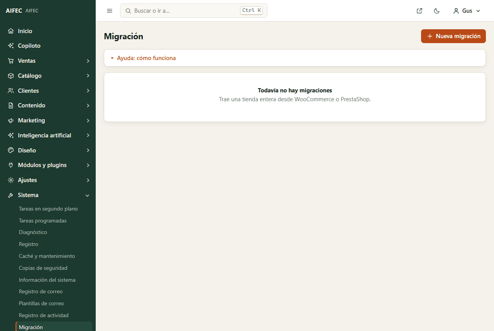

# Migrar desde otra tienda

AIFEC puede traer una tienda entera de WooCommerce o de PrestaShop: ajustes, impuestos, envíos, catálogo, clientes, pedidos y contenidos. Esta página explica cómo prepararlo, probarlo en un sitio de pruebas y qué hacer después. El módulo está apagado de serie: se enciende con `php aifec plugin:enable import` o en «Diseño» → «Módulos y plugins», y aparece como «Sistema» → «Migración».



## En resumen, para quien lleva la tienda

- **Qué se trae:** los ajustes de la tienda, impuestos, envíos y formas de pago (apagadas), grupos de clientes, marcas, categorías, atributos, productos, clientes con sus direcciones, pedidos, cupones, valoraciones, imágenes, páginas, entradas del blog, menús, redirecciones, personas del equipo y suscriptores.
- **Qué no se trae:** las contraseñas en claro (nadie las tiene: el cliente pide una nueva si el origen no da su resumen), las formas de pago encendidas, y lo que el origen no entrega por su API o su copia de base de datos. Los temas y los plugins del origen no se traen: se rehacen.
- **Quién lo hace:** una persona técnica, con las claves de la API o una copia de la base de datos, siguiendo los pasos de esta página en un sitio de pruebas. La dueña de la tienda decide qué se trae y revisa el informe y los avisos antes de dar el cambio por bueno.
- **No se envía ningún correo** a los clientes importados.

## Lo que no hace

- **No envía ningún correo.** Ni se compone: el sistema se pone en modo silencioso mientras trabaja. Los clientes importados no reciben «bienvenida» ni «pedido recibido».
- **No copia contraseñas en claro.** Nadie las tiene. Cuando el origen da el **resumen** de la contraseña, se guarda tal cual con su esquema y se renueva en el primer acceso del cliente. Cuando no lo da (la API de WooCommerce no lo entrega), el cliente queda sin contraseña y entra pidiendo una nueva.
- **No enciende las formas de pago.** Las trae apagadas y en pruebas, con sus claves cifradas, y las lista en «Revisar a mano».
- **Las personas del equipo entran inactivas y sin contraseña.** Hay que activarlas y mandarles un restablecimiento.
- **No se conecta por su cuenta** a ninguna tienda ni base de datos: solo a lo que escribes tú, y con una copia de base de datos la conexión es de solo lectura.

## Qué hace falta de cada origen

| Origen | Modo | Qué necesitas |
|---|---|---|
| WooCommerce | `api` | `--url`, `--key` y `--secret` de la API REST |
| WooCommerce | `public` | Solo `--url`: catálogo y contenidos publicados, sin pedidos ni clientes |
| WooCommerce | `db` | Copia de la base de datos: `--db-host`, `--db-port`, `--db-name`, `--db-user` y la contraseña; el prefijo de tablas y la carpeta de ficheros o la dirección base de las imágenes |
| PrestaShop | `api` | `--url` y `--key` del servicio web |
| PrestaShop | `db` | Lo mismo que WooCommerce `db`, y la clave de cookies de origen (`_COOKIE_KEY_`) para verificar contraseñas antiguas |

Las claves no se escriben en la línea de órdenes: van en las variables de entorno `AIFEC_IMPORT_KEY`, `AIFEC_IMPORT_SECRET`, `AIFEC_IMPORT_COOKIE_KEY` y `AIFEC_IMPORT_DB_PASSWORD`, o con `--ask`. Como opción se aceptan con un aviso, porque quedan en el historial.

## Pasos

1. **Crea un sitio de pruebas** ([Varios sitios y demostraciones](08-varios-sitios-y-demos.md)), con el correo retenido. Nunca migres sobre la tienda que ya vende.
2. **Prepara el origen**: las claves de la API o una copia de la base de datos. Esa copia lleva datos de personas reales: cuídala.
3. **«Sistema» → «Migración» → «Nueva migración».** Elige «¿De dónde viene la tienda?» y sigue los pasos: «Conexión», «Qué traer», «Equivalencias», «Confirmar», «En curso» e «Informe».
4. **«Probar la conexión»** hace la primera lectura real y cuenta lo que hay. Una lista vacía sale como aviso, no como «La conexión funciona.».
5. **Elige qué traer.** Los datos de personas van aparte («Datos de personas»). Opciones útiles: «Mantener funcionando las direcciones antiguas», «Traer las imágenes» y «Solo lo que ha cambiado desde».
6. **Revisa las equivalencias** (estados de pedido, clases de impuesto, grupos, formas de pago) o deja «Decidir por su significado».
7. **«Hacer el simulacro»** calcula qué pasaría sin escribir nada. Léelo.
8. **Marca la casilla de confirmación** y pulsa «Empezar la migración». Va por tandas en segundo plano y se puede «Pausar», «Reanudar» y «Cancelar».
9. **Lee el informe**: cifras por tipo («Leídos», «Creados», «Actualizados», «Sin cambios», «Choques», «Descartados»), la lista «Revisar a mano» y una «Comprobación final» que compara los recuentos del origen con los de aquí.

Por consola, con la clave y el secreto en variables de entorno:

```
php aifec import:probe --source=woocommerce --mode=api --url=https://tienda-vieja.ejemplo.test
php aifec import:run --source=woocommerce --mode=api --dry-run --url=https://tienda-vieja.ejemplo.test
php aifec import:run --source=woocommerce --mode=api --yes --url=https://tienda-vieja.ejemplo.test
php aifec import:status
php aifec import:verify
php aifec import:report --out=informe.csv
```

`--dry-run` no escribe nada. Sin `--dry-run` ni `--yes`, la orden se niega.

## Se puede repetir

Cada registro traído se casa con el de origen y no se duplica. Al repetir, lo que no cambió sale «Sin cambios», y un registro editado aquí después de traerlo se deja como está («Choques»), salvo que marques «Sobrescribir lo que se editó aquí después de traerlo».

## Después de migrar

1. Arregla los avisos del informe: formas de pago por configurar, impuestos sin equivalente, idiomas del origen que no están en el sitio.
2. Prueba con una muestra de direcciones de Search Console que las antiguas siguen respondiendo o redirigen.
3. Configura el correo, manda un mensaje de prueba y solo entonces cambia el modo ([Correo](05-correo.md)). Activa a las personas del equipo que deban volver.
4. **Cambio de dominio.** Con el sitio de pruebas bien: `php aifec site:config <id> url=https://dominio-definitivo.example`, apunta el DNS, activa HTTPS, programa el cron y haz una compra de prueba de punta a punta. Conserva la tienda vieja apagada unas semanas.

## Si algo no sale

- **«Add --yes to confirm that no email will be sent…».** Añade `--yes`, o `--dry-run` para probar.
- **«--url: This field is required», «--key: …».** Faltan campos de la conexión.
- **«Only https addresses are allowed (http only for a local address)».** El origen tiene que ir por HTTPS.
- **«The database refused the user name or the password».** Revisa el usuario y la contraseña de la copia.
- **La migración se pausa sola.** Tres fallos seguidos del origen, o una denegación de acceso, la pausan. Mira «Últimos avisos» y pulsa «Reanudar». Sin actividad durante 60 minutos se cierra.

Lo que se ha probado de verdad: las órdenes y las pantallas de esta guía se han ejecutado en un sitio de pruebas. Todavía no se ha migrado una tienda real de un cliente, así que prueba siempre con un simulacro y revisa el informe antes de dar nada por bueno.
